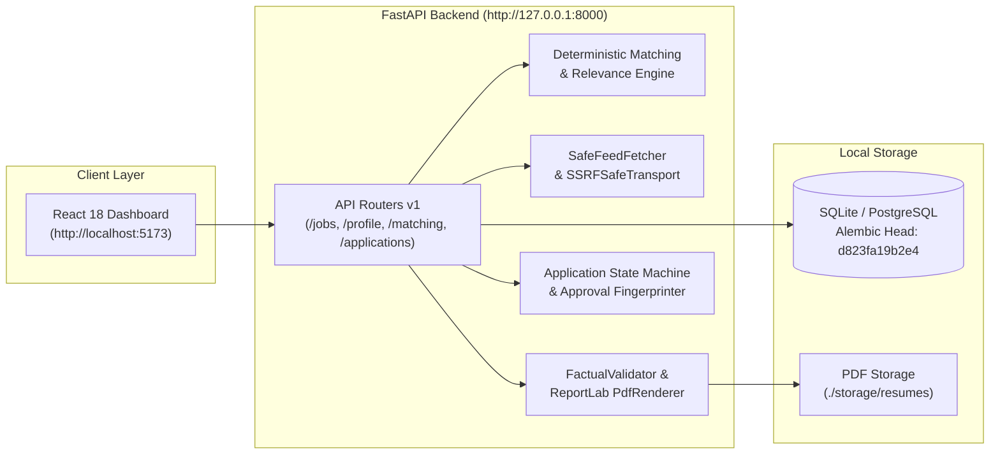

# JobPilot AI

> **Current Development Status**: **PAUSED / MAINTENANCE REFERENCE**
> *The core platform is feature-complete through Phase 12 and Indian Job Board Integrations. All 247 backend tests and 44 frontend tests pass cleanly (100%). The codebase is fully stabilized, hardened against SSRF/XXE, and archived for long-term reference or future development.*

---

## Overview

**JobPilot AI** is a local-first, privacy-focused, personal AI job-hunting agent and application management platform. It continuously discovers relevant job openings across supported ATS platforms and regional boards, evaluates listings against candidate career preferences with explainable deterministic scoring, generates tailored ATS-friendly resumes grounded strictly in verified candidate facts (zero hallucination), manages cryptographic human-in-the-loop approvals, and simulates application workflows safely without external spamming.

---

## Permanent Project Reference & Documentation Suite

A complete, exhaustive technical reference suite is maintained in [`docs/project-reference/`](docs/project-reference/):

| Document | Description |
| :--- | :--- |
| **[00 — Project Overview](docs/project-reference/00_PROJECT_OVERVIEW.md)** | Product vision, problem statement, target users, and end-to-end user workflow. |
| **[01 — Features & Implementation Status](docs/project-reference/01_FEATURES_AND_IMPLEMENTATION_STATUS.md)** | Detailed audit of every feature, source file, database model, endpoint, and test. |
| **[02 — Technical Architecture](docs/project-reference/02_TECHNICAL_ARCHITECTURE.md)** | High-level system design, backend/frontend architecture, data flows, and Mermaid diagrams. |
| **[03 — Database & API Reference](docs/project-reference/03_DATABASE_AND_API_REFERENCE.md)** | 17 database tables, schemas, relationships, Alembic history (`d823fa19b2e4`), and complete API inventory. |
| **[04 — Job Source Integrations](docs/project-reference/04_JOB_SOURCE_INTEGRATIONS.md)** | Greenhouse, Lever, Hirist RSS, Naukri, Instahyre, Cutshort, Foundit, Indeed, LinkedIn specifications. |
| **[05 — AI Matching & Resume Generation](docs/project-reference/05_AI_MATCHING_AND_RESUME_GENERATION.md)** | Deterministic scoring formulas, hard eligibility gates, Ollama LLM provider, fact grounding, ReportLab PDF. |
| **[06 — Application Workflow & Notifications](docs/project-reference/06_APPLICATION_WORKFLOW_AND_NOTIFICATIONS.md)** | State machine lifecycle, append-only event auditing, SHA-256 approval fingerprinting, digests. |
| **[07 — Setup & Development Guide](docs/project-reference/07_SETUP_AND_DEVELOPMENT_GUIDE.md)** | Step-by-step local workstation setup (Python 3.12, Node 20, SQLite/PostgreSQL, migrations, tests). |
| **[08 — Testing & Quality Report](docs/project-reference/08_TESTING_AND_QUALITY_REPORT.md)** | Verified execution logs: 247 backend tests, 44 frontend tests, build status, and security verifications. |
| **[09 — Known Limitations & Technical Debt](docs/project-reference/09_KNOWN_LIMITATIONS_AND_TECHNICAL_DEBT.md)** | Confirmed boundaries, disabled subsystems, operational risks, and technical debt inventory. |
| **[10 — Future Roadmap & Backlog](docs/project-reference/10_FUTURE_ROADMAP_AND_BACKLOG.md)** | Prioritized Phase 13–16 roadmap (Browser extension ingestion, supervised form-filler, telemetry). |
| **[11 — Git History & Release Notes](docs/project-reference/11_GIT_HISTORY_AND_RELEASE_NOTES.md)** | Verified branch topology, PR #1 and PR #2 deliverables, and milestone commit chronology. |
| **[12 — Future Resume Guide](docs/project-reference/12_FUTURE_RESUME_GUIDE.md)** | Essential developer handover guide for returning to the project after months or years, including AI prompt. |

*Additional user guides and walkthroughs remain available in [`docs/user-guide/`](docs/user-guide/).*

---

## Key Features

- **Local-First & Privacy Preserving**: Candidate data, generated resumes, and AI inference run locally on your machine via Ollama (`llama3.1`) and SQLite/PostgreSQL.
- **Factually Grounded Resumes**: Zero hallucination policy. Tailored resumes only highlight verified skills, achievements, and career history without inventing qualifications.
- **Explainable Match Scoring**: Deterministic rules for mandatory eligibility combined with weighted scoring for skills, experience, remote/location, and compensation preferences.
- **Indian Job Board & Currency Support**: Native support for **INR Lakhs Per Annum (LPA)** compensation tiers and compliant ingestion for Naukri, Instahyre, Cutshort, Hirist, Foundit, LinkedIn, and Indeed.
- **Conservative Duplicate Detection**: Multi-signal cross-source duplicate clustering with location preservation and manual review controls.
- **Authoritative Freshness Tracking**: Source-authoritative status tracking (Active, Potentially Stale, Confirmed Closed, Unknown) with live probe verification.
- **Cryptographic Human Approval**: Every application requires candidate approval locked to an immutable SHA-256 fingerprint over candidate facts, job text, resume hash, and policy version.
- **Safe Synthetic Submissions**: Real external submissions are disabled by default (`JOBPILOT_REAL_SUBMISSION_ENABLED=False`). A full synthetic simulation workflow enables end-to-end pipeline validation without external side effects.
- **SSRF & Socket-Level Security**: Outbound HTTP requests hook into `SSRFSafeNetworkBackend(AnyIOBackend)` to defeat DNS rebinding by inspecting connected socket peer IPs, dropping loopback, private, and metadata targets.

---

## Technology Stack

### Backend
- **Python 3.12**
- **FastAPI** (High-performance async REST API)
- **SQLAlchemy 2.0 (Async)** & **Alembic** (Database ORM & declarative schema migrations)
- **SQLite** via `aiosqlite` (Default local storage at `storage/jobpilot.db`)
- **PostgreSQL 16** via `asyncpg` (Production/Docker option)
- **ReportLab** (Single-column ATS-friendly PDF generation)
- **HTTPX & HTTPCore** (Async HTTP with custom socket-level SSRF transport)
- **Ollama** (Local LLM inference via `llama3.1:latest`)
- **Pytest** & **pytest-asyncio** (247 passing tests)

### Frontend
- **React 18** (Modern functional UI with React hooks)
- **TypeScript** (Strict type safety)
- **Vite** (Next-generation frontend tooling and bundler)
- **Tailwind CSS** (Utility-first styling system)
- **Lucide React** (Consistent icon library)
- **Vitest** & **React Testing Library** (44 passing UI tests)

---

## High-Level Architecture



---

## Indian Job Board Integrations & Ingestion Modes

| Platform | Source Type | Integration Status | Supported Ingestion Modes | Salary / CTC Support |
| :--- | :--- | :--- | :--- | :--- |
| **Naukri.com** | `job_board` | `MANUAL_IMPORT_ONLY` | Inbound Email Alerts, Structured JSON | LPA (Lakhs INR), 0–200 LPA range |
| **Instahyre** | `job_board` | `MANUAL_IMPORT_ONLY` | Opportunity Digest, Structured Export | LPA + Equity / ESOP metadata |
| **Cutshort** | `job_board` | `MANUAL_IMPORT_ONLY` | Fast-Track Alerts, Structured JSON | LPA + Skills tags |
| **Hirist** | `job_board` | `CONFIGURATION_REQUIRED` | Configured HTTPS RSS Feeds, Alert Ingestion | LPA + Tech categorization |
| **Foundit (Monster)** | `job_board` | `MANUAL_IMPORT_ONLY` | Inbound Job Alerts, Manual JSON | LPA range + Experience bracket |
| **LinkedIn India** | `aggregator` | `AUTHORIZATION_REQUIRED` | Saved Alert Ingestion, Partner API (when authorized) | Disclosed INR/USD ranges |
| **Indeed India** | `aggregator` | `MANUAL_IMPORT_ONLY` | Inbound Job Alerts, Structured JSON Import | Converted annual INR to LPA |
| **Greenhouse** | `job_board` | `ACTIVE_POLLING` | Public Employer Boards | Multi-Board Token Ingestion |
| **Lever** | `job_board` | `ACTIVE_POLLING` | Public Employer Boards | Multi-Site Token Ingestion |

---

## Quickstart

### Prerequisites
- **Python 3.12+**
- **Node.js 18+ or 20+** & **npm**
- **Git**
- **Ollama** with `llama3.1:latest` (`ollama run llama3.1`) *(Optional)*
- **Docker** *(Optional, for containerized PostgreSQL)*

### 1. Clone & Configure
```bash
git clone https://github.com/akash-thakur09/job_finder.git
cd job_finder
cp .env.example .env
```

### 2. Backend Setup
```powershell
# From repository root
python -m venv backend\.venv
.\backend\.venv\Scripts\Activate.ps1
pip install -r backend\requirements.txt

# Run migrations to head
.\backend\.venv\Scripts\alembic.exe -c backend/alembic.ini upgrade head

# Start backend server
.\backend\.venv\Scripts\python.exe -m uvicorn backend.app.main:app --host 127.0.0.1 --port 8000 --reload
```

### 3. Frontend Setup
```powershell
cd frontend
npm install
npm run dev
```

The frontend will be available at **`http://localhost:5173`** and the backend Swagger API docs at **`http://127.0.0.1:8000/docs`**.

---

## Environment Variables & Safe Defaults

The application strictly validates configuration upon startup (`validate_startup_configuration`).

| Variable | Default | Purpose / Safety Rule |
| :--- | :--- | :--- |
| `APP_HOST` | `127.0.0.1` | Local loopback binding. Non-localhost bindings log security warnings. |
| `APP_PORT` | `8000` | Backend API server port. |
| `CORS_ORIGINS` | `["http://localhost:5173", "http://127.0.0.1:5173"]` | Allowed frontend origins. |
| `JOBPILOT_REAL_SUBMISSION_ENABLED` | `False` | **CRITICAL SAFETY BOUNDARY**. Real external submissions are disabled by default. Automatically enforced to `False` on local start. |
| `JOBPILOT_SYNTHETIC_DISCOVERY_ENABLED` | `False` | Synthetic discovery disabled by default in production. |
| `DATABASE_URL` | `sqlite+aiosqlite:///.../storage/jobpilot.db` | Async SQLAlchemy database URI. |
| `RESUME_STORAGE_DIR` | `./storage/resumes` | Directory for immutable resume PDFs with atomic SHA-256 naming. |
| `SCREENSHOT_STORAGE_DIR` | `./storage/screenshots` | Directory for submission audit screenshots. |
| `SCHEDULER_ENABLED` | `False` | In-process discovery scheduler toggle. |
| `EMAIL_NOTIFICATIONS_ENABLED` | `False` | Notification delivery flag. Falls back to mock logger when False. |
| `OLLAMA_BASE_URL` | `http://localhost:11434` | Local Ollama inference URL. |
| `OLLAMA_MODEL` | `llama3.1:latest` | Local LLM model tag. |

---

## Database Migrations

JobPilot AI uses Alembic for declarative schema migrations:

```powershell
# Check current revision status:
.\backend\.venv\Scripts\alembic.exe -c backend/alembic.ini current

# Run migrations to head:
.\backend\.venv\Scripts\alembic.exe -c backend/alembic.ini upgrade head
```

- **Current Alembic Head**: `d823fa19b2e4`
  - Linear chain: `2051ba9838c8` $\rightarrow$ `667e479abab5` $\rightarrow$ `2692bda4ba04` $\rightarrow$ `3f63fd0f4fae` $\rightarrow$ `4b81cf738a92` $\rightarrow$ `5e29f8a31c4d` $\rightarrow$ `c821a4f02b9e` $\rightarrow$ `d934b51c8a2f` $\rightarrow$ `e145f6789abc` $\rightarrow$ `f123a45678bc` $\rightarrow$ `c14fd127ea45` $\rightarrow$ `d823fa19b2e4 (HEAD)`.

---

## Verified Test Suites

### Backend Tests (247 passed tests across 36 modules)
```powershell
.\backend\.venv\Scripts\pytest.exe backend/tests/ -v
# Output: 247 passed in ~169s
```

### Frontend Tests (44 passed tests across 12 files) & Build
```powershell
cd frontend
npx vitest run
npm run build
```

### Code Formatting & Whitespace Cleanliness
```powershell
git diff --check
# Output: Clean (0 errors)
```

---

## Resuming Development in the Future

When returning to JobPilot AI:
1. Open [`docs/project-reference/12_FUTURE_RESUME_GUIDE.md`](docs/project-reference/12_FUTURE_RESUME_GUIDE.md) and follow the step-by-step checklist.
2. If working with an AI coding assistant, copy and paste the resumption prompt located in Section 8 of that document.

---

## License

MIT License.
