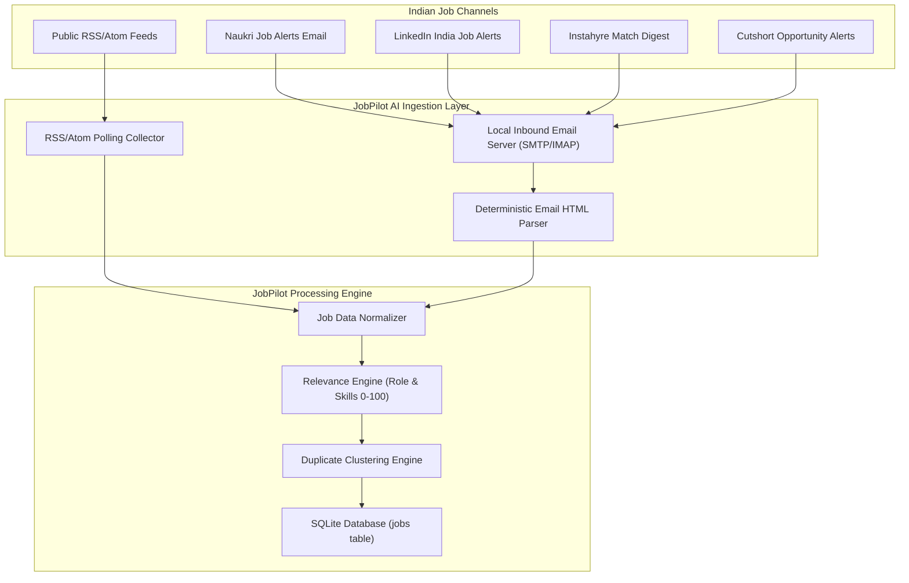

# Indian Job Sources Integration Specification

## Executive Summary

JobPilot AI is designed to support high-relevance job discovery for software engineers—specifically Full Stack Developers moving toward AI/GenAI, RAG, and Agentic AI roles. While the initial discovery adapters focus on ATS platforms (Greenhouse, Lever) with public JSON APIs, a significant majority of Indian tech hiring occurs on specialized regional platforms, aggregator networks, and tech-first talent marketplaces.

This document provides a comprehensive technical feasibility analysis and architectural integration roadmap for seven major Indian job platforms:
1. **Naukri.com**
2. **LinkedIn India**
3. **Indeed India**
4. **Instahyre**
5. **Cutshort**
6. **Hirist** (tech-focused)
7. **Foundit** (formerly Monster India)

---

## 1. Comparative Platform Evaluation

| Platform | Official API Availability | Anti-Bot Protections | CTC/Salary Transparency | India Tech Volume | Recommended Approach | Tier |
| :--- | :--- | :--- | :--- | :--- | :--- | :--- |
| **Naukri.com** | Enterprise Recruiter API only; closed partner program | Cloudflare Bot Management, Akamai, Captchas | High (Lakhs INR / LPA range common) | Extremely High (Market Leader) | Email Alert Ingestion & Parsing | Tier 1 |
| **Instahyre** | No public API; invitation/recruiter based | Custom rate-limiting, Cloudflare | Very High (Direct compensation & equity) | High (Tech startups, Unicorns, AI) | Headless Session / Email Digest Parser | Tier 1 |
| **Cutshort** | No public candidate API; webhook access for employers | WAF + Device fingerprinting | Very High (Verified tech compensation) | High (Product & AI tech roles) | Inbound Email Ingestion / Verified Alerts | Tier 1 |
| **LinkedIn India** | Highly restricted; official API requires LinkedIn Talent Solutions Partner agreement | Cloudflare, strict telemetry, aggressive IP bans | Moderate (Often unstated or wide USD/INR) | Extremely High (Global + Indian tech) | Official Guest RSS / Email Alerts | Tier 2 |
| **Indeed India** | Partner API available (requires Publisher account approval) | Cloudflare, strict IP rate-limiting | Moderate (Hourly/Monthly/Annual INR estimates) | High (MNCs + Service firms + Product) | Publisher Feed / Aggregated RSS | Tier 2 |
| **Hirist** | Closed recruiter API; internal mobile endpoints | PerimeterX / Cloudflare | High (Tech-focused LPA brackets) | Medium-High (Specialized Tech/AI/Backend) | Direct RSS / Inbound Alert Parsing | Tier 2 |
| **Foundit (Monster)** | Enterprise API only (Foundit Recruiter Suite) | Cloudflare, Bot detection | Moderate (Range in LPA) | Medium (Enterprise, Legacy tech) | Inbound Email Alerts / Scheduled Feed | Tier 3 |

---

## 2. In-Depth Platform Analysis

### 2.1 Naukri.com
- **Market Positioning**: Largest job portal in India with deepest penetration across tech startups, service giants (TCS, Infosys, Wipro), and global capability centers (GCCs).
- **Public API Availability**: None for candidates. Official Naukri APIs are strictly restricted to enterprise employers using RMS (Recruitment Management System).
- **Robots.txt & Scraping Feasibility**:
  - `robots.txt` explicitly disallows crawling of search result pages and candidate profile interactions.
  - Protected by Akamai and Cloudflare Enterprise Bot Management with TLS fingerprinting and dynamic JS challenges.
  - Aggressive HTTP request throttling triggers temporary IP blacklisting within 5–10 requests.
- **Email Alert Parsing (Recommended Vector)**:
  - Naukri delivers structured "Job Alerts" (Daily/Real-time) based on candidate saved search filters (e.g., "Full Stack Engineer + Python + Remote/Bengaluru").
  - Email HTML structure is highly consistent with clear anchors: Company Name, Experience bracket (e.g. `2-5 Yrs`), CTC bracket (e.g. `15-25 Lacs PA`), Key Skills tags (`Python, React, FastAPI`), and Direct Job URL with tracked token.
- **Maintenance Overhead**: Low to Moderate (email parser template requires occasional HTML regex update).

### 2.2 LinkedIn India
- **Market Positioning**: The de facto professional network for mid-to-senior product engineering, AI/ML research, and venture-backed Indian startups.
- **Public API Availability**:
  - LinkedIn Talent Solutions API requires formal LinkedIn Partner Program approval.
  - Guest Job Search endpoints exist (`/jobs-guest/jobs/api/seeMoreJobPostings/search`) but are rate-limited to ~20 requests per IP per hour and subject to immediate 429 throttling.
- **Robots.txt & Legal Boundaries**:
  - LinkedIn strictly prohibits scraping without authorization under Section 8.2 of User Agreement.
  - hiQ v. LinkedIn precedent established legal boundaries for public data, but LinkedIn employs sophisticated behavioral bot detection.
- **Recommended Vector**:
  - **Inbound Email Alert Ingestion**: Candidates configure targeted LinkedIn Job Alerts for India / Remote AI roles and forward alerts to JobPilot local ingestion address.
  - **Headless Local Browser Helper**: Local Playwright session utilizing user's active, authenticated browser cookies to inspect saved jobs on demand.

### 2.3 Instahyre
- **Market Positioning**: High-signal, AI-driven curated tech hiring platform used heavily by Indian unicorns, VC-funded startups (Swiggy, Razorpay, CRED, Zepto), and AI product companies.
- **Data Richness**:
  - Explicit tech stack requirements.
  - Precise compensation in INR Lakhs (e.g. `24 - 36 LPA`) plus ESOP details.
  - Clear work arrangement indicators (`Remote`, `Hybrid - Bengaluru`).
- **Technical Feasibility**:
  - Instahyre sends targeted interview invitations and daily job match summaries via email.
  - Email payload includes direct application link, salary bracket, required tech skills, and company culture tags.

### 2.4 Cutshort
- **Market Positioning**: Developer-first platform utilizing "Voila AI" to match candidates directly with engineering hiring managers and founders.
- **Technical Feasibility**:
  - High focus on Full Stack, AI/LLM, and backend talent.
  - Web platform uses single-page React app communicating with internal REST endpoints (`/api/v1/jobs/...`).
  - Strict CSRF and session authentication required; candidate authentication tokens expire frequently.
  - Recommended ingestion: Email notification parsing and webhooks.

### 2.5 Hirist
- **Market Positioning**: Specialized tech-only vertical of Info Edge / iimjobs catering specifically to software engineering, DevOps, Data Science, and AI.
- **Technical Feasibility**:
  - Clean categorization by tech family (`Python/Django`, `AI/Machine Learning`, `Fullstack`).
  - Structured fields: CTC, Experience (`0-2`, `3-5`), Locations (Bengaluru, Hyderabad, Pune, Gurugram, Noida).
  - RSS feeds have historically been available for specific category subdomains; email alerts offer high parsing stability.

---

## 3. Recommended Architectural Integration Strategy for JobPilot AI

Direct high-frequency web scraping of Indian portals poses significant anti-bot friction, legal risks, and continuous maintenance overhead. Therefore, JobPilot AI should implement a **multi-channel ingestion architecture**:

### Channel 1: Inbound Email Alert Parsing (Highest Feasibility & Lowest Risk)
1. **Mechanism**: User configures specific search alerts on Naukri, LinkedIn, and Instahyre (e.g., "Full Stack Engineer", "Generative AI", "RAG", Remote/India).
2. Alerts are forwarded or polled via IMAP from a dedicated mailbox (e.g. `alerts@jobpilot.local` or Gmail filter).
3. The `IndianJobEmailParser` extracts:
   - Employer Name
   - Title
   - Location (Bengaluru, Pune, Hyderabad, Gurgaon, Remote)
   - Salary range in INR (converted to normalized min/max)
   - Canonical application link
4. The normalized job is immediately evaluated through `RelevanceEngine` and stored with audit trail.

### Channel 2: Local Authenticated Playwright Sidecar (On-Demand Browser Helper)
1. Runs inside the user's local machine in headless or headed mode.
2. Uses the user's active browser cookies to fetch candidate's saved job lists without triggering anti-bot hurdles.
3. Completely local, zero proxy cost, adheres strictly to candidate's own view.

---

## 4. Phased Implementation Roadmap

### Phase 13A: Inbound Email Alert Ingestion (Tier 1)
- **Scope**: Naukri.com and Instahyre email alert parsers.
- **Deliverables**:
  - `backend/app/collectors/email_parsers/naukri_parser.py`
  - `backend/app/collectors/email_parsers/instahyre_parser.py`
  - IMAP polling background worker in `scheduler_service.py`
- **Output**: Discovered jobs with full Indian CTC (LPA) extraction and relevance classification.

### Phase 13B: Cutshort & Hirist Integration (Tier 2)
- **Scope**: Structured alert parsers for Cutshort and Hirist tech feeds.
- **Deliverables**:
  - Support for equity/ESOP metadata.
  - Direct hiring manager attribution.

### Phase 13C: LinkedIn India Local Browser Helper (Tier 3)
- **Scope**: Authenticated local Playwright session to import user's LinkedIn Job Alerts and saved searches safely.
- **Deliverables**:
  - Anti-detect Playwright configuration.
  - Safe request rate limiting (<= 1 request per 15 seconds).

