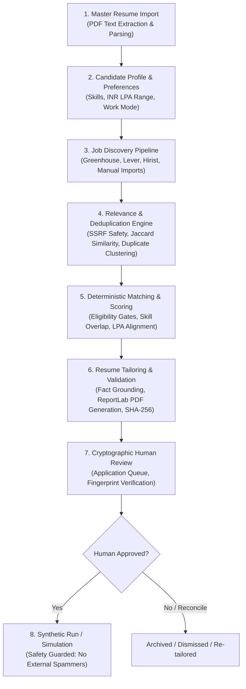

# 00 — JobPilot AI: Project Overview & Vision

## 1. Executive Summary

**JobPilot AI** is a local-first, privacy-focused, personal AI job-search copilot and application workflow platform. It is engineered to assist technical candidates—specifically software engineers, AI developers, and technology professionals—in discovering relevant job listings across global and Indian job platforms, deterministically ranking listings against candidate preferences and career history, tailoring ATS-compliant resumes with strict factual validation, managing cryptographic human-in-the-loop approvals, and simulating application submissions safely.

Unlike aggressive auto-apply scrapers that blindly spam external portals and compromise candidate reputation, JobPilot AI enforces strict safety constraints: **real external automated application submissions are disabled by default** (`JOBPILOT_REAL_SUBMISSION_ENABLED=False`), candidate facts are strictly partitioned from AI generation to prevent hallucinated qualifications, and every application requires explicit human review verified with a cryptographic SHA-256 fingerprint.

---

## 2. Problem Statement & Motivation

Modern technical job seekers face three significant systemic challenges in the digital employment landscape:

1. **Volume & Irrelevance**: Job aggregators and board platforms present thousands of poorly targeted listings filled with buzzwords, stale postings, or non-matching compensation tiers (e.g., mismatching INR LPA vs. USD expectations).
2. **Resume Tailoring Burden & Hallucination Risk**: Tailoring a resume to match distinct job requisition requirements is time-consuming. While generative AI can assist, commercial LLMs routinely hallucinate employer names, job tenures, project scopes, or unverified technical competencies, creating career-damaging liabilities.
3. **Safety & Aggressive Automation Risks**: "Auto-apply" bots violate platform terms of service, trigger captchas, target stale or spam postings, and submit unreviewed data on behalf of candidates.

JobPilot AI was architected from inception to solve these problems through a **deterministic-first, human-governed, local-first** design.

---

## 3. Product Vision & Principles

| Core Principle | Implementation in JobPilot AI |
| :--- | :--- |
| **Local-First & Private** | Operates on the candidate's personal computer using local SQLite/PostgreSQL storage, local file paths, and local/on-premise LLMs (Ollama with `llama3.1:latest`). Sensitive resume data is never transmitted to multi-tenant cloud SaaS vendors. |
| **Fact-Grounded Integrity** | Tailored resumes are generated strictly from the candidate's verified profile and master resume. An automated `ResumeFactValidator` checks every generated bullet and skill against candidate facts, outright rejecting hallucinations. |
| **Human-in-the-Loop Governance** | An application cannot transition to a submission state without an explicit candidate approval step locked to an immutable SHA-256 fingerprint of the exact job requisition, candidate facts, tailored resume artifact, and policy version. |
| **Compliant Discovery** | Job discovery is performed through sanctioned multi-board APIs (Greenhouse, Lever), user-configured RSS/Atom feeds (Hirist), and structured manual imports/email alert ingestion (Naukri, Instahyre, Cutshort, Foundit, LinkedIn, Indeed), eliminating brittle and terms-violating web scraping. |
| **Safety by Construction** | Real automated submission is disabled (`JOBPILOT_REAL_SUBMISSION_ENABLED=False`). A complete synthetic simulation harness provides end-to-end verification without contacting external portals. |

---

## 4. Target Users

The primary target user of JobPilot AI is:
- **Mid-to-Senior Software Engineers, Full-Stack Developers, and AI/ML Specialists** managing active or passive career searches.
- Candidates in the **Indian and Global tech ecosystems** who evaluate job compensation packages in **INR Lakhs Per Annum (LPA)** and USD, navigating multiple platforms (Naukri, Instahyre, Cutshort, Hirist, LinkedIn, Greenhouse, Lever).
- Candidates who value **data privacy**, requiring local control over resumes, contact information, and job search metrics.

---

## 5. High-Level End-to-End User Workflow

1. **Profile Onboarding**: Candidate uploads an existing master PDF resume. `ResumeParserService` extracts structured contact information, work experience, projects, education, and technical competencies.
2. **Search Preferences Configuration**: Candidate defines career criteria: target titles, must-have skills, minimum/maximum experience years, work mode (Remote/Hybrid/On-site), and minimum expected package in **INR LPA**.
3. **Multi-Source Job Discovery**: Discovery runs periodically or on-demand across Greenhouse tokens, Lever sites, Hirist RSS feeds, and manual alert pastes (Naukri, Instahyre, Cutshort, Foundit, Indeed, LinkedIn).
4. **Relevance Filtering & Deduplication**: The `RelevanceEngine` scores discovery items immediately. The `DuplicateDetectionService` clusters cross-board duplicate postings using title/company canonicalization and Jaccard description similarity.
5. **Deterministic & Semantic Matching**: `DeterministicScoringService` runs eligibility checks and assigns an explainable 0–100 match score. Optional semantic evaluation runs via Ollama.
6. **Fact-Grounded Resume Tailoring**: For eligible matching jobs, `ResumeVersionService` generates an ATS-friendly, single-column PDF tailored to the job requisition, verified by `ResumeFactValidator`.
7. **Human Review & Approval**: The candidate inspects the tailored resume and job details in the `ApplicationQueue`. Approving generates a canonical SHA-256 fingerprint.
8. **Safe Execution / Simulation**: The candidate triggers synthetic submission. In synthetic mode, `SyntheticSubmissionService` simulates the process and records audit events without contacting external servers.

---

## 6. Current Project Status

As of **November 2026**:
- **Milestone Reached**: Phase 12 Production Readiness & Indian Job Board Integrations completed.
- **Git Branch**: `feature/stop-working-for-now-in-job-pilot` (Merged with main at commit `7f89fa7`).
- **Development State**: **PAUSED / REFERENCE MODE**. The core system is stable, hardened against SSRF/XXE, fully tested, and ready for long-term archival or resumption.
- **Backend Test Status**: 247/247 Pytest test cases passing (100%).
- **Frontend Test Status**: 44/44 Vitest test cases passing across 12 suites (100%).
- **Build Status**: Clean TypeScript compilation (`tsc && vite build`).
- **Database Status**: Single linear Alembic migration head `d823fa19b2e4`.
- **Default Database**: Local SQLite (`storage/jobpilot.db`) with complete PostgreSQL compatibility via `docker-compose.yml`.

---

## 7. Key Product Decisions & Architectural Boundaries

1. **No Automated Web Scraping for Anti-Scraping Job Boards**:
   - Naukri, Instahyre, Cutshort, Foundit, and Indeed are designated as `MANUAL_IMPORT_ONLY`. They accept structured JSON and copy-pasted email alert digests.
   - Live automated scraping against aggressive Cloudflare/PerimeterX protections was rejected to prevent IP bans and terms-of-service violations.
2. **Hirist RSS & SSRF Hardening**:
   - Hirist is configured as `CONFIGURATION_REQUIRED` operating via custom RSS/Atom feeds.
   - Outbound HTTP requests are wrapped in `SafeFeedFetcher` and `SSRFSafeNetworkBackend` which binds to the socket layer, drops loopback/private/metadata IP connections, and enforces strict XML parsing (`safe_parse_xml`) to prevent XXE.
3. **INR LPA Salary Standardization**:
   - JobPilot AI uses Indian Lakhs Per Annum (INR LPA) as its primary financial model while maintaining full backward compatibility with legacy USD numbers.
4. **Cryptographic Human Approval**:
   - No application can be submitted without an approval fingerprint computed over `(candidate_facts, job_payload, resume_sha256, policy_version)`. Any mutation invalidates the approval.
5. **Real External Submissions Disabled**:
   - `JOBPILOT_REAL_SUBMISSION_ENABLED=False` is hard-enforced in code. Automated submission to real portals requires future human-verified authorization modules.

---

*Reference Document*: Proceed to [01_FEATURES_AND_IMPLEMENTATION_STATUS.md](file:///c:/Users/imaka/Desktop/Desk/PROJECTS/JobPilot_AI/job_finder/docs/project-reference/01_FEATURES_AND_IMPLEMENTATION_STATUS.md) for detailed feature breakdown.
