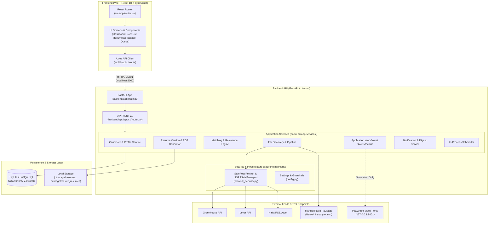
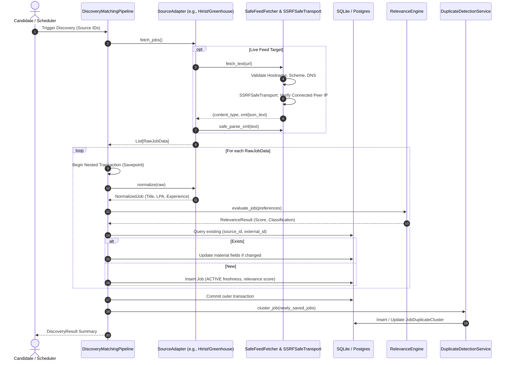
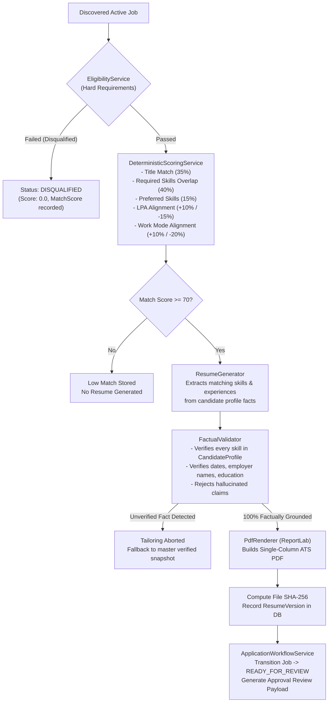
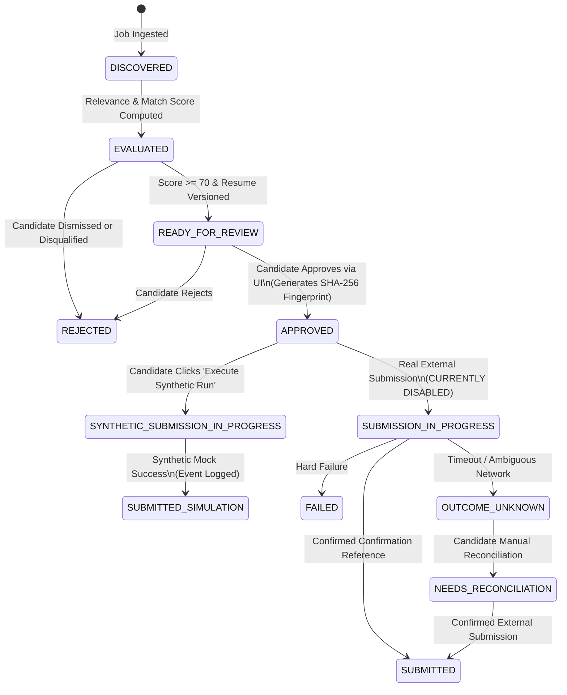

# 02 — Technical Architecture & System Design

## 1. System Overview & Architectural Paradigm

JobPilot AI is architected as a **modular, local-first single-tenant monolith**. It pairs a high-performance **FastAPI (Python 3.12)** asynchronous backend with a modern **React 18 + TypeScript + Tailwind CSS** single-page application (SPA).

The architecture is explicitly designed around four core technical guarantees:
1. **Zero External Data Leakage**: Sensitive candidate resumes, career history, and application logs are stored locally.
2. **Deterministic-First Processing**: Core matching, scoring, and eligibility logic is 100% deterministic, testable, and explainable, with optional local LLM augmentation via Ollama.
3. **Cryptographic Application Integrity**: Applications are locked with SHA-256 state fingerprints preventing unauthorized or stale modifications.
4. **Network & SSRF Safety**: Outbound feed requests are strictly isolated at the TCP socket layer to prevent Server-Side Request Forgery (SSRF) and DNS rebinding attacks.

---

## 2. High-Level Component Architecture



---

## 3. Backend Module Hierarchy & Responsibilities

The backend follows a domain-driven service architecture:

```
backend/
├── alembic/                    # Database migration scripts (Single head: d823fa19b2e4)
├── app/
│   ├── api/v1/                 # HTTP Routers & Endpoints
│   │   ├── applications.py     # Application queue, review, approve, attempt, reconcile
│   │   ├── health.py           # /health, /health/ready
│   │   ├── jobs.py             # Discovery, sources config, manual import, duplicates, freshness
│   │   ├── matching.py         # Deterministic evaluation, batch scoring, ranking eval
│   │   ├── notifications.py    # Notification center, digest status/trigger, email config
│   │   ├── profile.py          # Candidate facts, master resume import, search preferences
│   │   ├── resumes.py          # Tailored resume generation, download, integrity check
│   │   ├── scheduler.py        # Discovery intervals, manual run triggers, run telemetry
│   │   └── router.py           # Master v1 router aggregating all domain sub-routers
│   ├── automation/             # Browser automation & synthetic harness
│   │   ├── base_adapter.py     # Base abstract browser automation adapter
│   │   ├── browser_runner.py   # Playwright automation executor with timeout/safety caps
│   │   ├── form_mapper.py      # Conservative form-field mapping heuristics
│   │   ├── synthetic_adapter.py# Isolated submission simulation adapter
│   │   ├── synthetic_submission_service.py # Simulation lifecycle orchestrator
│   │   └── mock_portal/        # Local HTTP server mimicking career application portal
│   ├── collectors/             # Job board ingestion adapters
│   │   ├── base.py             # BaseJobSourceAdapter, RawJobData, NormalizedJob
│   │   ├── greenhouse.py       # Multi-board Greenhouse collector
│   │   ├── lever.py            # Multi-site Lever collector
│   │   ├── synthetic.py        # Deterministic synthetic job generator
│   │   ├── naukri.py           # Manual JSON & email alert parser for Naukri
│   │   ├── instahyre.py        # Manual JSON & email alert parser for Instahyre
│   │   ├── cutshort.py         # Manual JSON & email alert parser for Cutshort
│   │   ├── foundit.py          # Manual JSON & email alert parser for Foundit
│   │   ├── hirist.py           # RSS/Atom feed collector with SSRF validation
│   │   ├── indeed.py           # Manual JSON & email alert parser for Indeed
│   │   ├── linkedin.py         # Manual JSON & email alert parser for LinkedIn
│   │   └── indian_parser_utils.py # INR LPA salary, experience, location parsing
│   ├── core/                   # Cross-cutting concerns
│   │   ├── config.py           # Pydantic Settings, safety switches, directory bootstrap
│   │   ├── database.py         # Async engine, sessionmaker, transaction utilities
│   │   ├── logging.py          # Formatted logging system
│   │   └── network_security.py # SafeFeedFetcher, SSRFSafeTransport, safe_parse_xml
│   ├── matching/               # Scoring & eligibility engines
│   │   ├── scoring.py               # DeterministicScoringService (0-100 explainable scoring)
│   │   └── eligibility.py           # EligibilityService (Hard disqualification gates)
│   ├── models/                 # SQLAlchemy 2.0 ORM entities
│   │   ├── application.py      # applications, application_events, submission_attempts
│   │   ├── automation.py       # automation_runs
│   │   ├── candidate.py        # candidate_profiles, experiences, educations, skills, projects
│   │   ├── enums.py            # Type-safe string enumerations
│   │   ├── feedback.py         # job_feedbacks
│   │   ├── job.py              # jobs, job_sources, job_requirements, job_duplicate_clusters
│   │   ├── matching.py         # match_scores
│   │   ├── notification.py     # notifications
│   │   └── resume.py           # resume_versions
│   ├── providers/              # LLM integration providers
│   │   ├── base.py             # BaseLLMProvider interface
│   │   └── ollama.py           # Local Ollama llama3.1 client
│   ├── resumes/                # Document generation & verification
│   │   ├── fact_validator.py       # ResumeFactValidator (Token & fact grounding validator)
│   │   ├── tailoring_service.py     # ResumeTailoringService (Tailoring orchestrator)
│   │   ├── pdf_renderer.py     # ReportLab single-column ATS PDF builder
│   │   └── prompt_templates.py # Structured prompt definitions
│   ├── schemas/                # Pydantic v2 request/response schemas
│   ├── services/               # Core business services
│   │   ├── candidate_service.py
│   │   ├── digest_service.py
│   │   ├── discovery_pipeline.py
│   │   ├── duplicate_detection_service.py
│   │   ├── email_service.py
│   │   ├── feedback_service.py
│   │   ├── job_discovery_service.py
│   │   ├── job_freshness_service.py
│   │   ├── matching_service.py
│   │   ├── notification_service.py
│   │   ├── relevance_engine.py
│   │   ├── resume_parser.py
│   │   ├── resume_version_service.py
│   │   ├── salary_service.py
│   │   └── scheduler_service.py
│   └── workflow/               # State machine & approvals
│       ├── approval_fingerprint.py # SHA-256 canonical fingerprint builder
│       ├── exceptions.py       # StaleApprovalError, InvalidTransitionError
│       └── state_machine.py    # Transition rules & event logger
```

---

## 4. Key Pipeline Data Flows

### A. Job Discovery & Deduplication Pipeline



### B. Matching & Factual Resume Tailoring Pipeline



### C. Cryptographic Approval & Submission State Machine



---

## 5. Security & Network Isolation Architecture

JobPilot AI enforces defense-in-depth against malicious web targets and SSRF:

1. **Pre-Request URL & DNS Validation**:
   - Disallows non-HTTPS protocols by default.
   - Disallows URLs containing embedded user info (`user:pass@host`).
   - Disallows loopback (`127.0.0.0/8`), RFC 1918 private subnets (`10.0.0.0/8`, `172.16.0.0/12`, `192.168.0.0/16`), link-local (`169.254.0.0/16`), cloud metadata (`169.254.169.254`, `169.254.170.2`, `100.100.100.200`, `metadata.google.internal`), and internal domains (`.local`, `.internal`, `.localhost`).
   - Resolves DNS via `socket.getaddrinfo()` and checks *every* resolved IP address.
2. **Socket-Level Connection Hook (`SSRFSafeNetworkBackend`)**:
   - HTTP clients can suffer Time-of-Check to Time-of-Use (TOCTOU) DNS rebinding attacks if a malicious DNS server responds with a safe IP during `getaddrinfo` and a private IP during connection.
   - JobPilot AI's `SSRFSafeNetworkBackend` hooks directly into HTTPCore's `AnyIOBackend.connect_tcp`. Immediately upon socket connection, it queries the socket's peer address (`stream.get_extra_info("server_addr")`). If the actual connected IP is prohibited, the stream is closed immediately and `SSRFProtectionError` is raised before sending HTTP headers.
3. **Safe XML Parsing**:
   - `safe_parse_xml()` inspects all RSS XML payloads before parsing. Any payload containing `<!DOCTYPE` or `<!ENTITY` is rejected with `ValueError`, completely preventing XML External Entity (XXE) and Billion Laughs / quadratic entity expansion attacks.
4. **Credential & Log Redaction**:
   - `sanitize_url_for_logging()` masks user credentials and strips query parameters matching sensitive keys (`token`, `api_key`, `secret`, `auth`, `password`, `pwd`, `credential`).

---

## 6. Frontend Architecture & Technology Stack

The frontend is built with **React 18**, **TypeScript**, **Vite**, and **Tailwind CSS**.

### Directory Structure:
```
frontend/src/
├── app/
│   ├── App.tsx                 # Root component with layout and notification toast manager
│   └── router.tsx              # React Router v6 route configuration
├── components/
│   ├── layout/                 # AppLayout, Sidebar, TopBar navigation
│   └── ui/                     # Reusable design system (Button, Badge, Card, Modal, etc.)
├── features/                   # Domain-driven feature screens
│   ├── applications/           # ApplicationQueue, ReviewModal, HistoryDrawer
│   ├── dashboard/              # DashboardOverview with live metrics
│   ├── jobs/                   # JobsList, JobDetailModal, DuplicateClustersModal
│   ├── notifications/          # NotificationCenter, NotificationSettingsModal
│   ├── profile/                # CandidateProfileView, SearchPreferencesCard, ResumeImportModal
│   ├── resumes/                # ResumeWorkspace with PDF preview and hash integrity badge
│   └── scheduler/              # SchedulerManager, DiscoverySourcesCard
├── lib/
│   ├── api-client.ts           # Axios HTTP client with typed API functions
│   └── formatters.ts           # Currency (INR LPA/USD), date, and score formatters
└── types/
    └── index.ts                # TypeScript interface definitions mirroring backend schemas
```

---

## 7. Architectural Decisions & Trade-Offs

| Decision | Trade-Off Accepted | Justification |
| :--- | :--- | :--- |
| **Local-First Monolith over Microservices** | Single application process; horizontal scaling requires vertical compute. | Unmatched simplicity, zero deployment friction, zero network latency between services, maximum privacy. |
| **Manual Import for Anti-Scraping Job Boards** | Candidate must paste JSON or email alerts for Naukri/Cutshort/Instahyre. | Bypassing Cloudflare/PerimeterX protections via headless browsers is brittle, high-maintenance, and risks candidate IP bans. |
| **In-Process Asyncio Scheduler** | Scheduler restarts with backend process; no persistent distributed task queue. | Eliminates heavyweight Redis/RabbitMQ/Celery dependencies, keeping local installation painless for developers. |
| **ReportLab for PDF Generation** | PDF styling is controlled via code rather than visual drag-and-drop HTML-to-PDF templates. | ReportLab produces 100% compliant, lightweight, standard ATS-parseable single-column PDFs without Chromium headless rendering overhead. |

---

*Reference Document*: Proceed to [03_DATABASE_AND_API_REFERENCE.md](file:///c:/Users/imaka/Desktop/Desk/PROJECTS/JobPilot_AI/job_finder/docs/project-reference/03_DATABASE_AND_API_REFERENCE.md) for full database schemas, tables, relationships, and API route inventories.
