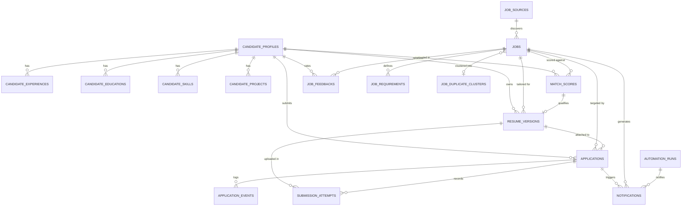

# 03 — Database & API Reference

## 1. Database Architecture & Schema Overview

JobPilot AI uses **SQLAlchemy 2.0 Async ORM** paired with **Alembic** migrations. By default, it operates on a local-first **SQLite** database (`storage/jobpilot.db`) using the `aiosqlite` asynchronous driver. It is fully compatible with **PostgreSQL 16** via `asyncpg` for multi-user or production deployments (configured via `docker-compose.yml` and `.env`).

### Alembic Migration History
Current Migration Head: **`d823fa19b2e4`**
The migration sequence is strictly linear with zero branching or split heads:

```
<base>
  └─ 2051ba9838c8: initial schema
       └─ 667e479abab5: add matching engine fields to match_scores
            └─ 2692bda4ba04: add resume versioning validation fields
                 └─ 3f63fd0f4fae: add application workflow and submission attempts
                      └─ 4b81cf738a92: add notification enhancements and dedup
                           └─ 5e29f8a31c4d: add search preferences and source config
                                └─ c821a4f02b9e: add digest tracking to notifications
                                     └─ d934b51c8a2f: phase 11 job intelligence and deduplication
                                          └─ e145f6789abc: phase 12 add job discovered_at and canonical_url indexes
                                               └─ f123a45678bc: add job relevance fields and source telemetry
                                                    └─ c14fd127ea45: add inr lpa to candidate profile
                                                         └─ d823fa19b2e4 (HEAD): add source_type and integration_status to job_sources
```

---

## 2. Database Tables & Entity Relationships

The schema consists of 17 relational tables:



---

## 3. Table Schemas & Column Definitions

### 1. `candidate_profiles`
**File**: [`backend/app/models/candidate.py`](file:///c:/Users/imaka/Desktop/Desk/PROJECTS/JobPilot_AI/job_finder/backend/app/models/candidate.py)
Stores master candidate facts, search goals, and notification preferences.
- `id` (VARCHAR(36), PK): UUID.
- `full_name` (VARCHAR(255), Not Null): Candidate name.
- `email` (VARCHAR(255), Not Null, Unique): Candidate email.
- `phone` (VARCHAR(50)): Phone number.
- `location` (VARCHAR(255)): Residential location (e.g., "Bengaluru, India").
- `work_authorization` (VARCHAR(255)): Visa/citizenship status.
- `summary` (TEXT): Professional summary.
- `years_of_experience` (FLOAT): Total career experience years.
- `target_titles` (JSON): List of strings.
- `target_package_min_lpa` (FLOAT): Minimum expected annual compensation in INR LPA.
- `target_package_max_lpa` (FLOAT): Maximum expected annual compensation in INR LPA.
- `target_salary_min` (FLOAT): Legacy USD minimum compensation.
- `target_salary_max` (FLOAT): Legacy USD maximum compensation.
- `remote_preference` (VARCHAR(50)): "REMOTE", "HYBRID", "ON_SITE", or "ANY".
- `notice_period_days` (INTEGER): Availability window.
- `linkedin_url`, `github_url`, `portfolio_url` (VARCHAR(255)): Professional links.
- `search_preferences` (JSON): Structured preferences (must-have skills, preferred locations, specialization).
- `notification_preferences` (JSON): In-app/email notification settings.
- `created_at`, `updated_at` (DATETIME): UTC timestamps.

### 2. `candidate_experiences`, `candidate_educations`, `candidate_skills`, `candidate_projects`
**File**: [`backend/app/models/candidate.py`](file:///c:/Users/imaka/Desktop/Desk/PROJECTS/JobPilot_AI/job_finder/backend/app/models/candidate.py)
Stores verified factual details extracted from the master resume.
- `candidate_experiences`: `id`, `candidate_id` (FK), `company`, `role`, `location`, `start_date`, `end_date`, `is_current`, `verified_bullets` (JSON array of strings).
- `candidate_educations`: `id`, `candidate_id` (FK), `institution`, `degree`, `field_of_study`, `graduation_year`.
- `candidate_skills`: `id`, `candidate_id` (FK), `skill_name`, `category`, `years_experience`, `is_verified`, `evidence`.
- `candidate_projects`: `id`, `candidate_id` (FK), `title`, `description`, `technologies` (JSON array), `project_url`, `verified_bullets` (JSON array).

### 3. `job_sources`
**File**: [`backend/app/models/job.py`](file:///c:/Users/imaka/Desktop/Desk/PROJECTS/JobPilot_AI/job_finder/backend/app/models/job.py)
Configures external job platforms and telemetry.
- `id` (VARCHAR(36), PK): UUID.
- `identifier` (VARCHAR(50), Unique, Indexed): e.g., "greenhouse", "lever", "naukri", "hirist".
- `name` (VARCHAR(100)): Human-readable label.
- `base_url` (VARCHAR(255)): Root URL.
- `rate_limit_rpm` (INTEGER): Rate limit per minute.
- `is_enabled` (BOOLEAN): Master toggle.
- `source_type` (VARCHAR(50)): "job_board" or "synthetic".
- `integration_status` (VARCHAR(50)): "ACTIVE_POLLING", "MANUAL_IMPORT_ONLY", "CONFIGURATION_REQUIRED", "AUTHORIZATION_REQUIRED", "DISABLED", "SYNTHETIC_TEST".
- `config_json` (JSON): Board tokens, RSS URLs, category settings.
- `last_status` (VARCHAR(50)): "HEALTHY", "DEGRADED", "ERROR".
- `last_error_summary` (TEXT): Diagnostic logs on failure.
- `jobs_discovered_count`, `jobs_relevant_count` (INTEGER): Cumulative ingestion counters.

### 4. `jobs`
**File**: [`backend/app/models/job.py`](file:///c:/Users/imaka/Desktop/Desk/PROJECTS/JobPilot_AI/job_finder/backend/app/models/job.py)
Stores normalized job listings.
- `id` (VARCHAR(36), PK): UUID.
- `source_id` (VARCHAR(36), FK): Reference to `job_sources.id`.
- `external_id` (VARCHAR(255)): Source-assigned ID (Unique constraint with `source_id`).
- `title` (VARCHAR(255), Indexed): Job title.
- `company` (VARCHAR(255), Indexed): Employer name.
- `canonical_url` (VARCHAR(500), Indexed): Tracking-stripped URL.
- `location` (VARCHAR(255)): City / Country.
- `remote_type` (VARCHAR(50)): "REMOTE", "HYBRID", "ON_SITE".
- `description` (TEXT): Sanitized description text.
- `employment_type` (VARCHAR(50)): "Full-time", "Contract", etc.
- `salary_min`, `salary_max` (FLOAT): Normalized compensation bounds.
- `currency` (VARCHAR(10)): "INR", "USD", "EUR", etc.
- `status` (VARCHAR(50)): "DISCOVERED", "EVALUATED", "APPLIED", "ARCHIVED".
- `relevance_score` (FLOAT): 0.0–1.0 fast relevance score.
- `relevance_classification` (VARCHAR(50)): "HIGHLY_RELEVANT", "POTENTIALLY_RELEVANT", "LOW_RELEVANCE", "NOT_RELEVANT".
- `relevance_metadata` (JSON): Keyword match breakdown and score reasoning.
- `duplicate_cluster_id` (VARCHAR(36), FK): Reference to `job_duplicate_clusters.id`.
- `freshness_status` (VARCHAR(50)): "ACTIVE", "STALE", "EXPIRED", "UNVERIFIED".
- `first_seen_at`, `last_seen_at`, `last_verified_at` (DATETIME): Freshness tracking timestamps.

### 5. `job_duplicate_clusters`
**File**: [`backend/app/models/job.py`](file:///c:/Users/imaka/Desktop/Desk/PROJECTS/JobPilot_AI/job_finder/backend/app/models/job.py)
Groups cross-board identical postings.
- `id` (VARCHAR(36), PK): UUID.
- `canonical_job_id` (VARCHAR(36), FK): Primary job chosen as canonical representative.
- `cluster_status` (VARCHAR(50)): "DETECTED", "CONFIRMED", "DISMISSED".
- `confidence` (VARCHAR(50)): "HIGH_CONFIDENCE", "MEDIUM_CONFIDENCE", "LOW_CONFIDENCE".
- `confidence_score` (FLOAT): 0.0–1.0 similarity score.
- `match_reasons` (JSON): List of strings detailing match evidence.
- `reviewed_at` (DATETIME), `review_notes` (TEXT): Human review audit fields.

### 6. `match_scores`
**File**: [`backend/app/models/matching.py`](file:///c:/Users/imaka/Desktop/Desk/PROJECTS/JobPilot_AI/job_finder/backend/app/models/matching.py)
Detailed scoring and eligibility breakdown for a (candidate, job) pair.
- `id` (VARCHAR(36), PK): UUID.
- `job_id` (VARCHAR(36), FK), `candidate_id` (VARCHAR(36), FK).
- `overall_score` (FLOAT): 0–100 match score.
- `is_eligible` (BOOLEAN): Hard eligibility gate flag.
- `eligibility_status` (VARCHAR(50)): "ELIGIBLE", "DISQUALIFIED", "NEEDS_REVIEW".
- `eligibility_checks` (JSON): Pass/fail results for experience, work auth, skills.
- `scoring_breakdown` (JSON): Detailed sub-scores (title, skills, compensation, location).
- `matching_skills`, `missing_skills` (JSON): Skill gap analysis lists.
- `scoring_policy_version` (VARCHAR(50)): Policy version string for fingerprinting.
- `job_fingerprint` (VARCHAR(64)): SHA-256 of job requirements at evaluation time.
- `is_latest` (BOOLEAN): Latest evaluation indicator.

### 7. `resume_versions`
**File**: [`backend/app/models/resume.py`](file:///c:/Users/imaka/Desktop/Desk/PROJECTS/JobPilot_AI/job_finder/backend/app/models/resume.py)
Tailored ATS resume versions generated for specific jobs.
- `id` (VARCHAR(36), PK): UUID.
- `candidate_id` (VARCHAR(36), FK), `job_id` (VARCHAR(36), FK), `match_score_id` (VARCHAR(36), FK).
- `version_number` (INTEGER): Incremental version per job.
- `structured_content` (JSON): Tailored sections and bullets.
- `candidate_snapshot` (JSON): Immutable copy of candidate profile at generation time.
- `pdf_file_path` (VARCHAR(500)): Local filesystem path to rendered PDF.
- `file_sha256` (VARCHAR(64)): Cryptographic SHA-256 digest of PDF file.
- `is_ats_valid`, `is_submission_ready` (BOOLEAN): Quality readiness flags.
- `factual_validation_result` (JSON): Detailed fact-checker audit output.

### 8. `applications`, `application_events`, `submission_attempts`
**File**: [`backend/app/models/application.py`](file:///c:/Users/imaka/Desktop/Desk/PROJECTS/JobPilot_AI/job_finder/backend/app/models/application.py)
Human-governed application lifecycle and submission audit logs.
- `applications`:
  - `id` (VARCHAR(36), PK): UUID.
  - `job_id`, `candidate_id`, `resume_version_id` (VARCHAR(36), FKs).
  - `selected_resume_sha256` (VARCHAR(64)): Hash of resume at approval.
  - `status` (VARCHAR(50)): Lifecycle status enum.
  - `approval_fingerprint` (VARCHAR(64)): Cryptographic SHA-256 approval lock.
  - `approved_at` (DATETIME): Timestamp of human approval.
- `application_events`:
  - `id` (VARCHAR(36), PK): UUID.
  - `application_id` (VARCHAR(36), FK): Reference to application.
  - `from_status`, `to_status` (VARCHAR(50)): State transition.
  - `actor` (VARCHAR(50)): "candidate", "system", "synthetic_runner".
  - `payload` (JSON): Transition audit metadata.
- `submission_attempts`:
  - `id` (VARCHAR(36), PK): UUID.
  - `application_id` (VARCHAR(36), FK), `selected_resume_version_id` (VARCHAR(36), FK).
  - `attempt_number` (INTEGER): Attempt counter.
  - `adapter_identifier` (VARCHAR(100)): e.g., "synthetic_mock_adapter".
  - `outcome` (VARCHAR(50)): "SUCCESS", "BLOCKED_SAFETY", "FAILED", "OUTCOME_UNKNOWN".
  - `confirmation_reference` (VARCHAR(255)): Confirmation number/ID.
  - `confirmation_payload` (JSON): Complete response data.

### 9. `notifications`
**File**: [`backend/app/models/notification.py`](file:///c:/Users/imaka/Desktop/Desk/PROJECTS/JobPilot_AI/job_finder/backend/app/models/notification.py)
In-app and email notification tracking.
- `id` (VARCHAR(36), PK): UUID.
- `notification_type` (VARCHAR(50)): "NEW_MATCH", "APPROVAL_REQUIRED", "SUBMISSION_SUCCESS", "SYSTEM_ALERT".
- `title` (VARCHAR(255)), `message` (TEXT): Notification copy.
- `channel` (VARCHAR(50)): "IN_APP", "EMAIL", "DIGEST".
- `status` (VARCHAR(50)): "PENDING", "SENT", "FAILED".
- `is_read`, `is_dismissed` (BOOLEAN): User interaction flags.
- `dedup_key` (VARCHAR(255), Indexed): Unique key preventing duplicate alerts.

---

## 4. Complete API Endpoint Inventory

All API endpoints are mounted under the `/api/v1` prefix.

### A. Health & System
| Method | Path | Summary / Purpose | Request Body | Response Model |
| :--- | :--- | :--- | :--- | :--- |
| `GET` | `/health` | Root basic health check | None | `{"status": "ok", "app": "JobPilot AI"}` |
| `GET` | `/api/v1/health` | Comprehensive system health check | None | `HealthCheckResponse` |
| `GET` | `/api/v1/health/ready` | Database & storage readiness check | None | `ReadinessResponse` |

### B. Candidate Profile & Preferences
| Method | Path | Summary / Purpose | Request Body | Response Model |
| :--- | :--- | :--- | :--- | :--- |
| `GET` | `/api/v1/profile` | Retrieve active candidate profile | None | `CandidateProfileResponse` |
| `POST` | `/api/v1/profile` | Create candidate profile | `CandidateProfileCreate` | `CandidateProfileResponse` |
| `PATCH`| `/api/v1/profile` | Update candidate facts | `CandidateProfileUpdate` | `CandidateProfileResponse` |
| `POST` | `/api/v1/profile/import-resume` | Upload & parse master PDF resume | Multipart `file` | `ResumeImportParsedDraft` |
| `POST` | `/api/v1/profile/import-resume/confirm` | Confirm & persist parsed resume | `ResumeImportConfirmRequest` | `CandidateProfileResponse` |
| `GET` | `/api/v1/profile/preferences` | Retrieve job search preferences | None | `SearchPreferencesResponse` |
| `PUT` | `/api/v1/profile/preferences` | Update preferences (titles, skills, LPA) | `SearchPreferencesUpdate` | `SearchPreferencesResponse` |
| `POST` | `/api/v1/profile/skills` | Add candidate skill | `CandidateSkillCreate` | `CandidateSkillResponse` |
| `DELETE`| `/api/v1/profile/skills/{skill_id}` | Remove candidate skill | None | `{"success": true}` |
| `POST` | `/api/v1/profile/experiences` | Add work experience | `CandidateExperienceCreate` | `CandidateExperienceResponse` |
| `DELETE`| `/api/v1/profile/experiences/{exp_id}` | Remove work experience | None | `{"success": true}` |
| `POST` | `/api/v1/profile/educations` | Add education entry | `CandidateEducationCreate` | `CandidateEducationResponse` |
| `DELETE`| `/api/v1/profile/educations/{edu_id}` | Remove education entry | None | `{"success": true}` |
| `POST` | `/api/v1/profile/projects` | Add project entry | `CandidateProjectCreate` | `CandidateProjectResponse` |
| `DELETE`| `/api/v1/profile/projects/{project_id}` | Remove project entry | None | `{"success": true}` |

### C. Jobs & Discovery
| Method | Path | Summary / Purpose | Request Body | Response Model |
| :--- | :--- | :--- | :--- | :--- |
| `GET` | `/api/v1/jobs` | Paginated jobs list with filters | Query params | `JobListResponse` |
| `GET` | `/api/v1/jobs/{job_id}` | Detailed job requisition data | None | `JobDetailResponse` |
| `POST` | `/api/v1/jobs/discover` | Trigger discovery across sources | `JobDiscoveryRequest` | `JobDiscoverySummaryResponse` |
| `GET` | `/api/v1/jobs/sources` | List all registered job sources | None | `List[JobSourceResponse]` |
| `GET` | `/api/v1/jobs/sources/{identifier}` | Get source config & telemetry | None | `JobSourceResponse` |
| `PUT` | `/api/v1/jobs/sources/{identifier}` | Update source config (tokens/feeds) | `JobSourceUpdateRequest` | `JobSourceResponse` |
| `POST` | `/api/v1/jobs/sources/{identifier}/import`| Import manual JSON / alert digest | `JobImportRequest` | `JobImportResponse` |
| `GET` | `/api/v1/jobs/duplicates` | List duplicate job clusters | Query params | `List[DuplicateClusterResponse]` |
| `POST` | `/api/v1/jobs/duplicates/{cluster_id}/review` | Confirm or dismiss duplicate cluster | `DuplicateReviewRequest` | `DuplicateClusterResponse` |
| `GET` | `/api/v1/jobs/{job_id}/freshness` | Get job freshness verification | None | `JobFreshnessResponse` |
| `POST` | `/api/v1/jobs/{job_id}/freshness/verify` | Live HTTP HEAD freshness check | None | `JobFreshnessResponse` |
| `POST` | `/api/v1/jobs/{job_id}/feedback` | Submit thumbs up/down recommendation feedback | `JobFeedbackCreate` | `JobFeedbackResponse` |
| `GET` | `/api/v1/jobs/{job_id}/feedback` | Get feedback for job | None | `JobFeedbackResponse` |
| `DELETE`| `/api/v1/jobs/{job_id}/feedback` | Remove feedback for job | None | `{"success": true}` |
| `POST` | `/api/v1/jobs/re-evaluate-relevance` | Re-score all jobs against preferences | None | `{"re_evaluated": int}` |

### D. Job Matching & Scoring
| Method | Path | Summary / Purpose | Request Body | Response Model |
| :--- | :--- | :--- | :--- | :--- |
| `POST` | `/api/v1/matching/evaluate/{job_id}` | Deterministic score for single job | Optional params | `MatchScoreResponse` |
| `POST` | `/api/v1/matching/evaluate-all` | Batch evaluate all active jobs | None | `BatchMatchResultResponse` |
| `GET` | `/api/v1/matching/results` | List paginated match scores | Query params | `List[MatchScoreResponse]` |
| `GET` | `/api/v1/matching/results/{job_id}` | Get match breakdown for job | None | `MatchScoreResponse` |
| `POST` | `/api/v1/matching/evaluate-ranking` | Offline nDCG ranking evaluation | `RankingEvaluationRequest`| `RankingEvaluationResponse` |
| `GET` | `/api/v1/matching/health` | Matching engine diagnostic status | None | `{"status": "healthy"}` |

### E. Resumes & Tailoring
| Method | Path | Summary / Purpose | Request Body | Response Model |
| :--- | :--- | :--- | :--- | :--- |
| `POST` | `/api/v1/resumes/generate` | Generate tailored resume PDF | `ResumeGenerateRequest` | `ResumeVersionResponse` |
| `GET` | `/api/v1/resumes/job/{job_id}` | List all tailored versions for job | None | `List[ResumeVersionResponse]` |
| `GET` | `/api/v1/resumes/{version_id}` | Get resume metadata and validation | None | `ResumeVersionResponse` |
| `GET` | `/api/v1/resumes/{version_id}/download`| Download rendered PDF file | None | `FileResponse` (`application/pdf`) |
| `GET` | `/api/v1/resumes/{version_id}/integrity`| Checksum verification against file | None | `ResumeIntegrityResponse` |

### F. Application Queue & Approvals
| Method | Path | Summary / Purpose | Request Body | Response Model |
| :--- | :--- | :--- | :--- | :--- |
| `GET` | `/api/v1/applications` | List applications by status tab | Query params | `ApplicationListResponse` |
| `POST` | `/api/v1/applications/prepare` | Prepare eligible job for review | `ApplicationPrepareRequest` | `ApplicationResponse` |
| `GET` | `/api/v1/applications/{application_id}` | Get application detail | None | `ApplicationResponse` |
| `GET` | `/api/v1/applications/{application_id}/review` | Get review payload & fingerprint | None | `ApplicationReviewResponse` |
| `POST` | `/api/v1/applications/{application_id}/approve` | Cryptographically approve application | `ApplicationApproveRequest` | `ApplicationResponse` |
| `POST` | `/api/v1/applications/{application_id}/attempt` | Execute synthetic submission | None | `SubmissionAttemptResponse` |
| `GET` | `/api/v1/applications/{application_id}/attempts` | List submission history attempts | None | `List[SubmissionAttemptResponse]` |
| `GET` | `/api/v1/applications/{application_id}/events` | Append-only state transition audit | None | `List[ApplicationEventResponse]` |
| `POST` | `/api/v1/applications/{application_id}/reconcile` | Manually reconcile unknown outcome | `OutcomeReconcileRequest` | `ApplicationResponse` |

### G. Scheduler
| Method | Path | Summary / Purpose | Request Body | Response Model |
| :--- | :--- | :--- | :--- | :--- |
| `GET` | `/api/v1/scheduler/status` | In-process scheduler state & timing | None | `SchedulerStatusResponse` |
| `POST` | `/api/v1/scheduler/config` | Update interval & enable toggle | `SchedulerConfigUpdate` | `SchedulerStatusResponse` |
| `POST` | `/api/v1/scheduler/run` | Trigger immediate discovery run | None | `AutomationRunResponse` |
| `GET` | `/api/v1/scheduler/runs` | List historical discovery runs | Query params | `List[AutomationRunResponse]` |
| `GET` | `/api/v1/scheduler/runs/{run_id}` | Get run execution diagnostics | None | `AutomationRunResponse` |

### H. Notifications & Digests
| Method | Path | Summary / Purpose | Request Body | Response Model |
| :--- | :--- | :--- | :--- | :--- |
| `GET` | `/api/v1/notifications` | List in-app notifications | Query params | `NotificationListResponse` |
| `GET` | `/api/v1/notifications/unread-count` | Unread notifications counter | None | `{"unread_count": int}` |
| `POST` | `/api/v1/notifications/{id}/read` | Mark single notification as read | None | `NotificationResponse` |
| `POST` | `/api/v1/notifications/read-all` | Mark all notifications read | None | `{"marked_read": int}` |
| `POST` | `/api/v1/notifications/{id}/dismiss` | Dismiss notification | None | `{"success": true}` |
| `GET` | `/api/v1/notifications/preferences` | Get notification settings | None | `NotificationPreferencesResponse` |
| `PUT` | `/api/v1/notifications/preferences` | Update email & channel preferences | `NotificationPreferencesUpdate` | `NotificationPreferencesResponse` |
| `GET` | `/api/v1/notifications/digest/status` | Daily/weekly digest schedule info | None | `DigestStatusResponse` |
| `POST` | `/api/v1/notifications/digest/trigger` | Trigger manual job digest | None | `DigestTriggerResponse` |
| `GET` | `/api/v1/notifications/delivery-history`| List email delivery attempts | Query params | `List[DeliveryHistoryItem]` |
| `POST` | `/api/v1/notifications/test-email` | Dispatch test email | `TestEmailRequest` | `TestEmailResponse` |
| `GET` | `/api/v1/notifications/email-status` | Check SMTP / mock service health | None | `EmailServiceStatusResponse` |

---

*Reference Document*: Proceed to [04_JOB_SOURCE_INTEGRATIONS.md](file:///c:/Users/imaka/Desktop/Desk/PROJECTS/JobPilot_AI/job_finder/docs/project-reference/04_JOB_SOURCE_INTEGRATIONS.md) for job board integration specifications.
