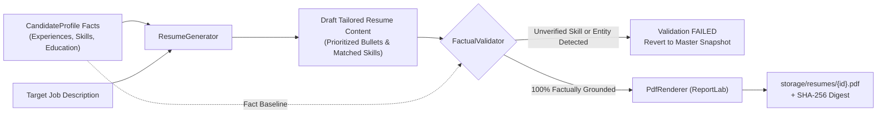

# 05 — AI Matching, Scoring & Resume Generation

## 1. Architectural Philosophy: Deterministic vs. Generative AI

JobPilot AI enforces a strict architectural boundary between **deterministic rule-based processing** and **generative LLM assistance**:

| Processing Domain | Technology Used | Determinism | Auditable Guarantee |
| :--- | :--- | :--- | :--- |
| **Eligibility Verification** | `EligibilityService` (Python) | 100% Deterministic | Zero false positives on hard disqualifiers (e.g., minimum experience, work authorization). |
| **Job Relevance Pre-Filter** | `RelevanceEngine` (Python) | 100% Deterministic | Real-time classification into Highly/Potentially/Low relevance. |
| **Match Scoring (0–100)** | `DeterministicScoringService` | 100% Deterministic | Fully explainable score breakdown with exact weights and bonuses. |
| **Fact-Grounded Validation** | `ResumeFactValidator` (Python AST) | 100% Deterministic | 0% hallucinated skills or experiences; generated bullets must match profile facts. |
| **ATS Document Rendering** | `PdfRenderer` (ReportLab) | 100% Deterministic | Clean single-column ATS typography with SHA-256 integrity hash. |
| **Semantic Analysis (Optional)** | `OllamaProvider` (Llama 3.1) | Non-Deterministic | Used solely for qualitative summaries and conceptual skill analogies. |

---

## 2. Fast Relevance Pre-Filter (`RelevanceEngine`)

**Source**: [`backend/app/services/relevance_engine.py`](file:///c:/Users/imaka/Desktop/Desk/PROJECTS/JobPilot_AI/job_finder/backend/app/services/relevance_engine.py)

During job discovery, before deep evaluation or resume generation is attempted, each job is evaluated against the candidate's active search preferences.

### Scoring Calculation:
1. **Title Matching (0.0 to 0.40)**:
   - Evaluates token overlap between job title and candidate target titles (e.g., "Senior Full Stack AI Engineer").
   - Title match weight: `0.40`. Non-technical title penalty: `-0.40` (filters out marketing, finance, or administrative postings).
2. **Skill Overlap (0.0 to 0.35)**:
   - Scans job title and description against candidate `must_have_skills`.
   - Ratio of matched must-have skills scaled by `0.35`.
3. **Location & Remote Compatibility (0.0 to 0.15)**:
   - Matches candidate location and remote preference (Remote / Hybrid / On-site).
   - Incompatible location/remote applies a `-0.30` penalty.
4. **Compensation / LPA Alignment (0.0 to 0.10)**:
   - Compares job package against `target_package_min_lpa`.
   - Meeting or exceeding target: `+0.10`. Below target: `-0.15`. Undisclosed salary: neutral (`0.0`).

### Classification Tiers:
- **`HIGHLY_RELEVANT`** (Score $\ge 0.75$): Automatically eligible for resume generation and application queue preparation.
- **`POTENTIALLY_RELEVANT`** (Score $0.50 \le \text{Score} < 0.75$): Retained in discovery list for candidate review.
- **`LOW_RELEVANCE`** (Score $0.25 \le \text{Score} < 0.50$): Deprioritized in UI.
- **`NOT_RELEVANT`** (Score $< 0.25$): Excluded from application pipeline.

---

## 3. Deterministic Matching Engine & Eligibility Gates

**Sources**: [`backend/app/matching/scoring.py`](file:///c:/Users/imaka/Desktop/Desk/PROJECTS/JobPilot_AI/job_finder/backend/app/matching/scoring.py), [`backend/app/matching/eligibility.py`](file:///c:/Users/imaka/Desktop/Desk/PROJECTS/JobPilot_AI/job_finder/backend/app/matching/eligibility.py)

### Stage 1: Hard Eligibility Gates
Before score calculation, `EligibilityService` evaluates non-negotiable job requirements:
- **Years of Experience Gate**: If the job mandates a minimum experience greater than candidate experience by more than 1.5 years, the candidate is marked `DISQUALIFIED`.
- **Work Authorization Gate**: If the posting explicitly mandates citizenship or security clearance that the candidate lacks, marked `DISQUALIFIED`.
- **Mandatory Hard Skills Gate**: If candidate possesses 0% of explicitly marked mandatory hard skills, marked `DISQUALIFIED`.
- **Disqualified Outcome**: Match score is clamped to `0.0`, `is_eligible=False`, and the job cannot transition to `READY_FOR_REVIEW`.

### Stage 2: 0–100 Score Breakdown
For eligible candidates, the deterministic score is computed:

$$\text{Overall Score} = \text{Clamp}_{0}^{100} \left( S_{\text{title}} + S_{\text{req\_skills}} + S_{\text{pref\_skills}} + B_{\text{exp}} + B_{\text{loc}} + B_{\text{comp}} \right)$$

- **Title Match ($S_{\text{title}}$)**: Up to 35 points based on token overlap between target titles and job title.
- **Required Skills ($S_{\text{req\_skills}}$)**: Up to 40 points based on candidate verified skills matching required requisitions.
- **Preferred Skills ($S_{\text{pref\_skills}}$)**: Up to 15 points for nice-to-have skill coverage.
- **Experience Alignment ($B_{\text{exp}}$)**: Up to +5 points bonus if candidate years align with target tier.
- **Location Compatibility ($B_{\text{loc}}$)**: +5 points for matching remote/location, or -15 points penalty for geographic mismatch.
- **Compensation Alignment ($B_{\text{comp}}$)**: +5 points bonus if disclosed package meets candidate's INR LPA expectation.

---

## 4. Semantic Matching with Ollama (Optional Local LLM)

**Source**: [`backend/app/providers/ollama.py`](file:///c:/Users/imaka/Desktop/Desk/PROJECTS/JobPilot_AI/job_finder/backend/app/providers/ollama.py)

When local Ollama is active (`settings.DEFAULT_AI_PROVIDER == "ollama"` and `http://localhost:11434` accessible):
- **Model**: `llama3.1:latest`
- **Execution**: Asynchronous POST to `/api/generate` with strict JSON mode.
- **Prompt Structure**:
  - Inputs: Candidate professional summary, verified skill list, target job title, and sanitized description.
  - System Prompt: Instructs LLM to identify conceptual skill overlaps (e.g., mapping "PostgreSQL" to "Relational Database Design" or "FastAPI" to "REST Microservices").
- **Output Schema**:
  ```json
  {
    "relevance_summary": "Strong alignment in backend Python microservices and GenAI integration.",
    "conceptually_similar_skills": ["AsyncIO", "Distributed Systems"],
    "relevant_experience_highlights": ["Swiggy Conversational Intelligence Project"],
    "confidence": 0.85
  }
  ```
- **Fallback Guarantee**: If Ollama is offline or times out (60s cap), the system logs an info warning and falls back transparently to 100% deterministic scoring. **Matching never halts due to LLM unavailability.**

---

## 5. Fact-Grounded Resume Tailoring & Validation

**Sources**: [`backend/app/resumes/tailoring_service.py`](file:///c:/Users/imaka/Desktop/Desk/PROJECTS/JobPilot_AI/job_finder/backend/app/resumes/tailoring_service.py), [`backend/app/resumes/fact_validator.py`](file:///c:/Users/imaka/Desktop/Desk/PROJECTS/JobPilot_AI/job_finder/backend/app/resumes/fact_validator.py)

Commercial LLMs routinely hallucinate resume accomplishments. JobPilot AI prevents this using an automated **Factual Grounding Pipeline**:



### Factual Validator Rules:
1. **Skill Grounding**: Every skill listed in the tailored resume must exist in `candidate_skills` or be a recognized lexical alias (e.g., `"TS"` $\rightarrow$ `"TypeScript"`).
2. **Work Experience Grounding**: Employer company names, job titles, start dates, and end dates must match `candidate_experiences` verbatim.
3. **Bullet Point Grounding**: Experience bullet points must be selected from the candidate's pre-verified `verified_bullets` JSON array. AI phrasing variations are checked for semantic equivalence without entity additions.
4. **Education Grounding**: Institution names, degree titles, and graduation years are immutable copies of `candidate_educations`.

---

## 6. PDF Rendering & ATS Document Specifications

**Source**: [`backend/app/resumes/pdf_renderer.py`](file:///c:/Users/imaka/Desktop/Desk/PROJECTS/JobPilot_AI/job_finder/backend/app/resumes/pdf_renderer.py)

Resumes are rendered using Python's **ReportLab** library, generating standard single-column documents optimized for Application Tracking Systems (ATS):

- **Page Layout**: Letter/A4 format, standard 0.5-inch margins.
- **Typography**: Clean Helvetica / Times-Roman font hierarchy (Title: 16pt, Headings: 12pt, Body: 10pt).
- **Structure**:
  1. Header: Full Name, Email, Phone, Location, LinkedIn, Portfolio.
  2. Professional Summary: 3–4 lines highlighting relevant strengths.
  3. Technical Skills: Grouped by category (Languages, Frameworks, Cloud/DevOps, Databases).
  4. Work Experience: Reverse chronological, bold company name and role, dates right-aligned, bullet points.
  5. Selected Projects: Title, technologies used, link, descriptive bullets.
  6. Education: Degree, Institution, Year.
- **Cryptographic Immutability**:
  - Immediately following PDF rendering, the file's SHA-256 checksum is calculated:
    ```python
    sha256 = hashlib.sha256(pdf_bytes).hexdigest()
    ```
  - Stored in `resume_versions.file_sha256`.
  - Endpoint `GET /api/v1/resumes/{version_id}/integrity` verifies that disk bytes match the recorded checksum, detecting any tampering.

---

*Reference Document*: Proceed to [06_APPLICATION_WORKFLOW_AND_NOTIFICATIONS.md](file:///c:/Users/imaka/Desktop/Desk/PROJECTS/JobPilot_AI/job_finder/docs/project-reference/06_APPLICATION_WORKFLOW_AND_NOTIFICATIONS.md) for application states and submission safeguards.
