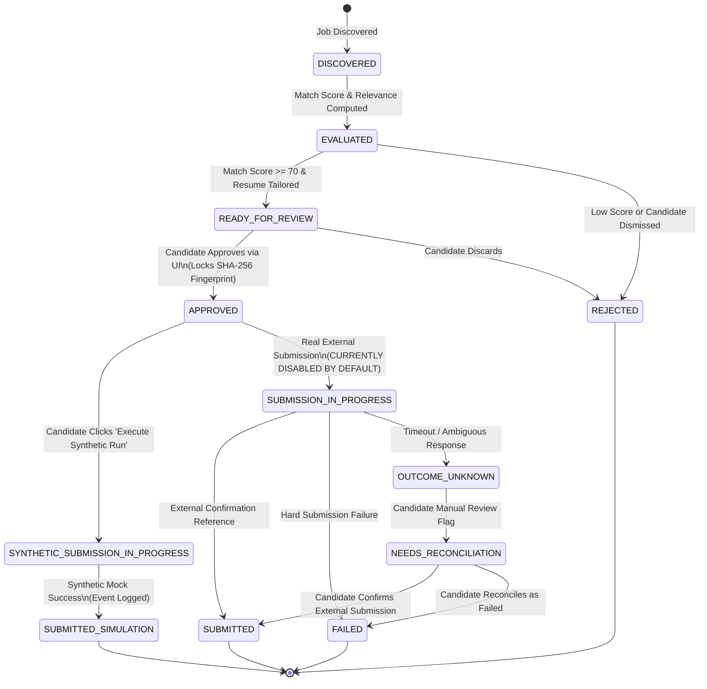
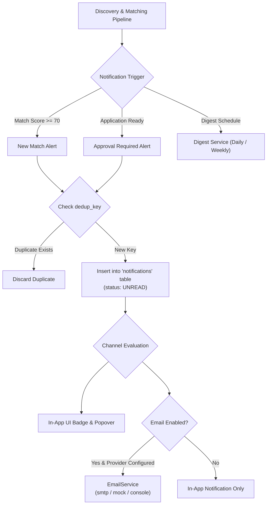

# 06 — Application Workflow, State Machine & Notifications

## 1. Application Lifecycle State Machine

**Sources**: [`backend/app/workflow/state_machine.py`](file:///c:/Users/imaka/Desktop/Desk/PROJECTS/JobPilot_AI/job_finder/backend/app/workflow/state_machine.py), [`backend/app/workflow/approval_fingerprint.py`](file:///c:/Users/imaka/Desktop/Desk/PROJECTS/JobPilot_AI/job_finder/backend/app/workflow/approval_fingerprint.py), [`backend/app/models/enums.py`](file:///c:/Users/imaka/Desktop/Desk/PROJECTS/JobPilot_AI/job_finder/backend/app/models/enums.py)

Every candidate job application is managed as a formal finite state machine with strict transition rules and immutable event auditing.

### Complete State Definitions (`ApplicationStatus`)
1. **`DISCOVERED`**: Initial state when a raw job requisition is ingested from an external source or manual import.
2. **`EVALUATED`**: Relevance score and deterministic matching scores have been computed.
3. **`READY_FOR_REVIEW`**: Candidate is eligible, match score is high ($\ge 70$), and tailored resume PDF is generated. Awaiting human decision.
4. **`APPROVED`**: Candidate has reviewed the job details and tailored resume, locking the application with a cryptographic approval fingerprint.
5. **`REJECTED`**: Candidate dismissed the application, or job failed hard eligibility gates.
6. **`SYNTHETIC_SUBMISSION_IN_PROGRESS`**: Active execution in Local Synthetic Mode against the isolated simulation adapter.
7. **`SUBMISSION_IN_PROGRESS`**: Active execution against a real external portal (**Disabled**).
8. **`SUBMITTED_SIMULATION`**: Successfully completed simulated submission without contacting external boards.
9. **`SUBMITTED`**: Successfully confirmed real application submission with external confirmation reference.
10. **`FAILED`**: Explicit error during submission (e.g., portal validation rejection).
11. **`OUTCOME_UNKNOWN`**: Network disconnect or timeout occurred while waiting for confirmation; prevents blind re-submission.
12. **`NEEDS_RECONCILIATION`**: Flagged for manual candidate inspection following an ambiguous outcome.

---

## 2. Append-Only Event Auditing

**Model**: `ApplicationEvent` in [`backend/app/models/application.py`](file:///c:/Users/imaka/Desktop/Desk/PROJECTS/JobPilot_AI/job_finder/backend/app/models/application.py)

Every state transition is recorded in the `application_events` table:
- `id` (UUID): Unique event ID.
- `application_id` (FK): Target application.
- `from_status`, `to_status`: Exact lifecycle transition.
- `actor`: Initiator ("candidate", "system", "synthetic_runner").
- `payload` (JSON): Sanitized transition metadata, form values, and error traces.
- `created_at`: UTC timestamp.

The event log is strictly **append-only**. Events are never updated or deleted, providing a complete audit trail accessible via `GET /api/v1/applications/{id}/events` and displayed in the frontend `ApplicationHistoryDrawer`.

---

## 3. Cryptographic Approval Fingerprinting

**Source**: [`backend/app/workflow/approval_fingerprint.py`](file:///c:/Users/imaka/Desktop/Desk/PROJECTS/JobPilot_AI/job_finder/backend/app/workflow/approval_fingerprint.py)

To prevent the **Stale Approval Vulnerability** (where a candidate approves an application, but background processes modify the resume or job requisition before submission), JobPilot AI computes a deterministic canonical SHA-256 hash:

$$\text{Fingerprint} = \text{SHA-256} \left( \text{CanonicalJSON} \Big( \text{CandidateSnapshot}, \text{JobSnapshot}, \text{ResumeSHA256}, \text{PolicyVersion} \Big) \Big)$$

### Verification Rules:
1. When the candidate clicks **Approve Application**, the backend generates and records `approval_fingerprint` and sets `status = APPROVED`.
2. Before any submission attempt begins, `ApprovalFingerprintService.verify_approval()` recalculates the hash from live database records.
3. If any field diverges (e.g., candidate edits profile, resume file on disk is modified, job requirements change), the hash mismatches and execution raises `StaleApprovalError` (HTTP 409).
4. The application transitions to `NEEDS_RECONCILIATION`, requiring the candidate to re-review the updated facts.

---

## 4. Synthetic Simulation vs. Real External Submissions

### A. Local Synthetic Mode (Active & Supported)
- **Adapter**: `SyntheticSubmissionAdapter` in [`backend/app/automation/synthetic_adapter.py`](file:///c:/Users/imaka/Desktop/Desk/PROJECTS/JobPilot_AI/job_finder/backend/app/automation/synthetic_adapter.py)
- **Workflow**:
  `READY_FOR_REVIEW` $\rightarrow$ `APPROVED` $\rightarrow$ `SYNTHETIC_SUBMISSION_IN_PROGRESS` $\rightarrow$ `SUBMITTED_SIMULATION`.
- **Guarantees**:
  - The adapter does **not** make HTTP requests to the real job URL or external hosts.
  - Generates a simulated confirmation reference (e.g., `MOCK-SUB-xxxx-xxxx`) and records full timing diagnostics.
  - Allows full end-to-end testing of the UI, state machine, and audit logs without external side effects.

### B. Real External Submissions (Disabled by Safety Default)
- **Safety Setting**: `JOBPILOT_REAL_SUBMISSION_ENABLED = False` in [`backend/app/core/config.py`](file:///c:/Users/imaka/Desktop/Desk/PROJECTS/JobPilot_AI/job_finder/backend/app/core/config.py).
- **Startup Enforcement**: If configured to `True`, the backend startup validator (`Settings.validate_startup_configuration()`) emits a critical log and automatically resets the flag to `False`.
- **Behavior**: Any attempt to target an external URL while `JOBPILOT_REAL_SUBMISSION_ENABLED=False` is intercepted:
  - Generates a `submission_attempts` record with outcome **`BLOCKED_SAFETY`**.
  - Does **not** transmit candidate information to external networks.
- **Repository Proof**: No live browser automation or API submitter is mounted to apply to real job boards. Automated external application submission is **NOT operational** by design.

---

## 5. Notification Center & Digest Pipeline

**Sources**: [`backend/app/services/notification_service.py`](file:///c:/Users/imaka/Desktop/Desk/PROJECTS/JobPilot_AI/job_finder/backend/app/services/notification_service.py), [`backend/app/services/digest_service.py`](file:///c:/Users/imaka/Desktop/Desk/PROJECTS/JobPilot_AI/job_finder/backend/app/services/digest_service.py), [`backend/app/services/email_service.py`](file:///c:/Users/imaka/Desktop/Desk/PROJECTS/JobPilot_AI/job_finder/backend/app/services/email_service.py)

### Idempotency & Deduplication
Every notification is assigned a deterministic `dedup_key` (e.g., `job_match_{candidate_id}_{job_id}`, `app_approval_{application_id}`). Before inserting, `NotificationService` verifies whether an active notification with that key already exists, preventing duplicate alerts across recurring scheduler runs.

### Digest Delivery Architecture
- **Daily Digest**: Scheduled at `DIGEST_DAILY_TIME` (default `09:00` local time). Aggregates all new matches discovered in the preceding 24 hours.
- **Weekly Digest**: Scheduled on `DIGEST_WEEKLY_DAY` at `DIGEST_WEEKLY_TIME` (default Monday `09:00`). Summarizes top-scoring opportunities, pending review items, and application pipeline progress.
- **Email Service Providers**:
  - `"mock"`: In-memory simulation recording delivery history (default for development/testing).
  - `"console"`: Prints formatted HTML/text email content to application stdout.
  - `"smtp"`: Connects to real SMTP host using TLS/STARTTLS credentials configured in `.env`.

---

*Reference Document*: Proceed to [07_SETUP_AND_DEVELOPMENT_GUIDE.md](file:///c:/Users/imaka/Desktop/Desk/PROJECTS/JobPilot_AI/job_finder/docs/project-reference/07_SETUP_AND_DEVELOPMENT_GUIDE.md) for full setup instructions, commands, and local execution.
