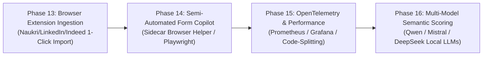

# 10 — Future Roadmap & Engineering Backlog

This document outlines a prioritized, actionable engineering roadmap for JobPilot AI when development resumes in the future. Each initiative builds directly upon the existing codebase without rewriting established architectural foundations.

---

## Roadmap Overview & Phases

---

## 1. High Priority (Phase 13) — One-Click Browser Extension Ingestion

### Problem
Naukri, LinkedIn, Instahyre, Cutshort, and Indeed are currently `MANUAL_IMPORT_ONLY`. While the email alert digest parser works well, manually copying and pasting JSON payloads from job boards into the web UI creates friction for candidates actively browsing jobs in Chrome/Brave/Firefox.

### Proposed Solution
Develop a lightweight, local browser extension (Manifest V3) that runs on the candidate's browser:
- Detects when the candidate is viewing an active job listing on `naukri.com`, `linkedin.com/jobs`, `instahyre.com`, `cutshort.io`, or `indeed.com`.
- Extracts structured DOM elements (Title, Company, Location, Description, Salary, Requirements).
- Submits the payload directly to the local JobPilot AI API: `POST http://127.0.0.1:8000/api/v1/jobs/sources/{identifier}/import`.

### Details
- **Priority**: **P1 (High)**
- **Dependencies**: Existing `POST /api/v1/jobs/sources/{identifier}/import` endpoint and schemas.
- **Affected Modules**:
  - `extension/` (New browser extension package)
  - `backend/app/api/v1/jobs.py` (Add CORS origin for extension runtime `chrome-extension://...`)
  - `backend/app/core/config.py` (Include extension origins in `CORS_ORIGINS`)
- **Acceptance Criteria**:
  1. Clicking the extension button on an active Naukri or LinkedIn job posting sends structured JSON to the local backend.
  2. The job appears immediately in `JobsList.tsx` with freshness status `ACTIVE` and calculated relevance score.
  3. No server-side headless scraping or anti-bot circumvention is required.

---

## 2. Medium Priority (Phase 14) — Human-Supervised Form Filling Copilot

### Problem
Candidates must manually fill out external application forms and upload resumes for live job boards because `JOBPILOT_REAL_SUBMISSION_ENABLED=False`.

### Proposed Solution
Rather than building an unmonitored "auto-apply bot" (which causes spam and account bans), implement a **Human-Supervised Form Copilot**:
- Launches a non-headless local Chromium browser instance via Playwright.
- Navigates to the external application URL from the approved application record.
- Prefills candidate contact fields (Name, Email, Phone, LinkedIn, GitHub, Experience).
- Auto-selects the tailored ATS resume PDF from `storage/resumes/{id}.pdf`.
- **Halts before submission button**: Prompts the candidate to review the prefilled form, solve any interactive CAPTCHA challenges, and click the final "Submit Application" button manually.
- Detects the confirmation page URL, captures a screenshot in `storage/screenshots/`, and transitions the application to `SUBMITTED`.

### Details
- **Priority**: **P2 (Medium)**
- **Dependencies**: Playwright runner in `backend/app/automation/browser_runner.py`, `form_mapper.py`.
- **Affected Modules**:
  - `backend/app/automation/browser_runner.py`
  - `backend/app/automation/form_mapper.py`
  - `backend/app/api/v1/applications.py`
  - `frontend/src/features/applications/ApplicationQueue.tsx`
- **Acceptance Criteria**:
  1. Candidate can click "Launch Supervised Apply" in the UI.
  2. Local visible browser opens and fills matching fields.
  3. Browser never submits automatically without human confirmation.
  4. Confirmation screenshot and reference are recorded in `submission_attempts`.

---

## 3. Medium Priority (Phase 15) — Frontend Code-Splitting & Telemetry

### Problem
Vite production build currently emits a 543 kB single monolithic JavaScript bundle (`dist/assets/index-CzAV7AfA.js`), triggering chunk-size warnings. System telemetry is stored in SQL tables without real-time metrics scraping.

### Proposed Solution
1. **Frontend Optimization**:
   - Configure dynamic imports (`React.lazy`) for heavy modal components (`ApplicationReviewModal`, `RankingEvaluationModal`, `DuplicateClustersModal`).
   - Configure `vite.config.ts` with `manualChunks` separating vendor packages (`react`, `lucide-react`, `axios`).
2. **Backend Telemetry**:
   - Add Prometheus `/metrics` endpoint using `prometheus-fastapi-instrumentator`.
   - Export counters for `jobs_discovered_total`, `matches_evaluated_total`, and `submissions_attempted_total`.

### Details
- **Priority**: **P2 (Medium)**
- **Dependencies**: `prometheus-fastapi-instrumentator` package.
- **Affected Modules**:
  - `frontend/vite.config.ts`
  - `frontend/src/app/router.tsx`
  - `backend/app/main.py`
  - `backend/requirements.txt`
- **Acceptance Criteria**:
  1. Frontend chunk size drops below 250 kB per bundle.
  2. `GET /metrics` returns standard Prometheus formatted counters.

---

## 4. Low Priority (Phase 16) — Multi-Model Local LLM Evaluation

### Problem
Semantic scoring currently targets a hardcoded Ollama model string (`llama3.1:latest`). Different candidates have different hardware capacities (Apple Silicon, NVIDIA RTX, CPU-only).

### Proposed Solution
- Add configurable model selection in `CandidateProfileView` or `SearchPreferencesCard`:
  - `qwen2.5-coder:7b` (High code comprehension)
  - `mistral:7b` (General reasoning)
  - `phi3:mini` (Low-resource CPU environments)
- Allow candidates to benchmark and choose their preferred local model.

### Details
- **Priority**: **P3 (Low)**
- **Dependencies**: Local Ollama server.
- **Affected Modules**:
  - `backend/app/providers/ollama.py`
  - `backend/app/core/config.py`
  - `frontend/src/features/profile/SearchPreferencesCard.tsx`
- **Acceptance Criteria**:
  1. Candidate can select active LLM model from dropdown in UI.
  2. Semantic scoring executes successfully across supported open-source models.

---

*Reference Document*: Proceed to [11_GIT_HISTORY_AND_RELEASE_NOTES.md](file:///c:/Users/imaka/Desktop/Desk/PROJECTS/JobPilot_AI/job_finder/docs/project-reference/11_GIT_HISTORY_AND_RELEASE_NOTES.md) for commit history and milestones.

