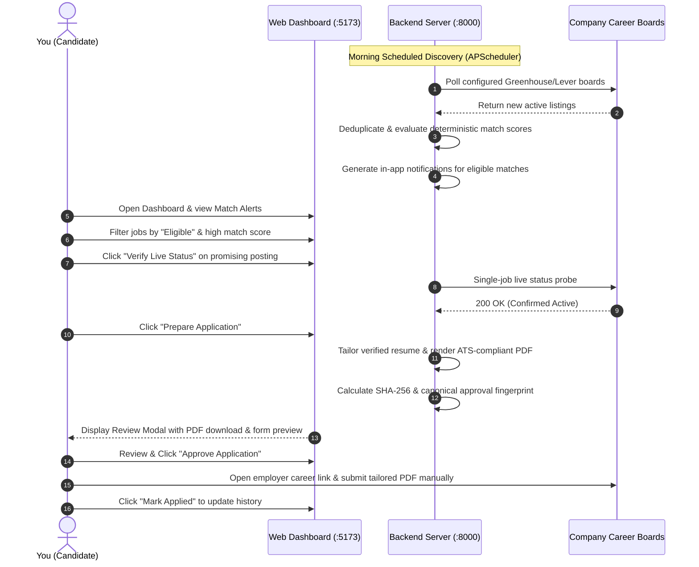

# JobPilot AI — Application Overview

Welcome to **JobPilot AI**, a local-first, privacy-preserving, personal AI job-search copilot designed to streamline and safeguard your job hunt.

---

## 1. What is JobPilot AI?

JobPilot AI is an autonomous, locally hosted job-search assistant that runs on your personal computer. Unlike commercial job platforms or cloud-based AI tools that upload your private resume to remote servers and blast generic applications across the internet, JobPilot AI operates strictly under your control:
- **Local-First & Private**: Your verified profile facts, career history, match evaluations, generated resumes, and application records stay on your local disk (`storage/jobpilot.db` and `storage/resumes`).
- **Factually Grounded**: Employs a strict **Zero-Hallucination Policy**. Resumes are tailored to highlight relevant skills and accomplishments without ever inventing qualifications, companies, or dates.
- **Explainable Matching**: Deterministic, audit-friendly evaluation rules determine whether you meet mandatory job requirements, accompanied by a weighted, transparent match breakdown.
- **Human-in-the-Loop Safety**: Real external submissions are disabled by default (`JOBPILOT_REAL_SUBMISSION_ENABLED=False`). The software prepares submission packages and generates cryptographic approval fingerprints, requiring your explicit human confirmation before any application state progresses.

---

## 2. What Problem Does It Solve?

Job hunting in the modern tech ecosystem is plagued by structural inefficiencies:
1. **Aggregator Noise & Phantom Jobs**: Public job boards are flooded with duplicate postings, outdated requisitions, and multi-agency spam that waste candidates' time.
2. **ATS Keyword Gaming vs. Integrity**: Automated Applicant Tracking Systems (ATS) filter resumes using keyword parsers. Candidates either spend hours tailoring resumes manually or use generative AI tools that hallucinate technologies they have never used, risking interview embarrassment.
3. **Opaque Job Matching**: Job sites recommend roles based on proprietary advertising budgets or black-box embeddings without explaining why a job is considered a match or whether you satisfy hard constraints (such as citizenship or location).
4. **Accidental Submissions & Data Sprawl**: Cloud job bots blast poorly formatted resumes across arbitrary employer portals without human review, burning bridges with recruiters and exposing private contact data.

JobPilot AI solves these challenges by combining public-board discovery, local deterministic ranking, fact-grounded resume compilation, and strict approval barriers.

---

## 3. Who is the Intended User?

JobPilot AI is designed for:
- **Software Engineers, Data Professionals, and Knowledge Workers**: Job seekers who value data privacy, desire clean ATS-parseable resumes, and want an organized, daily triage workflow.
- **Local-First Advocates**: Users who prefer running their tooling locally using Python, React, and local AI (Ollama) rather than handing personal career history to third-party subscription cloud agents.
- **Single-User Personal Desktop Operation**: The application is tailored for a single candidate managing their personal career journey on a workstation or laptop.

---

## 4. Main Objectives

1. **Continuous Targeted Discovery**: Fetch live job postings directly from authorized company career portals (Greenhouse, Lever) and clean fixtures without web scraping or CAPTCHA bypasses.
2. **Deterministic Eligibility**: Enforce hard rules (work authorization, location, remote compatibility, mandatory skills) so you never waste time reviewing jobs you cannot legally or physically accept.
3. **Transparent, Multi-Signal Scoring**: Produce explainable match scores (0–100) detailing positive contributions, missing keywords, and freshness warnings under Scoring Policy 1.1.0.
4. **Truthful Resume Tailoring**: Automatically generate single-column, ATS-parseable PDF resumes that re-order verified candidate facts and target role keywords without fabricating a single detail.
5. **Immutable Application Archival**: Track every prepared application with bit-for-bit SHA-256 PDF integrity verification, append-only lifecycle events, and outcome reconciliation.

---

## 5. What Tasks Can It Automate?

JobPilot AI automates high-volume, repetitive background tasks:
- **Scheduled & Manual Job Discovery**: Periodically polls configured Greenhouse and Lever boards, as well as synthetic offline test fixtures.
- **Listing Normalization**: Cleans HTML tags, extracts structured salaries, normalizes remote types (Remote, Hybrid, On-Site), and parses publication dates.
- **Cross-Source Deduplication Clustering**: Identifies duplicate listings across different boards without merging distinct vacancies in different physical cities.
- **Automated Eligibility & Weighted Scoring**: Automatically scores every newly discovered listing against your verified candidate profile.
- **Live Status Verification Probes**: Directly queries employer APIs to confirm whether an active posting remains open or has closed (HTTP 404).
- **In-App & Email Notifications**: Generates persistent in-app notifications and optional local daily/weekly email digests for newly discovered eligible matches.
- **Resume Tailoring & PDF Compilation**: Matches target job keywords with your verified profile facts and renders single-column ReportLab PDFs.
- **SHA-256 Checksumming**: Computes cryptographic hashes of all generated resumes to guarantee file integrity.
- **Process Crash Recovery**: Automatically cleans up orphaned background tasks on restart.

---

## 6. What Tasks Require Your Manual Involvement?

To maintain 100% human accountability, JobPilot AI strictly delegates critical decisions to you:
1. **Initial Profile & Skill Verification**: Entering your accurate career history, education, and marking verified skills.
2. **Source Selection**: Deciding which company board tokens to follow (e.g. `canonical`, `stripe`).
3. **Candidate Relevance Feedback**: Rating listings as `RELEVANT`, `NOT_RELEVANT`, `ALREADY_APPLIED`, or `NOT_INTERESTED` to tune ranking.
4. **Duplicate Confirmation/Dismissal**: Reviewing suspected duplicate clusters when ambiguous.
5. **Application Review & Approval**: Reviewing prepared form data and granting cryptographic approval with canonical SHA-256 fingerprints.
6. **Final Application Submission**: Performing the actual submission on the employer's official website.
7. **Outcome Reconciliation**: Updating application records when you are invited to interview, receive an offer, or receive a rejection.

---

## 7. What a Typical Day of Using JobPilot AI Looks Like

1. **Morning Review (5 mins)**: Open `http://localhost:5173`. Check the **Dashboard Overview** to see new jobs discovered overnight by the background scheduler.
2. **Triage & Filter (10 mins)**: Navigate to **Jobs & Matching**. Filter by `Eligible` and sort by `Score`. Inspect score breakdowns, matched required skills, and positive/negative contributions.
3. **Verify Freshness (1 min)**: Click **Verify Live Status** on a top job to ensure the employer hasn't unlisted the role.
4. **Generate Tailored Resume (2 mins)**: Click **Prepare Application**. JobPilot AI matches job keywords against your verified profile facts, creates an ATS-compliant PDF, verifies its text extractability, and calculates its SHA-256 checksum.
5. **Review & Approve (3 mins)**: In **Application Queue**, review the prepared form data and click **Approve Application**.
6. **Submit to Employer (5 mins)**: Click the job's official canonical URL, upload your downloaded tailored PDF, complete any employer-specific questions, and submit.
7. **Record History (1 min)**: In JobPilot AI, click **Reconcile Status** → **Mark as Submitted** to preserve an immutable audit trail.

---

## 8. Current Limitations

Understanding the operational boundaries of the software ensures safe, effective usage:
- **No Direct Real-World External Submission**: `JOBPILOT_REAL_SUBMISSION_ENABLED=False` is enforced in application code. The tool does not submit web forms to real employer websites.
- **Public Read-Only API Integration Only**: Job discovery only supports public boards (Greenhouse, Lever) with known employer board tokens, plus synthetic test fixtures. Arbitrary job portals (LinkedIn, Indeed, Workday) that require logins, sessions, or CAPTCHA solving are **not supported**.
- **Single-User Architecture**: Built for local desktop use. There is no multi-tenant user authentication or team role separation.
- **In-Memory Scheduler Concurrency**: The background scheduler uses APScheduler within a single process. Running multi-process worker pools (e.g. `gunicorn -w 4`) requires designating a single scheduler worker.
- **Static Evaluation Benchmarks**: Offline recommendation metrics (Recall@3 = 0.60, NDCG@5 = 0.9178) reflect static benchmark fixtures and do not represent long-term personalized production volumes.

---

## 9. What Can It Do Today vs. What It Cannot Do

| Capability | Supported Today | Not Supported / Blocked by Design |
| :--- | :---: | :---: |
| Poll public Greenhouse job boards by board token | **YES** | Search arbitrary websites without API/board token |
| Poll public Lever job postings by site token | **YES** | Scrape LinkedIn, Indeed, or private job boards |
| Offline testing via synthetic job fixtures | **YES** | Auto-submit applications to real employers |
| Deterministic citizenship & location filtering | **YES** | Override hard disqualifications with high scores |
| Single-column ATS-compliant PDF resume generation | **YES** | Multi-column, fancy graphics, or non-standard fonts |
| Zero-hallucination factual consistency validation | **YES** | Inventing skills or experience not in profile |
| Bit-for-bit SHA-256 PDF integrity checking | **YES** | Mutating historical resume versions |
| Cryptographic canonical approval fingerprints | **YES** | Submitting applications without human review |
| In-app notification center & mark-read lifecycle | **YES** | Guaranteed inbox delivery for simulated emails |
| Single-job live active/closed probe verification | **YES** | Bypassing Cloudflare, CAPTCHAs, or MFA |
| Local background discovery via APScheduler | **YES** | Distributed multi-node scheduler clusters |

---

## 10. How Is It Different from Manually Searching Job Websites?

| Workflow Aspect | Manual Job Searching | Using JobPilot AI |
| :--- | :--- | :--- |
| **Discovery** | Opening 20 browser tabs daily; sifting through duplicate and expired listings. | Background polling of configured company boards; deduplication and staleness evaluation automated. |
| **Eligibility** | Reading walls of text to find visa/citizenship or remote restrictions. | Deterministic pre-filter instantly marks jobs as `ELIGIBLE`, `NEEDS_REVIEW`, or `DISQUALIFIED`. |
| **Scoring** | Subjective estimation of whether a job matches your skills. | Explainable 0–100 score detailing positive contributions, missing skills, and bonuses. |
| **Resume Tailoring** | Manually copying and editing Word docs; risk of typos and ATS formatting errors. | Automated ReportLab generation emphasizing verified skills; guaranteed zero hallucination. |
| **Record Keeping** | Messy spreadsheets with broken links and lost resume versions. | Immutable database records linking exact job descriptions, tailored resume PDFs, SHA-256 hashes, and submission timestamps. |
| **Privacy** | Uploading full resumes to aggregators that sell candidate contact data. | 100% local database storage and local AI inference; zero cloud telemetry. |

---

## Real-World Example: Finding a Senior Backend Role

1. **Setup**: You add `canonical` as a Greenhouse board token in **Scheduler & Discovery Sources**.
2. **Discovery**: You click **Trigger Discovery Run**. JobPilot AI pulls 314 live listings from Canonical's public board.
3. **Filtering**: The matching engine flags 311 jobs as disqualified (location mismatch, non-technical roles, or missing required technologies) and highlights 3 eligible backend roles.
4. **Review**: The top match is *"Senior Python Backend Engineer"* (Score: 93.5). The explanation shows +40% for verified Python, FastAPI, and PostgreSQL skills, +20% for title relevance, and +10% for remote alignment.
5. **Tailoring**: You click **Prepare Application**. In 2 seconds, JobPilot AI renders a clean, single-column PDF containing your verified achievements, verifies the PDF text extractability, and stores it with SHA-256 checksum `8c49e8f...`.
6. **Approval & Submission**: You review the form preview, click **Approve**, copy your contact details, download the tailored PDF, and submit it on Canonical's official portal.
7. **Tracking**: You click **Mark as Submitted**. JobPilot AI saves the timestamp, resume version, and status in your immutable application history.

