# JobPilot AI — System Limitations & Future Roadmap

This document outlines the operational boundaries, technical constraints, prerequisite user configurations, external dependencies, and planned enhancements for JobPilot AI.

To ensure transparency, limitations are categorized into four distinct classes:
- **Category A**: Current Architectural & Technical Limitations
- **Category B**: User Configuration & Data Prerequisites
- **Category C**: External Live Dependencies & Environmental Behaviors
- **Category D**: Future Product Roadmap & Enhancements

---

## Category A: Current Architectural & Technical Limitations

These constraints are deliberate design choices or boundaries of the current implementation (Phases 0–12):

### 1. Automated External Job Submissions Are Disabled
- **Status**: **Hard-locked by design** (`JOBPILOT_REAL_SUBMISSION_ENABLED=False`).
- **Explanation**: JobPilot AI does not submit job applications directly to real employer ATS systems (such as `boards.greenhouse.io` or `jobs.lever.co`).
- **Why**: Real automated external submissions present severe legal, compliance, reputation, and security risks (including bot challenges, TOS violations, duplicate application bans, and accidental bad data submissions).
- **Current Behavior**: The system prepares complete application packets, validates ATS-compliant tailored resumes, and provides one-click links so the candidate can submit directly in their browser.

### 2. Single-Process APScheduler Architecture
- **Status**: Implemented with in-process `asyncio` task scheduling.
- **Limitation**: APScheduler runs inside the single Uvicorn backend process. It does not use distributed coordination (such as Redis locks or Celery beat).
- **Consequence**: Running multiple backend processes (e.g. `uvicorn --workers 4`) will trigger duplicate scheduled discovery runs. The system is designed for single-process local execution.

### 3. Local-First SQLite Database
- **Status**: `storage/jobpilot.db` using SQLite + aiosqlite.
- **Limitation**: SQLite supports high concurrency for reads, but serializes writes. Under heavy parallel load (e.g. multi-user cloud SaaS), SQLite may experience `database is locked` errors.
- **Consequence**: The application is intended for single-user personal job search on a local workstation. Multi-tenant deployment requires migrating to PostgreSQL.

### 4. Public ATS Job Boards Only
- **Status**: Supported adapters cover Greenhouse and Lever public API endpoints.
- **Limitation**: The system does not scrape login-protected job boards (LinkedIn, Indeed, ZipRecruiter) or proprietary corporate portals (Workday, Taleo, iCIMS).
- **Why**: Scraping login-walled portals requires account credential storage, bypasses terms of service, and frequently breaks due to anti-bot measures.

### 5. Single-Column ATS Resume Typography
- **Status**: ReportLab linear flowable rendering.
- **Limitation**: The resume generator deliberately produces single-column, clean, unadorned PDF documents. It does not generate multi-column, graphical, or creative layout templates.
- **Why**: Multi-column resumes and complex graphical tables frequently cause parsing failures in enterprise Applicant Tracking Systems (Workday, Greenhouse, Taleo).

### 6. Ranking Metric Dataset Distribution Bounds
- **Status**: Verified in regression test suite (`Recall@3 = 0.6000`, `NDCG@5 = 0.9178`).
- **Limitation**: In the 12-item benchmark dataset, 5 jobs have ground-truth relevance $\ge 2.0$. By mathematical definition:
  $$\text{Recall@3} = \frac{|\text{Relevant items in top 3}|}{5} \le \frac{3}{5} = \mathbf{0.6000}$$
- **Explanation**: Recall@3 can never reach 1.0000 on this benchmark dataset because 3 retrieved slots cannot contain 5 relevant items. The ranking engine operates at the maximum possible theoretical bound.

### 7. Sandboxed Browser Automation Scope
- **Status**: Playwright runner restricted to local test environments (`http://127.0.0.1:*` or `http://localhost:*`).
- **Limitation**: Browser automation is strictly for end-to-end regression testing against the built-in mock application portal. It cannot be pointed at external URLs.

---

## Category B: User Configuration & Data Prerequisites

The following items are not automated by the application and require candidate action:

| Prerequisite | Why It Is Required | Where to Configure |
| :--- | :--- | :--- |
| **Verified Candidate Facts** | Zero-hallucination policy prevents the resume generator from inventing skills or past jobs. | `/profile` (Profile tab) |
| **Legal Work Authorization** | Deterministic eligibility engine requires accurate visa/citizenship status to filter postings. | `/profile` (Basic Info) |
| **Company Board Identifiers** | The discovery pipeline requires company board slugs (e.g. `canonical`, `leverdemo`) to fetch jobs. | `/scheduler` (Discovery Sources) |
| **SMTP Email Credentials** | Email alerts and digests remain disabled until SMTP server details and an app password are provided. | Settings modal (TopBar gear icon) |
| **Local Ollama Daemon** | Offline AI bullet-point tailoring requires Ollama running on `localhost:11434` (otherwise falls back to rule-based engine). | External terminal: `ollama serve` |

---

## Category C: External Live Dependencies & Environmental Behaviors

The system interacts with external network environments where behavior cannot be guaranteed by local code:

1. **Company ATS Board Availability & Structure**:
   - Company boards may be shut down, renamed, or migrated to other ATS providers without notice.
   - If a company transitions from Greenhouse to Workday, the Greenhouse adapter will return HTTP 404.
2. **Public Network Latency & Rate Limits**:
   - Certain ATS endpoints may enforce IP-based rate limiting or Cloudflare shields during high discovery volume.
   - Adapters enforce a 25.0s timeout to mitigate slow network responses.
3. **Email Deliverability**:
   - Outgoing digests sent via personal SMTP accounts (e.g. Gmail) may be categorized into spam or promotions tabs by email clients.
4. **External Application Form Changes**:
   - Job boards frequently add custom questionnaire fields (e.g. diversity surveys, legal attestations). Because automated submission is disabled, the candidate handles these directly on the official employer website.

---

## Category D: Future Product Roadmap & Enhancements

Planned future enhancements for upcoming phases:

```mermaid
flowchart LR
    subgraph Near_Term ["Near-Term Enhancements"]
        A1[Additional ATS Adapters: Ashby & Workday Public]
        A2[Chrome Browser Extension for 1-Click Form Autofill]
        A3[Expanded Skill Ontology & Synonym Registry]
    end

    subgraph Mid_Term ["Mid-Term Enhancements"]
        B1[PostgreSQL Migration & Docker Compose Deployment]
        B2[Redis Distributed Task Queue for Celery / APScheduler]
        B3[Interactive Interview Preparation Assistant]
    end

    subgraph Long_Term ["Long-Term Enhancements"]
        C1[Multi-Candidate Support for Recruiters & Coaches]
        C2[Salary Negotiation & Total Compensation Modeler]
        C3[Automated Email Ingestion for Status Updates]
    end

    Near_Term --> Mid_Term
    Mid_Term --> Long_Term
```

### 1. Near-Term Roadmap
- **Ashby & Workday Public Adapters**: Expand ingestion to modern venture-backed startups using Ashby (`jobs.ashbyhq.com`) and public Workday career sites.
- **Companion Chrome Extension**: A lightweight browser extension that reads approved application packets from local JobPilot AI and autofills fields on external employer job portals with one click, preserving human sign-off without violating anti-bot policies.
- **Expanded Skill Registry**: Broader ontology mapping technology synonyms (e.g. `K8s` $\leftrightarrow$ `Kubernetes`, `Postgres` $\leftrightarrow$ `PostgreSQL`, `React.js` $\leftrightarrow$ `React`).

### 2. Mid-Term Roadmap
- **PostgreSQL & Docker Packaging**: Provide `docker-compose.yml` deploying FastAPI, PostgreSQL, and Vite frontend as containerized microservices.
- **Redis Distributed Scheduler**: Decouple scheduler execution from the web process to enable multi-worker scaling.
- **Interview Preparation Assistant**: Generate customized technical and behavioral interview preparation guides for any job based on candidate profile experience gaps and company history.

### 3. Long-Term Roadmap
- **Email Inbox Sync**: IMAP / Gmail OAuth integration to parse recruiter interview invitations and rejection emails automatically, updating application outcomes without manual user entry.
- **Salary Negotiation Modeler**: Benchmark offered compensation against Levels.fyi and H1B salary databases to suggest counter-offer strategies.

