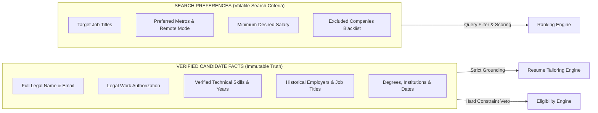
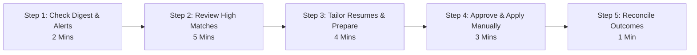

# JobPilot AI — Setup, Configuration & Daily Operations Guide

This guide provides instructions for setting up JobPilot AI, configuring candidate profiles, managing discovery sources, scheduling automated runs, and operating the system in a daily job search. It covers:
- **Part 5**: Candidate Profile and Resume Setup
- **Part 6**: Job Discovery and Source Configuration
- **Part 10**: Notifications, Digest Delivery, and Automation Scheduling
- **Part 12**: Installation, Configuration, and Daily Operations Guide

---

## Table of Contents

1. [Prerequisites & System Requirements](#prerequisites--system-requirements)
2. [Part 12 — Installation & Initial Environment Setup](#part-12--installation--initial-environment-setup)
   - [Step 1: Clone Repository & Directory Structure](#step-1-clone-repository--directory-structure)
   - [Step 2: Python Virtual Environment & Backend Dependencies](#step-2-python-virtual-environment--backend-dependencies)
   - [Step 3: Database Migrations (`alembic upgrade head`)](#step-3-database-migrations-alembic-upgrade-head)
   - [Step 4: Frontend Dependencies & Production Build](#step-4-frontend-dependencies--production-build)
   - [Step 5: Environment File Configuration (`.env`)](#step-5-environment-file-configuration-env)
   - [Step 6: Starting Backend and Frontend](#step-6-starting-backend-and-frontend)
   - [Step 7: Verification & Health Check Endpoints](#step-7-verification--health-check-endpoints)
3. [Part 5 — Candidate Profile & Resume Setup](#part-5--candidate-profile--resume-setup)
   - [Candidate Facts vs Search Preferences](#candidate-facts-vs-search-preferences)
   - [Importing Master Resume](#importing-master-resume)
   - [Verifying Technical Skills](#verifying-technical-skills)
   - [Configuring Work Experience & Achievements](#configuring-work-experience--achievements)
   - [Configuring Target Roles, Locations & Remote Preferences](#configuring-target-roles-locations--remote-preferences)
   - [Configuring Company Exclusions (Blacklist)](#configuring-company-exclusions-blacklist)
   - [Pre-Discovery Verification Checklist](#pre-discovery-verification-checklist)
4. [Part 6 — Job Discovery & Source Configuration](#part-6--job-discovery--source-configuration)
   - [Supported Source Adapters](#supported-source-adapters)
   - [Adding a Supported Company Board](#adding-a-supported-company-board)
   - [Running On-Demand Discovery](#running-on-demand-discovery)
   - [Deduplication & Clustering Inspection](#deduplication--clustering-inspection)
   - [Live Freshness Verification](#live-freshness-verification)
5. [Part 10 — Notifications, Digest Delivery, and Automation Scheduling](#part-10--notifications-digest-delivery-and-automation-scheduling)
   - [Configuring In-App Notifications](#configuring-in-app-notifications)
   - [Configuring Email Notifications & SMTP](#configuring-email-notifications--smtp)
   - [Daily & Weekly Digests](#daily--weekly-digests)
   - [Configuring APScheduler Background Automation](#configuring-apscheduler-background-automation)
   - [Multi-Process Constraint: Single-Scheduler Rule](#multi-process-constraint-single-scheduler-rule)
   - [Scheduler Failure Recovery](#scheduler-failure-recovery)
6. [Daily Operations: The 15-Minute Job-Search Routine](#daily-operations-the-15-minute-job-search-routine)
7. [Safe Shutdown, Restart & Backup Procedures](#safe-shutdown-restart--backup-procedures)

---

## Prerequisites & System Requirements

Before installing JobPilot AI, ensure your system meets these prerequisites:

| Component | Minimum Version | Recommended | Notes |
| :--- | :--- | :--- | :--- |
| **Operating System** | Windows 10/11, macOS 12+, Ubuntu 22.04+ | Windows 11 / Ubuntu 22.04 | Tested and verified on Windows 11 PowerShell |
| **Python** | 3.11+ | Python 3.12 | Requires virtual environment (`backend/.venv`) |
| **Node.js** | 18.x LTS | Node 20+ LTS | Package manager: `npm` |
| **Database** | SQLite 3.35+ | SQLite bundled with Python | Stored locally in `storage/jobpilot.db` |
| **AI LLM (Optional)** | Ollama 0.1.30+ | `llama3.1:latest` | Runs on `http://localhost:11434` for offline tailoring |

---

## Part 12 — Installation & Initial Environment Setup

### Step 1: Clone Repository & Directory Structure
```powershell
# Open terminal (PowerShell on Windows or bash on Unix)
cd path/to/jobpilot-ai
```

### Step 2: Python Virtual Environment & Backend Dependencies
```powershell
# Create virtual environment inside backend/ directory
python -m venv backend\.venv

# Activate virtual environment
# Windows PowerShell:
.\backend\.venv\Scripts\Activate.ps1
# Linux / macOS:
# source backend/.venv/bin/activate

# Upgrade pip and install wheel
python -m pip install --upgrade pip setuptools wheel

# Install all backend requirements
pip install -r backend\requirements.txt
```

### Step 3: Database Migrations (`alembic upgrade head`)
Apply database migrations to create the local SQLite schema:
```powershell
# Run migrations using the active virtual environment
python -m alembic upgrade head
```
Expected output:
```text
INFO  [alembic.runtime.migration] Context impl SQLiteImpl.
INFO  [alembic.runtime.migration] Will assume non-transactional DDL.
INFO  [alembic.runtime.migration] Running upgrade  -> e145f6789abc, head migration
```

### Step 4: Frontend Dependencies & Production Build
```powershell
# Navigate to frontend directory
cd frontend

# Install npm packages
npm install

# Run TypeScript type check and production build test
npm run build
```
Expected output:
```text
✓ built in 2.31s
```
Return to the project root:
```powershell
cd ..
```

### Step 5: Environment File Configuration (`.env`)
Create or edit `.env` in the project root:
```ini
# Application Server Settings
ENVIRONMENT=development
APP_HOST=127.0.0.1
APP_PORT=8000
LOG_LEVEL=INFO
SECRET_KEY=jobpilot-local-dev-secret-key-change-for-prod

# Database
DATABASE_URL=sqlite+aiosqlite:///storage/jobpilot.db
DATABASE_SYNC_URL=sqlite:///storage/jobpilot.db

# Safety Boundaries (CRITICAL: MUST REMAIN FALSE)
JOBPILOT_REAL_SUBMISSION_ENABLED=False
REQUIRE_HUMAN_APPROVAL_BEFORE_SUBMISSION=True

# AI Configuration (Local Ollama)
DEFAULT_AI_PROVIDER=ollama
OLLAMA_BASE_URL=http://localhost:11434
OLLAMA_MODEL=llama3.1:latest

# Scheduler Configuration
SCHEDULER_ENABLED=False
DISCOVERY_INTERVAL_MINUTES=240
MATCH_NOTIFICATION_THRESHOLD=70

# Email Notifications (Optional - disabled by default)
EMAIL_NOTIFICATIONS_ENABLED=False
EMAIL_PROVIDER=mock
EMAIL_HOST=localhost
EMAIL_PORT=587
EMAIL_USE_TLS=True
EMAIL_FROM=alerts@jobpilot.local
EMAIL_TO=user@example.com

# Timezone & Digest Schedule
TIMEZONE=UTC
DIGEST_DAILY_TIME=09:00
DIGEST_WEEKLY_DAY=mon
DIGEST_WEEKLY_TIME=09:00
```

### Step 6: Starting Backend and Frontend

JobPilot AI includes an auto-delegating root launcher that detects `backend/.venv` automatically.

**Terminal 1 — Start Backend Server**:
```powershell
python run.py
```
Expected output:
```text
[JobPilot Launcher] Using virtualenv Python: ...\backend\.venv\Scripts\python.exe
INFO:     Started server process [23504]
INFO:     Waiting for application startup.
INFO:     JobPilot AI initialized. Database: storage/jobpilot.db
INFO:     Uvicorn running on http://127.0.0.1:8000 (Press CTRL+C to quit)
```

**Terminal 2 — Start Frontend Server**:
```powershell
cd frontend
npm run dev
```
Expected output:
```text
  VITE v5.4.19  ready in 220 ms

  ➜  Local:   http://localhost:5173/
  ➜  Network: use --host to expose
```

### Step 7: Verification & Health Check Endpoints

Open your web browser and verify these URLs:

| Service / View | URL | Expected Response |
| :--- | :--- | :--- |
| **API Root** | `http://127.0.0.1:8000/` | `{"app": "JobPilot AI", "status": "running", "docs": "/docs"}` |
| **Health Check** | `http://127.0.0.1:8000/health` | `{"status": "healthy", "database": "connected"}` |
| **Swagger UI** | `http://127.0.0.1:8000/docs` | Interactive OpenAPI documentation |
| **Frontend Web App** | `http://localhost:5173/` | JobPilot AI Dashboard |

---

## Part 5 — Candidate Profile & Resume Setup

### Candidate Facts vs Search Preferences

JobPilot AI enforces a strict architectural boundary between **Verified Candidate Facts** and **Search Preferences**:



- **Candidate Facts**: What is true about your background. Resumes can **never** include items not found here.
- **Search Preferences**: What roles you are looking for. Preferences affect query filters and match rankings, but cannot create resume claims.

### Importing Master Resume
1. Navigate to `/profile`.
2. Click **Import Resume**.
3. Drag and drop your master `.pdf` or `.docx` resume.
4. Select **Merge with Existing** or **Replace Entire Profile**.
5. Click **Upload & Parse**.
6. Review extracted contact details, employment history, and technical skills before saving.

### Verifying Technical Skills
1. In the **Verified Skills** card on `/profile`, inspect extracted skills.
2. To add a skill:
   - Enter `Skill Name` (e.g. `FastAPI`).
   - Enter `Years of Experience` (e.g. `4`).
   - Select `Category` (`technical`, `cloud_devops`, `frontend`, `database`, `soft_skill`).
   - Click **Add Verified Skill**.
3. Green shield icons confirm that the skill is marked verified and eligible for inclusion in tailored resumes.

### Configuring Work Experience & Achievements
1. Review chronological entries under **Work Experience**.
2. Ensure each role contains:
   - Exact employer company name.
   - Exact job title.
   - Start and end dates (or "Present").
   - Action-oriented achievement bullets with quantified metrics.

### Configuring Target Roles, Locations & Remote Preferences
1. Click the **Preferences** tab on `/profile`.
2. Enter **Target Job Titles** separated by commas:
   `Senior Python Engineer, Backend Architect, Lead Platform Engineer`
3. Select **Work Mode Preference**:
   - `Fully Remote`: Disqualifies on-site roles outside your metro.
   - `Hybrid`: Matches hybrid and remote opportunities.
   - `All`: Matches any work arrangement.
4. Enter **Preferred Locations** (e.g. `London, UK` or `San Francisco, CA`).
5. Enter **Minimum Target Salary** (e.g. `110000`).

### Configuring Company Exclusions (Blacklist)
1. In the **Excluded Companies** field, list organizations you do not wish to apply to (e.g. current employer, companies with bad Glassdoor reviews):
   `Acme Corp, OldEmployer Inc, Unwanted Agency`
2. Any job discovered from these organizations will be marked `DISQUALIFIED` automatically.

### Pre-Discovery Verification Checklist
- [ ] Legal name, email, and phone number verified.
- [ ] Legal work authorization set accurately (`US_CITIZEN`, `GREEN_CARD`, `UK_CITIZEN`, `REQUIRES_SPONSORSHIP`).
- [ ] At least 5–10 core technical skills verified with accurate experience years.
- [ ] All previous employers, titles, and dates checked against official employment records.
- [ ] Target job titles entered.
- [ ] Minimum desired salary set.
- [ ] Excluded company list populated.

---

## Part 6 — Job Discovery & Source Configuration

### Supported Source Adapters

JobPilot AI integrates with ATS public job boards over standard HTTPS:

| Adapter | Source ID | Target ATS | Required Token / Identifier | Live Verified |
| :--- | :--- | :--- | :--- | :---: |
| **Greenhouse** | `greenhouse` | Greenhouse public boards | Board token (e.g. `canonical`, `gitlab`, `stripe`) | Yes |
| **Lever** | `lever` | Lever public job postings | Company board slug (e.g. `leverdemo`, `netflix`) | Yes |
| **Synthetic** | `synthetic` | Local test mock adapter | Configured count of randomized test postings | Yes |

### Adding a Supported Company Board
1. Navigate to `/scheduler`.
2. Locate the **Discovery Sources** card.
3. Select **Source Type** (`Greenhouse` or `Lever`).
4. Enter the public board token:
   - For `https://boards.greenhouse.io/canonical`, enter `canonical`.
   - For `https://jobs.lever.co/leverdemo`, enter `leverdemo`.
5. Click **Add Source**.
6. The source appears in the active adapters table with status toggle set to **Enabled**.

### Running On-Demand Discovery
1. Navigate to `/jobs`.
2. Click **Discover Jobs** (top right blue button).
3. Select an individual source (e.g. `Greenhouse - canonical`) or `All Active Sources`.
4. Click **Run Discovery**.
5. The live console displays progress:
   ```text
   [DISCOVERY] Connecting to Greenhouse board 'canonical'...
   [DISCOVERY] Ingested 314 raw postings.
   [NORMALIZATION] Sanitized HTML, normalized 314 jobs.
   [PERSISTENCE] Inserted 12 new jobs, updated 3 existing.
   ```

### Deduplication & Clustering Inspection
1. Click the **Duplicates** button on `/jobs`.
2. Inspect detected duplicate clusters.
3. The system highlights the primary canonical job posting.
4. If two distinct roles were clustered erroneously, click **Dismiss Cluster** to separate them.

### Live Freshness Verification
- Job freshness is tracked automatically via `last_seen_at`.
- When an active discovery run runs, any job no longer present on the company's public board has its status updated to `CONFIRMED_CLOSED`.
- Jobs closed on external boards are filtered out of daily digests.

---

## Part 10 — Notifications, Digest Delivery, and Automation Scheduling

### Configuring In-App Notifications
- In-app alerts are active by default.
- Alerts trigger when:
  - Discovery run finishes with new eligible jobs.
  - A job with Match Score $\ge 70\%$ is identified.
  - An application is waiting for human review.
  - A background error or failed adapter occurs.
- Open the Notification Center via the top-bar bell icon to review and dismiss alerts.

### Configuring Email Notifications & SMTP
To receive email digests and high-priority alerts:
1. Click the **Settings Gear** icon in the TopBar.
2. Toggle **Enable Email Notifications** to ON.
3. Configure your SMTP provider:
   - **Host**: `smtp.gmail.com` (or provider of choice).
   - **Port**: `587`.
   - **Username**: Your email address.
   - **Password**: Your SMTP app password.
   - **Use TLS**: Checked.
   - **Recipient Email**: Target destination inbox.
4. Click **Send Test Email** to verify the connection.
5. Click **Save Settings**.

### Daily & Weekly Digests
- **Daily Digest**:
  - Automatically compiles top eligible jobs discovered in the last 24 hours.
  - Delivered daily at `DIGEST_DAILY_TIME` (default: `09:00` local time).
  - Summarizes top matches, compensation, and required candidate actions.
- **Weekly Digest**:
  - Compiles weekly pipeline summary every `DIGEST_WEEKLY_DAY` (default: `mon` at `09:00`).
  - Summarizes total applications submitted, interview requests received, and new board activity.

### Configuring APScheduler Background Automation
1. Navigate to `/scheduler`.
2. Inspect the **Scheduler Status** card.
3. To alter discovery frequency, enter desired minutes in **Discovery Interval** (e.g. `120` for every 2 hours, `240` for every 4 hours).
4. Click **Save Interval**.
5. Click **Run Now** at any time to trigger an immediate discovery cycle.

### Multi-Process Constraint: Single-Scheduler Rule
> [!IMPORTANT]
> APScheduler runs as an in-process asynchronous daemon inside the FastAPI backend instance.
> **Constraint**: Do not run multiple worker processes (e.g. `uvicorn --workers 4`) without configuring external distributed locks (such as Redis). Running multiple Uvicorn worker processes will cause duplicate scheduled discovery runs. Keep workers set to 1 for personal local operation.

### Scheduler Failure Recovery
If an external ATS experiences downtime or network errors:
1. The scheduler captures the exception per-adapter without crashing the FastAPI process.
2. The failing source is marked `ERROR` in the Automation Run History.
3. The scheduler automatically rolls back uncommitted SQLite transactions cleanly.
4. The scheduler continues operating and executes the next scheduled run at the designated time.

---

## Daily Operations: The 15-Minute Job-Search Routine

Here is the recommended daily routine for personal job searching with JobPilot AI:



1. **Step 1: Check Digest & Notifications (2 minutes)**:
   - Open `http://localhost:5173/`.
   - Check the TopBar notification bell and read the daily morning digest.
2. **Step 2: Review New High Matches (5 minutes)**:
   - Navigate to `/jobs`.
   - Filter by `Eligibility: Eligible` and sort by highest match score.
   - Click top matches to review match explanations and missing skill breakdowns.
3. **Step 3: Tailor Resumes (4 minutes)**:
   - For promising jobs, click **Tailor Resume**.
   - Review ATS compliance checkmarks in `/resumes` and inspect the generated PDF.
4. **Step 4: Approve & Apply (3 minutes)**:
   - Navigate to `/applications`.
   - Click **Review Application**, verify attached resume version, and click **Approve Application**.
   - Click the external job link, upload the downloaded tailored PDF, submit on the company portal, and mark application as `SUBMITTED`.
5. **Step 5: Reconcile Outcomes (1 minute)**:
   - For any existing applications where you received email responses or interview requests, click **Update Outcome** to log the status change.

---

## Safe Shutdown, Restart & Backup Procedures

### Graceful Shutdown
1. In the backend terminal, press `CTRL + C`. Uvicorn will shut down the APScheduler daemon, close database connection pools, and exit cleanly.
2. In the frontend terminal, press `CTRL + C` to stop the Vite development server.

### Safe Restart
```powershell
# Start backend
python run.py

# In second terminal, start frontend
cd frontend
npm run dev
```

### Backup Procedures
All candidate data, match scores, application histories, and generated resumes reside in two local folders. To back up your entire JobPilot AI instance:
```powershell
# Create a timestamped backup directory
$backupDir = "storage_backup_$(Get-Date -Format 'yyyyMMdd_HHmmss')"
mkdir $backupDir

# Backup SQLite database
Copy-Item "storage\jobpilot.db" "$backupDir\"

# Backup generated PDF resumes
Copy-Item -Recurse "storage\resumes" "$backupDir\"
```

To restore:
Replace `storage/jobpilot.db` and the contents of `storage/resumes/` with your backed-up files and restart the backend server.

