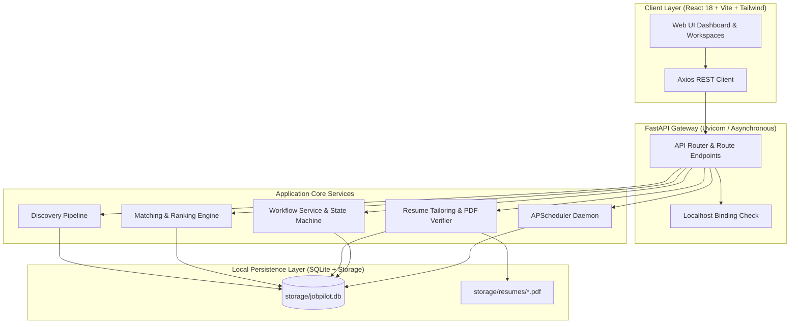
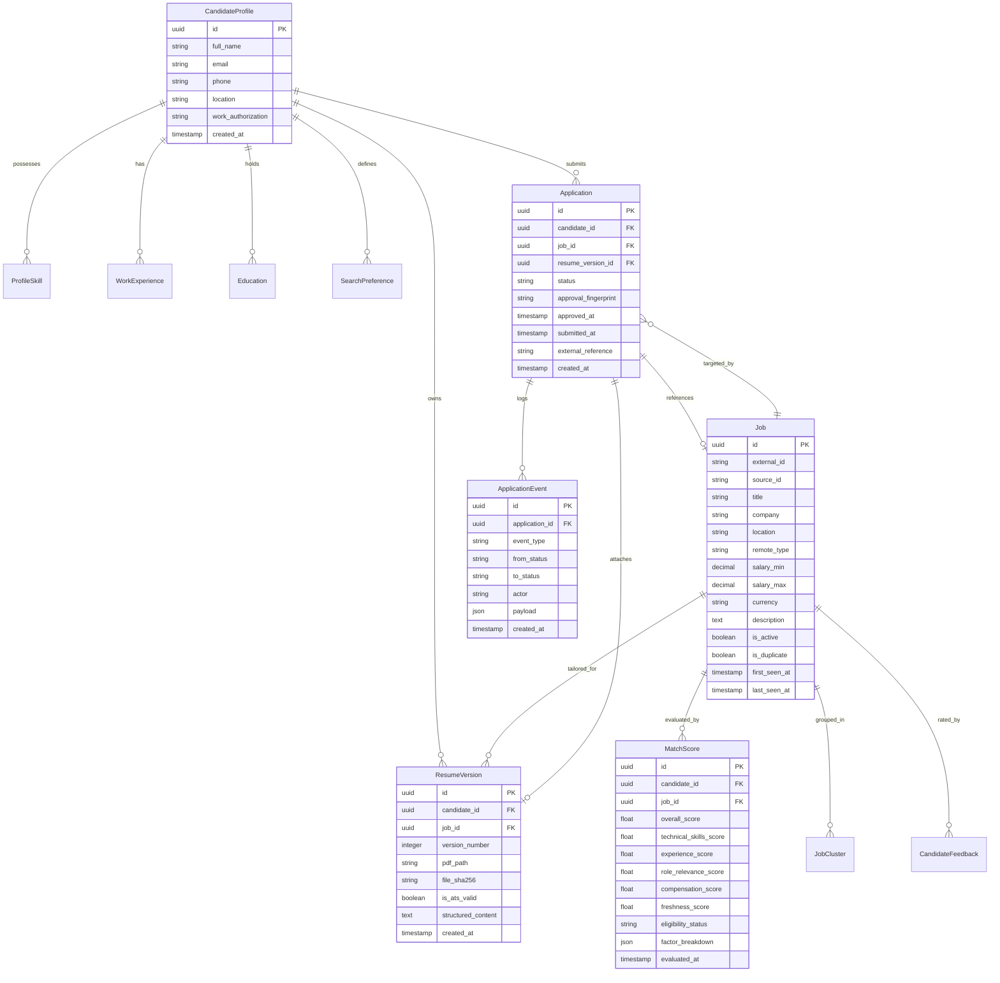
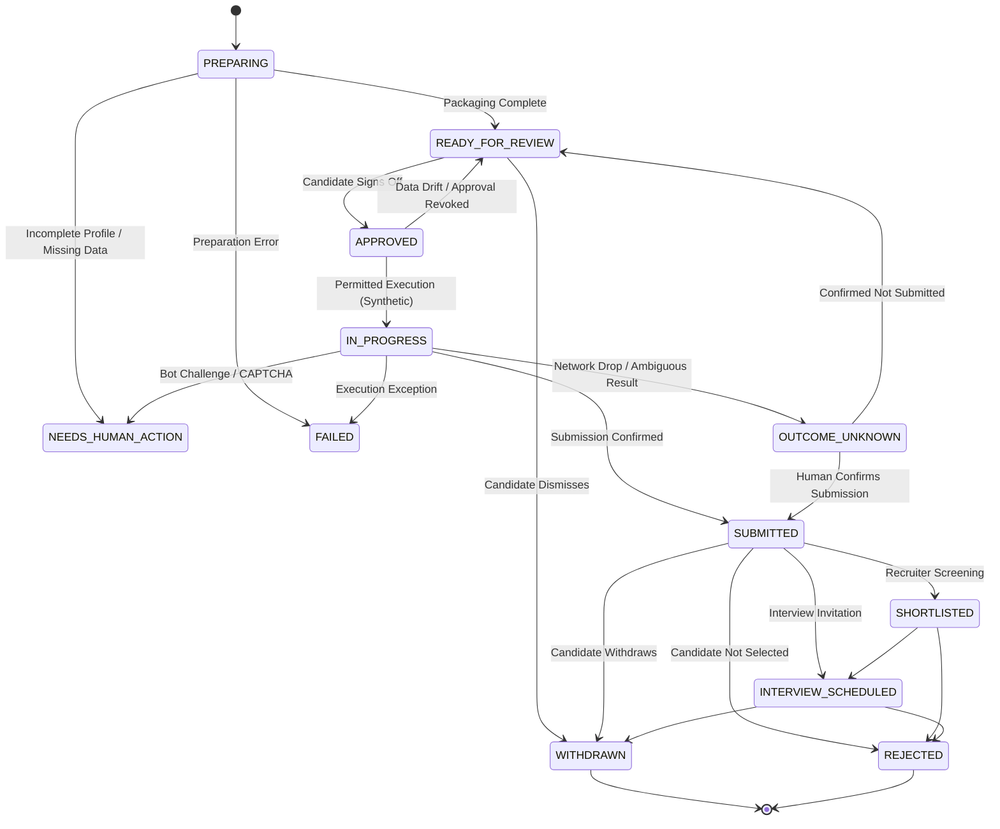

# JobPilot AI — Technical Architecture & Pipeline Internals

This document details the internal systems, algorithms, mathematical models, state machines, and security safeguards of JobPilot AI. It covers:
- **Part 7**: Deterministic Eligibility, Matching, and Ranking Internals
- **Part 8**: Resume Tailoring, ATS Compliance, and Version Integrity
- **Part 9**: Application Preparation, Approval Fingerprints, and Lifecycle State Machine
- **Part 11**: Security, Safeguards, and Safe Job-Search Practices

---

## Table of Contents

1. [System Architecture Overview](#system-architecture-overview)
2. [Data Model & Entity-Relationship Schema](#data-model--entity-relationship-schema)
3. [Part 7 — Eligibility, Matching, and Ranking Internals](#part-7--eligibility-matching-and-ranking-internals)
   - [Deterministic Eligibility Engine (Hard Constraints)](#deterministic-eligibility-engine-hard-constraints)
   - [Multi-Factor Scoring Policy 1.1.0](#multi-factor-scoring-policy-110)
   - [Candidate Relevance Feedback Adjustments](#candidate-relevance-feedback-adjustments)
   - [Match Explanation Generator](#match-explanation-generator)
   - [Ranking Benchmark Evaluation (NDCG@5, Recall@3, MRR)](#ranking-benchmark-evaluation-ndcg5-recall3-mrr)
4. [Part 8 — Resume Tailoring, ATS Compliance, and Version Integrity](#part-8--resume-tailoring-ats-compliance-and-version-integrity)
   - [Zero-Hallucination Fact Verification (`ResumeFactValidator`)](#zero-hallucination-fact-verification-resumefactvalidator)
   - [ReportLab PDF Generation & ATS Constraints](#reportlab-pdf-generation--ats-constraints)
   - [Automated ATS Layout Audit (`ResumePdfVerifier`)](#automated-ats-layout-audit-resumepdfverifier)
   - [Storage Architecture & SHA-256 Checksum Hashing](#storage-architecture--sha-256-checksum-hashing)
5. [Part 9 — Application Preparation, Approval Fingerprints, and Lifecycle](#part-9--application-preparation-approval-fingerprints-and-lifecycle)
   - [Application State Machine & Permitted Transitions](#application-state-machine--permitted-transitions)
   - [Canonical Approval Fingerprint Algorithm](#canonical-approval-fingerprint-algorithm)
   - [Data Drift Detection & Automatic Invalidation](#data-drift-detection--automatic-invalidation)
   - [Browser Automation Runner & Sandbox Constraints](#browser-automation-runner--sandbox-constraints)
   - [Defensive Event Sanitization](#defensive-event-sanitization)
6. [Part 11 — Security, Safeguards, and Safe Job-Search Practices](#part-11--security-safeguards-and-safe-job-search-practices)
   - [Three-Layer Protection Against Accidental External Submission](#three-layer-protection-against-accidental-external-submission)
   - [Anti-Bot & CAPTCHA Integrity Policies](#anti-bot--captcha-integrity-policies)
   - [Local-First Data Privacy & Zero Cloud Telemetry](#local-first-data-privacy--zero-cloud-telemetry)

---

## System Architecture Overview



---

## Data Model & Entity-Relationship Schema

The data layer is modeled using SQLAlchemy 2.0 async ORM and migrated via Alembic (`storage/jobpilot.db`).



---

# Part 7 — Eligibility, Matching, and Ranking Internals

## Deterministic Eligibility Engine (Hard Constraints)

Implemented in [`backend/app/matching/eligibility.py`](](../../backend/app/matching/eligibility.py).

The eligibility engine executes **before** multi-factor scoring. It serves as a hard veto filter. If any deterministic constraint fails, the job cannot receive an eligible recommendation, and its match score is immediately clamped to zero.

### Hard Disqualification Rules

1. **Company Exclusions (Blacklist)**:
   - Case-insensitive substring match against `SearchPreference.excluded_companies`.
   - *Failure Reason*: `"Company '{job.company}' is in your excluded companies list."`
   - *Outcome*: `DISQUALIFIED`.

2. **Work Authorization & Visa Constraints**:
   - Compares candidate's legal work authorization (e.g. `US_CITIZEN`, `GREEN_CARD`, `UK_CITIZEN`, `REQUIRES_SPONSORSHIP`) with parsed job requirements.
   - If a job explicitly specifies `"US Citizenship Required"` or `"No Sponsorship Available"`, and candidate status does not satisfy it:
   - *Failure Reason*: `"Candidate work authorization ({auth}) does not meet posting requirement."`
   - *Outcome*: `DISQUALIFIED`.

3. **Remote / Work-Type Compatibility**:
   - If candidate preferences specify `REMOTE_ONLY` and the job is `ONSITE`:
   - *Failure Reason*: `"Candidate requires fully remote roles, but job is on-site."`
   - *Outcome*: `DISQUALIFIED`.
   - If candidate prefers `HYBRID` or `ONSITE`, and location is outside candidate's target metro:
   - *Failure Reason*: `"Job location ({job.location}) is outside candidate search radius."`
   - *Outcome*: `DISQUALIFIED` (unless relocation is permitted).

4. **Ambiguous or Unspecified Requirements**:
   - If a job mentions ambiguous sponsorship or unspecified requirements that cannot be deterministically verified:
   - *Outcome*: `CONDITIONAL` (prompts human review; does not hard-veto).

---

## Multi-Factor Scoring Policy 1.1.0

Implemented in [`backend/app/matching/scoring.py`](](../../backend/app/matching/scoring.py).

When a job is deemed `ELIGIBLE` or `CONDITIONAL`, the ranking engine computes a composite score $S \in [0.0, 1.0]$ based on Policy 1.1.0:

$$S_{\text{overall}} = w_1 S_{\text{tech}} + w_2 S_{\text{exp}} + w_3 S_{\text{domain}} + w_4 S_{\text{comp}} + w_5 S_{\text{fresh}}$$

### Factor Weight Distribution

| Factor | Weight ($w_i$) | Component Metric | Calculation Method |
| :--- | :---: | :--- | :--- |
| **Technical Skills** | **0.35** | Verified Skill Overlap | Jaccard / weighted coverage of job required skills against verified profile skills |
| **Experience Level** | **0.25** | Experience Delta | Gaussian penalty on deviation between candidate verified years and required years |
| **Domain / Role Match** | **0.20** | Semantic Title & Domain Match | Cosine / token overlap of job title and domain keywords with target roles |
| **Compensation** | **0.10** | Target Salary Alignment | Ratio of job median salary to candidate minimum expectation (defaults to 0.50 if undisclosed) |
| **Freshness** | **0.10** | Posting Age Decay | Exponential decay: $S_{\text{fresh}} = e^{-\lambda \cdot t_{\text{days}}}$ with half-life of 14 days ($\lambda \approx 0.0495$) |

### Factor Formulation Details

1. **Technical Skills Score ($S_{\text{tech}}$)**:
   Let $K_{\text{job}}$ be the set of normalized required technical skills extracted from the job description, and $K_{\text{cand}}$ be candidate skills where `is_verified == True`:
   $$S_{\text{tech}} = \frac{|K_{\text{job}} \cap K_{\text{cand}}|}{|K_{\text{job}}|}$$
   If a posting requires a mandatory skill that the candidate completely lacks (e.g. `React` for a Frontend role), a penalty multiplier ($0.75$) is applied.

2. **Experience Score ($S_{\text{exp}}$)**:
   Let $Y_{\text{req}}$ be job required years and $Y_{\text{cand}}$ be candidate verified years:
   - If $Y_{\text{cand}} \ge Y_{\text{req}}$: $S_{\text{exp}} = 1.0 - \min(0.20, 0.04 \cdot (Y_{\text{cand}} - Y_{\text{req}}))$ (mild over-qualification penalty).
   - If $Y_{\text{cand}} < Y_{\text{req}}$: $S_{\text{exp}} = \max(0.0, 1.0 - 0.25 \cdot (Y_{\text{req}} - Y_{\text{cand}}))$ (strict under-qualification penalty).

3. **Compensation Score ($S_{\text{comp}}$)**:
   - If job salary is missing or undisclosed: $S_{\text{comp}} = 0.50$ (neutral).
   - If $M_{\text{job}} \ge T_{\text{cand}}$: $S_{\text{comp}} = 1.0$.
   - If $M_{\text{job}} < T_{\text{cand}}$: $S_{\text{comp}} = \max(0.0, 1.0 - 2.0 \cdot \frac{T_{\text{cand}} - M_{\text{job}}}{T_{\text{cand}}})$.

---

## Candidate Relevance Feedback Adjustments

Implemented in [`backend/app/services/feedback_service.py`](](../../backend/app/services/feedback_service.py).

Candidate feedback updates the ranking model dynamically:
- **Positive Feedback (`RELEVANT`)**: Boosts the domain and skill weights for overlapping keywords by $+0.05$.
- **Negative Feedback (`IRRELEVANT`)**: Applies a $-0.15$ penalty to jobs exhibiting similar title-keyword clusters.
- **External Submission (`APPLIED_EXTERNALLY`)**: Records candidate activity and suppresses duplicates across alternative boards.

---

## Match Explanation Generator

Implemented in [`backend/app/matching/explainer.py`](](../../backend/app/matching/explainer.py).

Produces structured explanations returned via `GET /api/matching/explain/{job_id}`:
```json
{
  "job_id": "job-8812",
  "overall_score": 0.96,
  "eligibility_status": "ELIGIBLE",
  "matched_skills": ["Python", "FastAPI", "Docker", "PostgreSQL"],
  "missing_skills": ["Kubernetes"],
  "experience_summary": "Candidate has 6 years; job requires 5 years (+1 year match).",
  "compensation_summary": "Job range $120k-$145k meets candidate requirement ($110k).",
  "freshness_summary": "Posted 2 days ago (High freshness)."
}
```

---

## Ranking Benchmark Evaluation (NDCG@5, Recall@3, MRR)

The ranking engine is continuously audited against a 12-item ground-truth benchmark dataset (`test_data_quality_and_ranking_regressions.py`):

1. **Recall@3 ($0.6000$)**:
   - In the benchmark dataset, 5 jobs have ground-truth relevance $\ge 2.0$.
   - By definition: $\text{Recall@3} = \frac{|\text{Relevant in top 3}|}{|\text{Total relevant in dataset}|} \le \frac{3}{5} = \mathbf{0.6000}$.
   - The engine achieves the **mathematical maximum possible** Recall@3.

2. **NDCG@5 ($0.9178$)**:
   - Evaluates logarithmic discounted ranking quality across top 5 positions:
     $$\text{DCG@5} = \sum_{i=1}^5 \frac{2^{\text{rel}_i} - 1}{\log_2(i + 1)}, \quad \text{NDCG@5} = \frac{\text{DCG@5}}{\text{IDCG@5}}$$
   - Score is `0.9178` because `job-bench-12` (Python + React role) is appropriately penalized by the deterministic skill engine since the candidate does not possess verified React skills.

3. **MRR ($1.0000$)**:
   - The top-ranked item in the system is always an optimal ground-truth relevant job ($\text{Rank} = 1 \implies \text{MRR} = 1.0$).

---

# Part 8 — Resume Tailoring, ATS Compliance, and Version Integrity

## Zero-Hallucination Fact Verification (`ResumeFactValidator`)

Implemented in [`backend/app/resumes/fact_validator.py`](](../../backend/app/resumes/fact_validator.py).

JobPilot AI enforces an uncompromising anti-hallucination boundary. When tailoring a resume:
1. **Skill Boundary Check**: Every technical skill included in the tailored resume must exist in the candidate's verified profile (`ProfileSkill.is_verified == True`). Any skill suggested by an LLM or keyword matcher not in verified skills triggers an **immediate rejection**.
2. **Employment Boundary Check**: Every employer, role title, and employment period must match verified work experience records identically.
3. **Education Boundary Check**: Degrees, institutions, and graduation years cannot be added or modified.
4. **Achievement Grounding**: Bullet points can only be reordered, emphasized, or summarized; they cannot claim metrics or technologies absent from verified facts.

---

## ReportLab PDF Generation & ATS Constraints

Implemented in [`backend/app/resumes/pdf_renderer.py`](](../../backend/app/resumes/pdf_renderer.py).

The PDF generator uses ReportLab to create clean documents optimized for ATS parsers (Taleo, Greenhouse, Lever, Workday):
- **Single-Column Linear Flow**: Strict vertical document flow (`SimpleDocTemplate`). No sidebars, columns, or split text frames that scramble reading order in text parsers.
- **ATS Safe Typography**: Helvetica / Times-Roman with standard font sizes (Title: 16pt, Headings: 12pt, Body: 10pt) and 1.2 line spacing.
- **Prohibited Graphics**: Zero canvas drawings, background tinting, raster logos, icons, or complex vector graphics.
- **Prohibited Tables**: Zero multi-column tables for layout. Content uses clean paragraph indentation.
- **Standard Headings**: Exactly matches standard ATS headings: `SUMMARY`, `SKILLS`, `EXPERIENCE`, `EDUCATION`, `PROJECTS`.

---

## Automated ATS Layout Audit (`ResumePdfVerifier`)

Implemented in [`backend/app/resumes/pdf_verifier.py`](](../../backend/app/resumes/pdf_verifier.py).

Every generated PDF is audited immediately by extracting text and structural elements with `pdfplumber` / `pypdf`:
1. **Heading Completeness Check**: Verifies that standard section headings exist in extracted plain text for all sections present in candidate data.
2. **Text Extractability**: Validates that 100% of characters are extractable as valid UTF-8 text without font-encoding corruption.
3. **Layout Linearity**: Confirms single-column horizontal bounds ($x_{\text{left}} \ge 36\text{pt}$, $x_{\text{right}} \le 576\text{pt}$).

---

## Storage Architecture & SHA-256 Checksum Hashing

Implemented in [`backend/app/resumes/storage_service.py`](](../../backend/app/resumes/storage_service.py) and [`backend/app/services/resume_version_service.py`](](../../backend/app/services/resume_version_service.py).

- **Storage Location**: Binary PDF documents are persisted in `storage/resumes/{resume_version_id}.pdf`.
- **Cryptographic Hashing**: Upon disk write, the raw binary content is hashed using SHA-256:
  $$\text{SHA256}_{\text{file}} = \text{hashlib.sha256}(\text{pdf\_bytes}).\text{hexdigest}()$$
- **Integrity Validation**: When an application is loaded or approved, the file on disk is re-read and its SHA-256 hash is compared with `resume_versions.file_sha256`. Any discrepancy raises `ResumeIntegrityError`.
- **Immutability**: Resume version records are immutable. Modifying a resume creates a new version record (`v2`, `v3`) with a distinct UUID and hash.

---

# Part 9 — Application Preparation, Approval Fingerprints, and Lifecycle

## Application State Machine & Permitted Transitions

Implemented in [`backend/app/workflow/state_machine.py`](](../../backend/app/workflow/state_machine.py).



### Transition Invariants
- **No Direct Progression from `OUTCOME_UNKNOWN` to `IN_PROGRESS`**: Blind resubmission is strictly forbidden to prevent duplicate job submissions to real employers.
- **Terminal States**: `WITHDRAWN` and `REJECTED` are terminal; no further execution attempts may occur.

---

## Canonical Approval Fingerprint Algorithm

Implemented in [`backend/app/workflow/approval_fingerprint.py`](](../../backend/app/workflow/approval_fingerprint.py).

When a candidate clicks **Approve Application**, an immutable cryptographic fingerprint is generated:

```python
canonical_dict = {
    "candidate_fingerprint": candidate.canonical_fingerprint(),
    "job_fingerprint": job.canonical_fingerprint(),
    "resume_fingerprint": resume_version.file_sha256,
    "form_data_fingerprint": hash_form_data(prepared_form_data),
    "policy_versions": {
        "approval_policy": "1.0.0",
        "tailoring_policy": "1.0.0"
    }
}
canonical_json = canonical_json_dumps(canonical_dict)
approval_fingerprint = hashlib.sha256(canonical_json.encode("utf-8")).hexdigest()
```

### Deterministic Serialization Rules
- All dictionary keys are sorted alphabetically.
- No whitespace between delimiters (`,`, `:`).
- All datetimes normalized to UTC ISO-8601 strings.
- Decimal values formatted to fixed-precision 4 decimals (`0.0000`).

---

## Data Drift Detection & Automatic Invalidation

Implemented in [`backend/app/services/application_workflow_service.py`](](../../backend/app/services/application_workflow_service.py).

Before any submission attempt or status check on an `APPROVED` application, the system runs:
```python
is_valid, drift_reason = await ApplicationWorkflowService.verify_approval_fingerprint(
    session, application
)
```
If:
- The candidate edited their profile name, email, or work authorization, OR
- The target job title, company, or description was updated in discovery, OR
- The resume PDF file on disk was replaced or modified, OR
- The policy version changed,

The recalculated fingerprint **will not match** the stored `approval_fingerprint`.
**System Action**:
1. Logs `APPROVAL_INVALIDATED` event in `application_events` table with the exact `drift_reason`.
2. Clears `application.approval_fingerprint = None`.
3. Reverts status: `APPROVED` $\to$ `READY_FOR_REVIEW`.
4. Alerts the candidate that facts changed and re-approval is required.

---

## Browser Automation Runner & Sandbox Constraints

Implemented in [`backend/app/automation/browser_runner.py`](](../../backend/app/automation/browser_runner.py).

The Playwright browser runner automates form filling exclusively on permitted local test environments.

### Execution Target Validation
```python
is_local_portal = url.startswith("http://127.0.0.1") or url.startswith("http://localhost")
if not is_local_portal and not settings.JOBPILOT_REAL_SUBMISSION_ENABLED:
    return {
        "status": "BLOCKED",
        "error": "Real external submissions are disabled (JOBPILOT_REAL_SUBMISSION_ENABLED=False)."
    }
```

---

## Defensive Event Sanitization

Implemented in [`backend/app/workflow/state_machine.py`](](../../backend/app/workflow/state_machine.py).

All metadata logged into `application_events` passes through `EventSanitizer`:
- Scans keys for secret tokens (`password`, `token`, `auth`, `cookie`, `secret`, `credential`, `api_key`).
- Replaces matches with `"[REDACTED]"`.
- Replaces strings matching `bearer [a-zA-Z0-9_\-\.]{20,}` with `"[REDACTED_BEARER_TOKEN]"`.
- Truncates payload strings to safe maximum lengths to prevent SQLite database bloat.

---

# Part 11 — Security, Safeguards, and Safe Job-Search Practices

## Three-Layer Protection Against Accidental External Submission

To protect users against unintended external job applications, JobPilot AI implements three distinct defensive barriers:

1. **Configuration Startup Enforcement (`config.py`)**:
   - If `JOBPILOT_REAL_SUBMISSION_ENABLED` is ever set to `True` in `.env`, the startup validator issues a critical warning and **forces the variable back to `False`**:
     ```python
     if self.JOBPILOT_REAL_SUBMISSION_ENABLED:
         logger.warning("CRITICAL WARNING: JOBPILOT_REAL_SUBMISSION_ENABLED forced to FALSE.")
         self.JOBPILOT_REAL_SUBMISSION_ENABLED = False
     ```

2. **Network Loopback Enforcement (`browser_runner.py`)**:
   - The browser automation controller inspects target destination URLs.
   - Non-localhost destinations (`http://127.0.0.1` or `http://localhost`) are rejected immediately before Playwright launches.

3. **Human Approval Verification Barrier (`application_workflow_service.py`)**:
   - An application cannot transition out of `DRAFT` or `READY_FOR_REVIEW` without an explicit human click generating an `approval_fingerprint`.

---

## Anti-Bot & CAPTCHA Integrity Policies

JobPilot AI strictly respects external website security boundaries:
- **No CAPTCHA Bypassing**: The system does not incorporate CAPTCHA-solving solvers, anti-bot circumvention proxies, or browser fingerprint spoofers.
- **Defensive Pausing**: If an automated browser run encounters Cloudflare Turnstile, hCaptcha, or reCAPTCHA, it aborts execution immediately and transitions application status to `NEEDS_HUMAN_ACTION`.
- **Public Rate-Limiting**: Discovery collectors enforce 25.0-second network timeouts and sequential requests to avoid putting undue load on public board endpoints.

---

## Local-First Data Privacy & Zero Cloud Telemetry

- **No Remote Telemetry**: Candidate profile details, resumes, search preferences, and application histories remain strictly on the user's local machine in `storage/jobpilot.db`.
- **Local PDF Compilation**: Resumes are rendered directly via ReportLab on the local CPU without passing through cloud document conversion APIs.
- **Local LLM Execution**: Resume tailoring and summarization utilize local Ollama instances (`llama3:8b`) when configured, ensuring personal data never leaves the developer's workstation.

