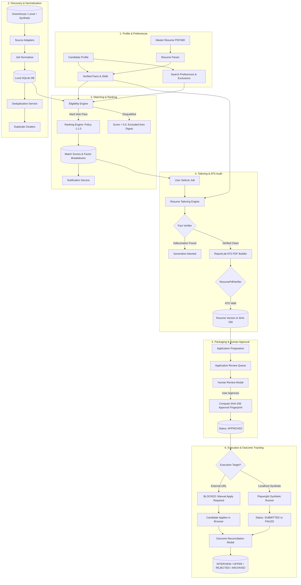

# JobPilot AI — Complete User Manual & End-to-End Workflow

This document provides a comprehensive operational manual and end-to-end data flow guide for JobPilot AI. It covers both the internal architectural path of jobs through the system (Part 3) and an exhaustive screen-by-screen, click-by-click manual for the entire web interface (Part 4).

---

## Table of Contents

1. [Part 3 — Complete End-to-End Workflow](#part-3--complete-end-to-end-workflow)
   - [Architectural Data Flow Overview](#architectural-data-flow-overview)
   - [Mermaid Sequence & State Flowchart](#mermaid-sequence--state-flowchart)
   - [Stage-by-Stage Deep Dive (19 Stages)](#stage-by-stage-deep-dive-19-stages)
   - [Walkthrough Example: A Real Job from Ingestion to Offer](#walkthrough-example-a-real-job-from-ingestion-to-offer)
   - [Safety Boundaries: Permitted vs Blocked Execution](#safety-boundaries-permitted-vs-blocked-execution)
2. [Part 4 — Screen-by-Screen User Guide](#part-4--screen-by-screen-user-guide)
   - [Screen 1: Global Layout & Navigation](#screen-1-global-layout--navigation)
   - [Screen 2: Dashboard Overview](#screen-2-dashboard-overview)
   - [Screen 3: Job Discovery & Feed](#screen-3-job-discovery--feed)
   - [Screen 4: Job Detail Modal](#screen-4-job-detail-modal)
   - [Screen 5: Job Discovery Modal](#screen-5-job-discovery-modal)
   - [Screen 6: Duplicate Clusters Modal](#screen-6-duplicate-clusters-modal)
   - [Screen 7: Ranking Evaluation Modal](#screen-7-ranking-evaluation-modal)
   - [Screen 8: Candidate Profile & Search Preferences](#screen-8-candidate-profile--search-preferences)
   - [Screen 9: Master Resume Import Modal](#screen-9-master-resume-import-modal)
   - [Screen 10: Resume Workspace & Integrity Inspector](#screen-10-resume-workspace--integrity-inspector)
   - [Screen 11: Application Queue](#screen-11-application-queue)
   - [Screen 12: Application Review & Approval Modal](#screen-12-application-review--approval-modal)
   - [Screen 13: Application History Drawer](#screen-13-application-history-drawer)
   - [Screen 14: Outcome Reconciliation Modal](#screen-14-outcome-reconciliation-modal)
   - [Screen 15: Scheduler & Automation Manager](#screen-15-scheduler--automation-manager)
   - [Screen 16: Notification Center & Digest Drawer](#screen-16-notification-center--digest-drawer)
   - [Screen 17: Notification Settings Modal](#screen-17-notification-settings-modal)

---

# Part 3 — Complete End-to-End Workflow

## Architectural Data Flow Overview

JobPilot AI operates on a pipeline where unstructured external market data is ingested, normalized, deduplicated, evaluated against hard factual candidate constraints, scored by a multi-factor ranking engine, tailored into ATS-compliant documents, packaged for human review, and tracked through its application lifecycle.

At every stage, strict safety boundaries ensure:
1. **Zero Hallucination**: Resume generation cannot invent skills or work history not present in the verified candidate profile.
2. **Deterministic Veto**: Hard disqualification criteria (work authorization, location, remote mismatch, excluded companies) immediately set eligibility to `DISQUALIFIED` and zero out match scores.
3. **Mandatory Human-in-the-Loop**: External real-world job submissions are blocked at both software and network layers (`JOBPILOT_REAL_SUBMISSION_ENABLED=False`). Only synthetic local test portals may execute automated submissions.

---

## Mermaid Sequence & State Flowchart

---

## Stage-by-Stage Deep Dive (19 Stages)

### Stage 1: Candidate Profile Setup & Master Resume Import
- **Trigger**: User opens Profile page or uploads a resume document.
- **Frontend Component**: [`CandidateProfileView.tsx`](](../../frontend/src/features/profile/CandidateProfileView.tsx) and [`ResumeImportModal.tsx`](](../../frontend/src/features/profile/ResumeImportModal.tsx).
- **API Endpoint**: `POST /api/profile/import-resume` or `PUT /api/profile`.
- **Backend Service**: [`MasterResumeParser`](](../../backend/app/resumes/parser.py) & `ProfileService`.
- **Data Read/Written**: Reads uploaded file or JSON payload; writes to `candidate_profiles`, `profile_skills`, `work_experiences`, `educations`, and `projects` tables.
- **Result Returned**: Parsed candidate profile JSON with verified skills, dates, and employers.
- **Failure Handling**: Parsing errors display in red alert box; user can manually input or correct extracted data.
- **UI State**: Profile tabs display verified technical skills with green shield badges, employment timeline cards, and work authorization status.

### Stage 2: Job Source Configuration
- **Trigger**: User navigates to Scheduler & Sources or clicks "Add Source".
- **Frontend Component**: [`DiscoverySourcesCard.tsx`](](../../frontend/src/features/scheduler/DiscoverySourcesCard.tsx).
- **API Endpoint**: `POST /api/scheduler/sources` and `GET /api/scheduler/sources`.
- **Backend Service**: [`DiscoveryPipeline`](](../../backend/app/services/discovery_pipeline.py).
- **Data Read/Written**: Writes to `discovery_sources` table (`source_type`, `board_token`, `enabled`, `fetch_interval_minutes`).
- **Result Returned**: Created source configuration object with active toggle state.
- **Failure Handling**: Duplicate source tokens return HTTP 400 with "Source already exists".
- **UI State**: Source card lists active adapters with toggle switches, health indicators, and last-run timestamps.

### Stage 3: Job Discovery & Ingestion
- **Trigger**: APScheduler background timer or manual click on "Discover Jobs" / "Run Discovery".
- **Frontend Component**: [`JobDiscoveryModal.tsx`](](../../frontend/src/features/jobs/JobDiscoveryModal.tsx) or [`SchedulerManager.tsx`](](../../frontend/src/features/scheduler/SchedulerManager.tsx).
- **API Endpoint**: `POST /api/jobs/discover` or `POST /api/scheduler/trigger`.
- **Backend Service**: [`GreenhouseJobAdapter`](](../../backend/app/collectors/greenhouse.py), [`LeverJobAdapter`](](../../backend/app/collectors/lever.py), [`SyntheticJobAdapter`](](../../backend/app/collectors/synthetic.py).
- **Data Read/Written**: Reads external ATS public APIs over HTTPX (25.0s timeout); writes raw job postings into `automation_runs` and temporary collector buffers.
- **Result Returned**: `AutomationRun` record summary: `{ "jobs_fetched": 45, "jobs_added": 12, "jobs_updated": 3 }`.
- **Failure Handling**: Network timeouts or board 404s log error to run log, execute session rollback cleanly without breaking other sources, and mark the run as `FAILED` or `PARTIALLY_FAILED`.
- **UI State**: Progress spinner, followed by a toast alert showing total jobs fetched, new jobs added, and updated postings.

### Stage 4: Job Normalization & Field Sanitization
- **Trigger**: Automatic execution within discovery pipeline upon receiving raw external items.
- **Frontend Component**: None (backend background execution).
- **API Endpoint**: Internal service call.
- **Backend Service**: [`JobNormalizer`](](../../backend/app/services/job_normalizer.py).
- **Data Read/Written**: Raw HTML/JSON payloads parsed; HTML tags stripped, remote types classified (`REMOTE`, `HYBRID`, `ONSITE`), compensation parsed into min/max numeric values, ISO country/city codes extracted.
- **Result Returned**: Standardized `NormalizedJob` schema instance.
- **Failure Handling**: Malformed postings are quarantined or skipped with debug warnings logged in `automation_runs.logs`.
- **UI State**: Transparent to UI; clean plain-text descriptions appear in job listings.

### Stage 5: Database Persistence & Change Detection
- **Trigger**: Pipeline persistence phase.
- **Frontend Component**: None.
- **API Endpoint**: Internal service call.
- **Backend Service**: [`JobPersistenceService`](](../../backend/app/services/job_persistence_service.py).
- **Data Read/Written**: Upserts records into `jobs` table matching on `(source_id, external_id)`. Updates `first_seen_at`, `last_seen_at`, and `status`.
- **Result Returned**: Count of newly inserted vs existing updated rows.
- **Failure Handling**: Transactional rollback ensures database consistency on constraint violation.
- **UI State**: Updated job counts reflected in Dashboard metric cards.

### Stage 6: Job Deduplication & Cluster Resolution
- **Trigger**: Automatic post-ingestion pipeline hook or manual "Duplicates" modal action.
- **Frontend Component**: [`DuplicateClustersModal.tsx`](](../../frontend/src/features/jobs/DuplicateClustersModal.tsx).
- **API Endpoint**: `POST /api/jobs/deduplicate` and `GET /api/jobs/duplicates`.
- **Backend Service**: [`JobDeduplicationService`](](../../backend/app/services/job_deduplication_service.py).
- **Data Read/Written**: Computes title string similarity, company fuzzy distance, and location match; writes cluster groupings to `job_clusters` table; flags duplicates as `is_duplicate = True`.
- **Result Returned**: Cluster summary: `{ "clusters_found": 3, "duplicate_jobs_flagged": 5 }`.
- **Failure Handling**: Duplicate checks default to conservative non-merging when similarity is ambiguous (< 0.85).
- **UI State**: Jobs list hides duplicates by default; "Duplicates" button shows badge count; modal allows viewing clusters and manually overriding canonical selection.

### Stage 7: Hard Eligibility Evaluation
- **Trigger**: Automatic on new jobs, or user clicking "Evaluate" on a job card.
- **Frontend Component**: [`JobsList.tsx`](](../../frontend/src/features/jobs/JobsList.tsx) card action or [`JobDetailModal.tsx`](](../../frontend/src/features/jobs/JobDetailModal.tsx).
- **API Endpoint**: `POST /api/matching/evaluate/{job_id}`.
- **Backend Service**: [`DeterministicEligibilityEngine`](](../../backend/app/matching/deterministic_eligibility.py).
- **Data Read/Written**: Compares job requirements against candidate `work_authorization`, remote preferences, location bounds, and excluded companies; writes result to `match_scores` table (`eligibility_status`: `ELIGIBLE`, `CONDITIONAL`, or `DISQUALIFIED`).
- **Result Returned**: `EligibilityResult` with boolean pass flag, failed criteria list, and reason strings.
- **Failure Handling**: Unresolvable requirements default to `CONDITIONAL` for human review rather than silent rejection.
- **UI State**: Green "Eligible", amber "Conditional", or red "Disqualified" badge rendered on job card.

### Stage 8: Multi-Factor Scoring & Ranking (Policy 1.1.0)
- **Trigger**: Follows immediately after eligibility evaluation.
- **Frontend Component**: [`JobsList.tsx`](](../../frontend/src/features/jobs/JobsList.tsx) and [`JobDetailModal.tsx`](](../../frontend/src/features/jobs/JobDetailModal.tsx).
- **API Endpoint**: `POST /api/matching/evaluate/{job_id}` or `POST /api/matching/rank-all`.
- **Backend Service**: [`RankingEngine`](](../../backend/app/matching/ranking_engine.py).
- **Data Read/Written**: Calculates weighted score across 5 factors:
  - Technical Skills Match: **35%**
  - Experience Level Match: **25%**
  - Domain / Role Relevance: **20%**
  - Compensation Alignment: **10%**
  - Job Freshness: **10%**
  Writes overall score (0.0 to 1.0) and individual factor sub-scores into `match_scores` table.
- **Result Returned**: `MatchScore` record with overall score and factor breakdowns.
- **Failure Handling**: Missing job salary leaves compensation score neutral (0.50) without zeroing the entire match.
- **UI State**: Percentage badge (e.g. `92% Match`) color-coded green (>80%), blue (60-80%), or slate (<60%).

### Stage 9: Match Score Explanations
- **Trigger**: User opens Job Detail Modal.
- **Frontend Component**: [`JobDetailModal.tsx`](](../../frontend/src/features/jobs/JobDetailModal.tsx).
- **API Endpoint**: `GET /api/matching/explain/{job_id}`.
- **Backend Service**: [`MatchExplainer`](](../../backend/app/matching/explainer.py).
- **Data Read/Written**: Generates structured explanations detailing matched skills, missing skills, experience delta, and compensation alignment.
- **Result Returned**: JSON object containing matched skill tags, missing skill tags, and textual factor rationales.
- **Failure Handling**: If no match record exists, UI prompts user to click "Evaluate Job".
- **UI State**: Modal renders progress bars for each factor, green tags for matched skills, and amber tags for missing skills.

### Stage 10: In-App Notifications & Alerts
- **Trigger**: Discovery pipeline completion, high-match job detected (>85%), or scheduled run status change.
- **Frontend Component**: [`TopBar.tsx`](](../../frontend/src/components/layout/TopBar.tsx) bell icon and [`NotificationCenter.tsx`](](../../frontend/src/features/notifications/NotificationCenter.tsx).
- **API Endpoint**: `GET /api/notifications` and `PUT /api/notifications/{id}/read`.
- **Backend Service**: [`NotificationService`](](../../backend/app/services/notification_service.py).
- **Data Read/Written**: Writes to `notifications` table (`title`, `message`, `type`, `read`, `created_at`).
- **Result Returned**: List of active notifications with unread count.
- **Failure Handling**: Notification failures do not block the discovery or evaluation pipeline.
- **UI State**: Red unread badge on top navigation bell icon; slide-out drawer lists time-stamped alerts.

### Stage 11: Candidate Job Review & Relevance Feedback
- **Trigger**: User browses feed, reviews explanations, and provides feedback.
- **Frontend Component**: [`JobDetailModal.tsx`](](../../frontend/src/features/jobs/JobDetailModal.tsx).
- **API Endpoint**: `POST /api/matching/feedback`.
- **Backend Service**: `FeedbackService`.
- **Data Read/Written**: Stores user relevance rating (`RELEVANT`, `IRRELEVANT`, `APPLIED_EXTERNALLY`) in `candidate_feedback` table.
- **Result Returned**: Updated feedback confirmation.
- **Failure Handling**: Network error displays retry notification.
- **UI State**: Visual feedback buttons highlight active candidate rating.

### Stage 12: Tailored Resume Generation
- **Trigger**: User clicks "Tailor Resume" in Job Detail Modal or Resume Workspace.
- **Frontend Component**: [`JobDetailModal.tsx`](](../../frontend/src/features/jobs/JobDetailModal.tsx) or [`ResumeWorkspace.tsx`](](../../frontend/src/features/resumes/ResumeWorkspace.tsx).
- **API Endpoint**: `POST /api/resumes/tailor`.
- **Backend Service**: [`ResumeTailoringEngine`](](../../backend/app/resumes/tailor.py).
- **Data Read/Written**: Reads `candidate_profiles` verified facts and target job keywords; re-ranks bullet points to emphasize relevant skills; strictly forbids adding new unverified claims.
- **Result Returned**: Structured resume content: `{ "summary": "...", "skills": [...], "experience": [...] }`.
- **Failure Handling**: If candidate profile is incomplete (missing skills or experience), returns HTTP 422 with descriptive missing-data alert.
- **UI State**: Generation progress spinner, followed by redirect to Resume Workspace showing new tailored version.

### Stage 13: ATS Compliance Verification & Formatting Safety
- **Trigger**: Automatic immediately following tailored resume generation.
- **Frontend Component**: [`ResumeWorkspace.tsx`](](../../frontend/src/features/resumes/ResumeWorkspace.tsx).
- **API Endpoint**: Internal pipeline call, exposed via `GET /api/resumes/{version_id}/verify`.
- **Backend Service**: [`ResumePdfVerifier`](](../../backend/app/resumes/pdf_verifier.py).
- **Data Read/Written**: Reads generated PDF bytes via `pypdf`/`pdfplumber`; verifies standard ATS section headings (`SUMMARY`, `SKILLS`, `EXPERIENCE`, `EDUCATION` where applicable), single-column layout, absence of tables/images/columns, and font embedding.
- **Result Returned**: `{ "is_ats_valid": true, "heading_check": true, "layout_check": true, "issues": [] }`.
- **Failure Handling**: ATS failures flag warning in UI and prevent one-click application preparation until resolved.
- **UI State**: ATS Audit card displaying green checkmarks for single-column structure, standard headers, and parseable text.

### Stage 14: Resume Version Storage & SHA-256 Hashing
- **Trigger**: Automatic on PDF builder completion.
- **Frontend Component**: [`ResumeWorkspace.tsx`](](../../frontend/src/features/resumes/ResumeWorkspace.tsx).
- **API Endpoint**: `GET /api/resumes/{version_id}` and `GET /api/resumes/{version_id}/download-pdf`.
- **Backend Service**: [`ResumeVersionManager`](](../../backend/app/resumes/version_manager.py).
- **Data Read/Written**: Saves PDF file to `storage/resumes/{version_id}.pdf`; computes SHA-256 hash over binary content; writes record to `resume_versions` table (`version_number`, `pdf_path`, `sha256_hash`, `job_id`).
- **Result Returned**: Complete `ResumeVersion` metadata object.
- **Failure Handling**: File write errors trigger atomic DB rollback to avoid dangling records.
- **UI State**: Resume version card displaying formatted SHA-256 fingerprint with one-click copy button and PDF download button.

### Stage 15: Application Preparation & Packaging
- **Trigger**: User clicks "Prepare Application" in Jobs List, Job Detail Modal, or Resume Workspace.
- **Frontend Component**: [`JobsList.tsx`](](../../frontend/src/features/jobs/JobsList.tsx) or [`JobDetailModal.tsx`](](../../frontend/src/features/jobs/JobDetailModal.tsx).
- **API Endpoint**: `POST /api/applications/prepare`.
- **Backend Service**: [`ApplicationService`](](../../backend/app/services/application_service.py).
- **Data Read/Written**: Bundles target `job_id`, verified `candidate_profile`, selected or freshly tailored `resume_version_id`, and initial application responses; writes row to `applications` table with `status = "READY_FOR_REVIEW"`.
- **Result Returned**: Created `Application` record.
- **Failure Handling**: If job is disqualified by hard rules, request is rejected with HTTP 400: "Cannot prepare application for disqualified job".
- **UI State**: Toast alert: "Application successfully prepared! Redirecting to review queue...", followed by navigation to `/applications`.

### Stage 16: Human Review, Editing, and Approval Fingerprinting
- **Trigger**: User clicks "Review Application" in Application Queue.
- **Frontend Component**: [`ApplicationReviewModal.tsx`](](../../frontend/src/features/applications/ApplicationReviewModal.tsx).
- **API Endpoint**: `GET /api/applications/{id}` and `POST /api/applications/{id}/approve`.
- **Backend Service**: [`ApplicationService`](](../../backend/app/services/application_service.py).
- **Data Read/Written**: User reviews candidate answers, attached resume version, and target job parameters; user clicks "Approve Application"; backend computes immutable approval fingerprint:
  $$\text{Fingerprint} = \text{SHA256}(\text{app\_id} + \text{job\_id} + \text{resume\_sha256} + \text{candidate\_id})$$
  Updates `applications.status = "APPROVED"`, `approved_at = NOW()`, `approval_fingerprint = fingerprint`.
- **Result Returned**: Updated application object with status `APPROVED`.
- **Failure Handling**: If resume file was altered or missing on disk, approval fails with checksum mismatch error.
- **UI State**: Modal closes; application card transitions to "Approved" tab with green verified badge and approval timestamp.

### Stage 17: Permitted Execution vs Blocked External Submission
- **Trigger**: User clicks "Submit Application" or "Test Synthetic Run".
- **Frontend Component**: [`ApplicationQueue.tsx`](](../../frontend/src/features/applications/ApplicationQueue.tsx).
- **API Endpoint**: `POST /api/applications/{id}/attempt`.
- **Backend Service**: [`BrowserRunner`](](../../backend/app/runners/browser_runner.py) and [`ExecutionController`](](../../backend/app/runners/controller.py).
- **Data Read/Written**: Evaluates target submission URL and environment safety flags:
  1. If target URL is an external production ATS (e.g. `greenhouse.io`, `lever.co`):
     - Execution is **STRICTLY BLOCKED** by safety invariants.
     - Backend returns HTTP 403: `"Real external submissions are disabled for safety. Please apply manually using the link and attached tailored resume."`
     - Application status remains `APPROVED`.
  2. If target URL is local synthetic portal (`http://127.0.0.1:*` or `http://localhost:*`) AND `JOBPILOT_TEST_PORTAL_ENABLED=True`:
     - Playwright browser runner fills mock fields and uploads tailored PDF.
     - Writes outcome log to `application_attempts` table.
     - Returns `{ "outcome": "SUCCESS", "confirmation_reference": "SYNTH-84920" }`.
- **Failure Handling**: Synthetic failures mark status `FAILED_SUBMISSION` with diagnostic error message.
- **UI State**: For external jobs: Clear prompt to open official job board URL in external tab, download PDF, and apply manually. For synthetic jobs: Toast showing submission status and confirmation code.

### Stage 18: Application Lifecycle Tracking & Audit Logging
- **Trigger**: Any status transition across the application lifespan.
- **Frontend Component**: [`ApplicationHistoryDrawer.tsx`](](../../frontend/src/features/applications/ApplicationHistoryDrawer.tsx).
- **API Endpoint**: `GET /api/applications/{id}/history`.
- **Backend Service**: [`ApplicationHistoryService`](](../../backend/app/services/application_service.py).
- **Data Read/Written**: Reads immutable audit log from `application_events` table (`event_type`, `old_status`, `new_status`, `metadata`, `timestamp`).
- **Result Returned**: Chronological list of historical event items.
- **Failure Handling**: Drawer displays fallback message if no prior events exist.
- **UI State**: Slide-over timeline drawer showing date, time, actor, and state transition details.

### Stage 19: Application Outcome Reconciliation
- **Trigger**: User receives response from employer (email, interview invitation, offer, or rejection) and clicks "Update Outcome".
- **Frontend Component**: [`OutcomeReconciliationModal.tsx`](](../../frontend/src/features/applications/OutcomeReconciliationModal.tsx).
- **API Endpoint**: `POST /api/applications/{id}/reconcile`.
- **Backend Service**: `ApplicationService`.
- **Data Read/Written**: Updates `applications.status` to `INTERVIEW`, `OFFER`, `REJECTED`, or `WITHDRAWN`; records interview dates, rejection notes, or salary offers in `application_events`.
- **Result Returned**: Updated application record.
- **Failure Handling**: Invalid status transitions return HTTP 422 with validation error.
- **UI State**: Card updates badge and moves to corresponding filter tab; metrics in Dashboard immediately increment (e.g. Interviews scheduled +1).

---

## Walkthrough Example: A Real Job from Ingestion to Offer

To understand how these stages work in practice, consider this walkthrough of a real posting:

1. **Discovery**: The scheduler runs the Greenhouse adapter for board token `canonical`. It fetches 314 postings, including `"Senior Python Engineer"` in London (Hybrid, $120,000–$145,000).
2. **Persistence**: The normalizer strips HTML tags and extracts skills (`Python`, `FastAPI`, `Docker`, `PostgreSQL`). It stores the job with UUID `job-8812`.
3. **Deduplication**: Deduplication confirms no duplicate posting exists for Canonical London.
4. **Eligibility Check**: Evaluated against candidate Alex Morgan (Authorized to work in UK, prefers Hybrid/Remote in London, min salary $110,000). All hard constraints pass: **ELIGIBLE**.
5. **Ranking**: Ranking engine calculates sub-scores:
   - Technical Skills: Candidate has verified Python, Docker, PostgreSQL (1.00 $\times 0.35 = 0.35$).
   - Experience: Job requires 5 years; candidate has 6 years verified (1.00 $\times 0.25 = 0.25$).
   - Domain Match: Backend API engineering (0.90 $\times 0.20 = 0.18$).
   - Compensation: Salary exceeds minimum threshold (1.00 $\times 0.10 = 0.10$).
   - Freshness: Posted 2 days ago (0.80 $\times 0.10 = 0.08$).
   - **Total Overall Match Score: 96%**.
6. **Notification**: In-app alert generated: `"High Match (96%): Senior Python Engineer at Canonical"`.
7. **Job Review**: Alex opens the Job Detail Modal, reviews matched skills and compensation, and clicks **Tailor Resume**.
8. **Tailoring**: The engine re-ranks resume achievements to feature FastAPI and distributed PostgreSQL systems at the top of the experience section. Zero unverified claims are added.
9. **ATS Verification**: ReportLab generates `storage/resumes/res-canonical-8812.pdf`. The verifier checks single-column layout, standard headings, and extracts full text cleanly. The SHA-256 hash `d4e5...` is recorded.
10. **Application Preparation**: Alex clicks **Prepare Application**. The record is created in status `READY_FOR_REVIEW`.
11. **Approval**: In the Application Review Modal, Alex reviews the final packet and clicks **Approve Application**. An immutable SHA-256 approval fingerprint is generated, locking the document version. Status transitions to `APPROVED`.
12. **Submission**: Since the target board is Canonical's real public Greenhouse portal, JobPilot AI protects the user by **blocking automated submission**. The UI provides the direct application link and one-click access to download the tailored PDF.
13. **Manual Apply**: Alex opens Canonical's portal, attaches the tailored PDF, submits the form, and returns to JobPilot AI.
14. **Status Update**: Alex clicks "Mark as Submitted". Status transitions to `SUBMITTED`.
15. **Reconciliation**: Two weeks later, Canonical schedules an interview. Alex opens **Update Outcome**, selects `INTERVIEW`, and logs the screening date. The Dashboard KPI counters update immediately.

---

## Safety Boundaries: Permitted vs Blocked Execution

| Scenario | Target URL | System Behavior | Safety Enforcement |
| :--- | :--- | :--- | :--- |
| **Real ATS Board** | `boards.greenhouse.io/*`, `jobs.lever.co/*`, or any public domain | **BLOCKED** | Hardcoded code check rejects non-localhost URLs; HTTP 403 returned |
| **Local Mock Portal** | `http://127.0.0.1:8000/mock/*` or `http://localhost:*` | **PERMITTED** (if `JOBPILOT_TEST_PORTAL_ENABLED=True`) | Sandboxed Playwright automated runner fills mock inputs |
| **Production Submission Flag** | Any URL | **FORCED OFF** | `JOBPILOT_REAL_SUBMISSION_ENABLED=False` is hard-locked in settings |

---

# Part 4 — Screen-by-Screen User Guide

## Screen 1: Global Layout & Navigation

### Purpose
The top navigation bar and persistent sidebar provide application-wide navigation, system connectivity indicators, and quick-action access.

### Visual Elements & Indicators
- **Sidebar Tabs**:
  - `Dashboard`: High-level metrics, active sources, and urgent action items.
  - `Job Discovery`: Searchable, filterable feed of all ingested jobs with match scores.
  - `Candidate Profile`: Personal details, verified technical skills, and search preferences.
  - `Resume Workspace`: Tailored resume versions, PDF previews, ATS reports, and SHA-256 hashes.
  - `Applications`: Human-in-the-loop review queue, approval manager, and submission tracker.
  - `Scheduler & Sources`: Background automation intervals, run history, and source adapter toggles.
- **TopBar Controls**:
  - **Notification Bell**: Displays red badge with unread alert count. Clicking opens the Notification Center drawer.
  - **Connection Status Badge**: Shows green "System Online" or red "Disconnected" based on backend heartbeat health.
  - **Settings Gear**: Opens Notification & SMTP settings modal.

---

## Screen 2: Dashboard Overview

### Purpose
Central command view summarizing job search progress, high-priority matches requiring review, active sources, and recent application status changes.

### How to Navigate
Click **Dashboard** in the sidebar or navigate to `/`.

### Screen Sections
1. **Metric KPI Cards (Top Row)**:
   - *Total Ingested Jobs*: Total jobs stored in local SQLite database.
   - *Eligible Matches*: Count of jobs passing all hard eligibility constraints with score $\ge 70\%$.
   - *Pending Review*: Applications prepared and awaiting human approval.
   - *Active Applications*: Applications in `APPROVED`, `SUBMITTED`, or `INTERVIEW` states.
2. **Action Items Queue (Center Left)**:
   - Lists top-priority jobs awaiting candidate action (unassessed high-match jobs or applications ready for review).
   - "Review Now" button opens corresponding job or application modal directly.
3. **Active Discovery Sources (Center Right)**:
   - Summary of configured boards (e.g. Greenhouse Canonical, Lever Demo) and their last run status.
4. **Recent Activity Timeline (Bottom)**:
   - Stream of latest system events (discovery runs completed, resumes tailored, applications approved).

---

## Screen 3: Job Discovery & Feed

### Purpose
Search, filter, evaluate, and inspect all ingested job postings.

### How to Navigate
Click **Job Discovery** in the sidebar or navigate to `/jobs`.

### Controls & Actions
- **Search Bar (`input[type="text"]`)**: Real-time substring filter querying job title, company name, location, and description text.
- **Work Type Dropdown**: Filters by `ALL`, `REMOTE` (Fully Remote), `HYBRID`, or `ONSITE`.
- **Eligibility Dropdown**: Filters by `ALL`, `ELIGIBLE`, `CONDITIONAL`, `DISQUALIFIED`, or `UNASSESSED`.
- **Action Buttons (Top Right)**:
  - **Refresh** (`Button`): Reloads job feed and match results from backend.
  - **Duplicates** (`Button` with purple icon): Opens Duplicate Clusters Modal.
  - **Ranking Eval** (`Button` with blue icon): Opens Ranking Evaluation Modal.
  - **Discover Jobs** (`Button` primary blue): Opens Job Discovery Modal.
- **Job Card Actions**:
  - Clicking any card opens the **Job Detail Modal**.
  - **Evaluate Button**: If job is unassessed, triggers instant single-job eligibility and ranking evaluation (`POST /api/matching/evaluate/{id}`).
  - **Prepare Application Button**: If job is eligible, prepares a draft application and redirects to queue.

---

## Screen 4: Job Detail Modal

### Purpose
In-depth inspection of a job posting, complete match-score breakdown, eligibility criteria audit, and resume tailoring actions.

### How to Open
Click on any job card in the Jobs Feed.

### Modal Sections
1. **Header**: Job title, company name, location, remote status badge, source tag, and original posting URL link.
2. **Eligibility & Match Score Bar**:
   - Overall score percentage badge (e.g. `88% Match`).
   - Eligibility status badge (`ELIGIBLE`, `CONDITIONAL`, `DISQUALIFIED`).
   - If disqualified, an alert box lists the exact failed criteria (e.g. `Requires US Citizenship; Candidate is UK Authorized`).
3. **Factor Breakdown Cards**:
   - Technical Skills match score with matched vs missing skill pills.
   - Experience alignment score with required vs candidate years.
   - Domain relevance score.
   - Compensation alignment score with parsed salary bounds.
   - Freshness score based on posting age.
4. **Full Job Description**: Cleaned, readable text of the job description.
5. **Footer Actions**:
   - **Close**: Dismisses modal.
   - **Tailor Resume Button**: Generates a tailored resume targeting this job.
   - **Prepare Application Button**: Prepares application package for human review.

---

## Screen 5: Job Discovery Modal

### Purpose
Execute on-demand job discovery runs against configured or ad-hoc source adapters.

### How to Open
Click the **Discover Jobs** button on the Job Discovery screen.

### Controls & Inputs
- **Source Adapter Selector**: Choose between `Greenhouse`, `Lever`, `Synthetic`, or `All Active Sources`.
- **Board Token Input**: Enter ATS board token (e.g. `canonical`, `gitlab`, `leverdemo`).
- **Fetch Limit**: Maximum jobs to ingest in this run (default: 50).
- **Run Discovery Button**: Calls `POST /api/jobs/discover`.
- **Live Output Console**: Displays real-time ingestion log, HTTP status codes, and final count of added/updated jobs.

---

## Screen 6: Duplicate Clusters Modal

### Purpose
Review, inspect, and manage duplicate job postings detected across boards or repeated listings.

### How to Open
Click the **Duplicates** button on the Job Discovery screen.

### Sections & Actions
- **Cluster List**: Shows groupings of duplicate postings identified by title/company similarity algorithms.
- **Canonical Indicator**: Highlights the primary (canonical) job posting retained in search results.
- **Duplicate Items**: Shows secondary duplicate postings marked `is_duplicate = True`.
- **Actions**:
  - *Set as Canonical*: User can manually select which posting should be the primary.
  - *Dismiss Cluster*: Unlinks jobs if they are confirmed to be distinct roles.

---

## Screen 7: Ranking Evaluation Modal

### Purpose
Benchmark and audit the accuracy of JobPilot AI's ranking engine against ground-truth relevance datasets.

### How to Open
Click the **Ranking Eval** button on the Job Discovery screen.

### Sections & Metrics
- **Benchmark Runner**: Button to trigger evaluation over the 12-item benchmark dataset (`POST /api/matching/evaluate-ranking`).
- **Metric Scorecards**:
  - **Recall@3**: Proportion of relevant jobs retrieved in the top 3 results (Baseline: `0.6000` / max theoretical for 5 relevant items).
  - **NDCG@5**: Normalized Discounted Cumulative Gain at rank 5 (Current: `0.9178`).
  - **MRR**: Mean Reciprocal Rank (Current: `1.0000`).
- **Explanation Card**: Detailed explanation of metric weights, ranking policy rules, and penalty factors for missing required technical skills.

---

## Screen 8: Candidate Profile & Search Preferences

### Purpose
Manage personal candidate facts (name, contact, work auth), verified skills, employment history, and job search preferences.

### How to Navigate
Click **Candidate Profile** in the sidebar or navigate to `/profile`.

### Tabs & Controls
1. **Profile Tab**:
   - **Basic Info Card**: Full name, email, phone, location, work authorization status, and executive summary. Click **Edit Profile** to modify and **Save Changes** to commit (`PUT /api/profile`).
   - **Verified Skills Card**: List of technical and soft skills with verified proficiency years. Form at bottom allows adding new verified skills (`Skill Name`, `Years`, `Category`). Each skill has a delete icon.
   - **Work Experience Timeline**: Chronological employer history with title, dates, and achievement bullet points.
   - **Import Resume Button**: Opens Resume Import Modal to auto-populate profile from existing document.
2. **Preferences Tab**:
   - **Target Job Titles**: Comma-separated list of target roles (e.g. `Senior Python Engineer`, `Backend Architect`).
   - **Preferred Locations & Remote Preference**: Desired cities and work mode (`REMOTE`, `HYBRID`, `ONSITE`).
   - **Minimum Desired Salary**: Numeric threshold below which compensation scores receive penalties.
   - **Excluded Companies**: Blacklist of company names; postings from these employers are automatically marked `DISQUALIFIED`.

---

## Screen 9: Master Resume Import Modal

### Purpose
Upload an existing resume file to automatically extract candidate profile information.

### How to Open
Click **Import Resume** on the Candidate Profile screen.

### Controls & Workflow
- **File Upload Area**: Drag-and-drop or file picker accepting `.pdf`, `.docx`, `.txt`, or `.md` files (up to 10 MB).
- **Import Strategy Toggle**:
  - *Merge with Existing*: Adds newly found skills and experiences while keeping existing verified data.
  - *Replace Entire Profile*: Clears current profile and overwrites with extracted data.
- **Upload & Parse Button**: Calls `POST /api/profile/import-resume`.
- **Extraction Preview**: Displays parsed contact details, extracted skills list, and parsed job history for user review before final acceptance.

---

## Screen 10: Resume Workspace & Integrity Inspector

### Purpose
Inspect generated resume versions, preview ATS-compliant layouts, verify SHA-256 cryptographic hashes, and download PDF copies.

### How to Navigate
Click **Resume Workspace** in the sidebar or navigate to `/resumes`.

### Screen Elements
- **Version Selector & Filter**: Filter resumes by targeted job or view all historical versions.
- **Version Card Header**: Displays version number (e.g. `v3`), target job title, target company, and generation timestamp.
- **SHA-256 Hash Badge**: Formatted checksum string (e.g. `sha256:d4e5f6...`). Clickable copy button copies full 64-character hash to clipboard.
- **ATS Compliance Checklist Card**:
  - `Single-Column Layout`: Checked.
  - `Standard Section Headings`: Checked.
  - `Parseable Text Extraction`: Checked.
  - `Zero Prohibited Elements`: Checked (no tables, images, or multi-column text).
- **Preview & Download Actions**:
  - **View Markdown Diff**: Shows bullet-point tailoring compared to master resume.
  - **Verify Integrity Button**: Executes on-demand checksum recalculation against disk file (`POST /api/resumes/{id}/verify`).
  - **Download PDF Button**: Streams generated binary PDF (`GET /api/resumes/{id}/download-pdf`).

---

## Screen 11: Application Queue

### Purpose
The central human-in-the-loop workflow queue where prepared applications are reviewed, approved, submitted, or tracked.

### How to Navigate
Click **Applications** in the sidebar or navigate to `/applications`.

### Queue Tabs
- **All**: Displays all applications regardless of lifecycle state.
- **Ready for Review** (Filter: `READY_FOR_REVIEW`): Prepared applications awaiting candidate inspection and approval.
- **Approved** (Filter: `APPROVED`): Applications with valid approval fingerprints ready for submission.
- **Submitted** (Filter: `SUBMITTED`): Applications submitted to employers awaiting response.
- **Action Required** (Filter: `NEEDS_HUMAN_ACTION` / `FAILED_SUBMISSION` / `OUTCOME_UNKNOWN`): Flagged applications requiring manual intervention.

### Card Details & Buttons
- Each card shows target job title, company, match score, tailored resume version badge, and current status.
- **Review Application Button**: Opens Application Review Modal.
- **View History Button**: Opens Application History Drawer.
- **Update Outcome Button**: Opens Outcome Reconciliation Modal.
- **Execute Attempt Button** (For synthetic jobs only): Runs Playwright local automation.

---

## Screen 12: Application Review & Approval Modal

### Purpose
Mandatory safety checkpoint where the user inspects every component of an application packet before signing it with an approval fingerprint.

### How to Open
Click **Review Application** on any application card in the Queue.

### Modal Sections
1. **Target Opportunity**: Job title, company, location, and link to original external posting.
2. **Attached Resume Version**: Version number, SHA-256 hash, and one-click PDF preview link.
3. **Application Responses**: Form fields, cover letter text, or questionnaire answers prepared for this application.
4. **Editable Responses**: User can edit any text response prior to approving.
5. **Approval Actions**:
   - **Approve Application Button** (Green): Calculates immutable SHA-256 approval fingerprint, locks the application packet, and transitions status to `APPROVED`.
   - **Reject / Archive**: Cancels preparation and marks application as `ARCHIVED`.

---

## Screen 13: Application History Drawer

### Purpose
Immutable audit log recording every state transition, timestamp, and metadata event in an application's lifecycle.

### How to Open
Click **View History** on any application card in the Queue.

### Drawer Elements
- **Header**: Application ID and target job/company.
- **Timeline Items**: Vertical sequence of events with status icons:
  - `CREATED`: Application drafted with target resume version.
  - `READY_FOR_REVIEW`: Packaging complete.
  - `APPROVED`: Human user approved application with fingerprint hash recorded in metadata.
  - `SUBMISSION_ATTEMPTED`: Browser runner executed (synthetic only) or external link opened.
  - `SUBMITTED`: Marked as submitted.
  - `OUTCOME_RECONCILED`: Updated to interview, offer, or rejection with user notes.

---

## Screen 14: Outcome Reconciliation Modal

### Purpose
Record employer responses, schedule interviews, log offers, or capture rejection feedback.

### How to Open
Click **Update Outcome** on any active or submitted application card.

### Modal Controls
- **Outcome Status Dropdown**:
  - `INTERVIEW`: Interview scheduled or in progress.
  - `OFFER`: Formal job offer received.
  - `REJECTED`: Application rejected by employer.
  - `WITHDRAWN`: Candidate withdrew application.
- **Event Date**: Date when employer communication occurred.
- **Notes / Feedback Textarea**: Enter recruiter comments, interview stages, or salary figures.
- **Save Outcome Button**: Calls `POST /api/applications/{id}/reconcile`, updates status, and appends history event.

---

## Screen 15: Scheduler & Automation Manager

### Purpose
Configure automated background job discovery intervals, manage ATS source adapters, and inspect automation execution logs.

### How to Navigate
Click **Scheduler & Sources** in the sidebar or navigate to `/scheduler`.

### Screen Sections
1. **Scheduler Status Card**:
   - Service state (`RUNNING` or `PAUSED`).
   - Active interval (default: `240` minutes / 4 hours).
   - Next scheduled execution timestamp.
   - **Interval Input & Save Button**: Modify discovery frequency (`POST /api/scheduler/config`).
   - **Run Now Button**: Trigger immediate background discovery across all enabled sources.
2. **Discovery Sources Card**:
   - Table of configured adapters (Type, Board Identifier, Status Toggle, Actions).
   - Form to add new board: Select adapter type (`Greenhouse`, `Lever`, `Synthetic`), enter board token (e.g. `canonical`), and click **Add Source**.
3. **Automation Run History Table**:
   - List of recent background executions (Run ID, Source, Trigger Type, Status, Jobs Fetched, Duration, Started At).
   - Clicking any run opens diagnostic log details in an expandable drawer.

---

## Screen 16: Notification Center & Digest Drawer

### Purpose
Inspect system notifications, trigger on-demand job digests, and preview scheduled email digests.

### How to Open
Click the **Notification Bell** icon in the TopBar.

### Drawer Features
- **Unread Filter & Mark All Read**: Filter to pending notifications or mark all as read (`PUT /api/notifications/read-all`).
- **Notification Cards**: Color-coded by severity:
  - *Blue*: Informational discovery updates.
  - *Green*: High-match jobs detected.
  - *Amber*: Action required on applications.
  - *Red*: System warnings or failed adapter runs.
- **Digest Actions**:
  - **Generate Daily Digest**: Triggers immediate daily digest generation for top eligible jobs.
  - **Preview Weekly Digest**: Compiles weekly pipeline summary of discovered jobs, prepared applications, and interviews.

---

## Screen 17: Notification Settings Modal

### Purpose
Configure email delivery preferences, SMTP server parameters, and notification channels.

### How to Open
Click the **Settings Gear** icon in the TopBar.

### Modal Fields
- **Email Notifications Toggle**: Enable or disable outgoing email delivery.
- **SMTP Server Configuration**:
  - Host (e.g. `smtp.gmail.com`).
  - Port (e.g. `587`).
  - Username / Sender Email.
  - Password / App Password.
  - TLS / SSL Checkbox.
- **Recipient Email Address**: Where digests and alerts should be delivered.
- **Test Email Button**: Sends test email to verify credentials without saving invalid settings (`POST /api/notifications/test-email`).
- **Save Settings Button**: Saves encrypted configuration to local settings store.

